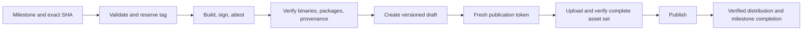

# Release identity, publication, and token lifetime

Incident record: [#3475](https://github.com/cloudposse/atmos/issues/3475).
Implementation: [#3474](https://github.com/cloudposse/atmos/pull/3474).
The [Release Orchestration PRD](../prd/release-orchestration.md) defines the complete
policy and rollout requirements. The implementation is on this branch; production
cutover and live signing/distribution validation are still pending.

## What failed

### v1.233.0: correct version, wrong source

The tag resolves to `12f83b5248253662d8af06030e3966034a7ef5d4`, but its Darwin
arm64 binary embeds `vcs.revision=b392e54f74a9c436d2c27fc8ba1b82605e95b58e`.
The binary precedes the credential-injection fix by three commits.

The [draft build](https://github.com/cloudposse/atmos/actions/runs/39352125013)
built and uploaded that earlier source. The draft still targeted moving `main`.
Publication created the tag at the newer commit without rebuilding its assets.
The [post-publication workflow](https://github.com/cloudposse/atmos/actions/runs/39357239296)
rebuilt the tagged source with `--skip=publish`, so stale executables remained
attached. A later workflow overwriting correct binaries is not needed to explain
this mismatch.

### v1.233.1: assets for a different version

A `minor` label caused the [draft build](https://github.com/cloudposse/atmos/actions/runs/39611235648)
to resolve `v1.234.0` and attach `atmos_1.234.0_*` assets. The intended patch was
`v1.233.1`. Erik changed the release identity in GitHub's UI and clicked Publish,
without realizing the attached assets still represented `1.234.0`. Editing the
metadata did not rebuild or invalidate them.

The [publication workflow](https://github.com/cloudposse/atmos/actions/runs/39672354878)
requested `atmos_1.233.1_linux_amd64` and received HTTP 404. The release was
subsequently deleted; its tag remains. The initial report mentioned `1.231.1`,
but the inspected run records identify this incident as `1.233.1`.

### Separate failed attempts: expired publication credentials

Two earlier attempts completed building and signing, then failed before uploading:

| Run | Intended version | App token created (UTC) | Publication failed (UTC) |
| --- | --- | --- | --- |
| [39528459177](https://github.com/cloudposse/atmos/actions/runs/39528459177/job/118988782348) | `v1.233.1` | Oct 21 01:40:38 | Oct 21 02:42:48 |
| [39543133137](https://github.com/cloudposse/atmos/actions/runs/39543133137/job/119035425224) | `v1.234.0` | Oct 21 04:19:06 | Oct 21 05:22:24 |

Both returned `401 Bad credentials` while GoReleaser listed existing releases.
[Installation tokens expire after one hour](https://docs.github.com/en/apps/creating-github-apps/authenticating-with-a-github-app/generating-an-installation-access-token-for-a-github-app).
The tokens were over 62 and 63 minutes old: the evidence supports expiration,
not insufficient repository permissions. Their downstream publication jobs were
skipped. These failures do not by themselves explain either artifact mismatch.
The logs show local tag creation, without proving those tags were pushed remotely.

## Replacement process



The supported stable entry point is:

```bash
atmos release list       # Inspect PRs in the next milestone
atmos release check
atmos release cut
```

`check` prints a short version/source/previous-release summary and a validation
result. Full PR descriptions stay in the internal JSON plan, which the native
confirmation flow captures without displaying it.

`cut` confirms the exact version through Atmos's native confirmation UI (default
No), dispatches the milestone, expected version and full SHA, and follows that
specific run. Actions independently authorizes the actor and repeats preflight.
`atmos release candidate` uses the same pipeline while allowing unfinished
milestone work; it leaves the milestone open. Nightly and feature workflows also
call `release-pipeline.yml`. They do not create release-preview issues.

All modes reserve real Git tags before building. For a next milestone of
`v1.234.0`, examples are:

| Mode | Tag | Source |
| --- | --- | --- |
| Stable | `v1.234.0` | Validated default-branch SHA |
| Candidate | `v1.234.0-rc.1` | Validated default-branch SHA; unfinished milestone work allowed |
| Nightly | `v1.234.0-nightly.123456` | Validated default-branch SHA |
| Feature | `v1.234.0-feature.42.123456` | PR #42's exact head SHA |

Candidates increment from `rc.1` independently for each version. Their annotated
tags bind the number to the workflow run and source SHA, so retries recover the
same tag; failed builds retain their reserved number. For nightly and feature
tags, `123456` represents the workflow run ID. Workflow dispatch or the nightly
schedule initiates tag creation; manually pushing a tag is not the entry point.
Retries retain the run's version and refuse a tag that points elsewhere.

The milestone defines the version; labels no longer select it. Every PR except
`no-release` needs a compatible label and the lowest open release milestone.
Patch changes may enter minor releases, but minor changes cannot enter patches.
If merged minor-release PRs already occur in the default branch's unreleased
history, creating an earlier patch milestone does not make it viable. The merge
status, Quality Gate and release preflight reject that history.
`atmos release list 1.233.2` shows all PRs assigned to that milestone in aligned
columns, with merge dots and textual states. It accepts an optional `v` prefix
and can inspect closed milestones without requiring release eligibility.
Milestone creation reports whether the version was created or already exists.

`atmos release milestones ensure` maintains three sequential minor milestones;
patch and major milestones are manual. Upcoming stable releases have one managed
preview issue per milestone, updated after merges, pinned while open and unpinned
on completion. Release notes use `.github/release-notes.yml` and Go rather than
Release Drafter.

The pipeline reserves the tag at the validated SHA before building. The build
uses that exact source and authoritative version, with trusted configuration
from the workflow revision. GoReleaser retains signing, packaging and caching,
but runs with `--skip=publish` and no release-publishing App token.

Verification checks all ten platform binaries, packaged executables, embedded
version/commit, clean build state, checksums, signatures and attestations. It
checks the actual source SHA separately from the trusted workflow revision.
Artifacts transfer between jobs by immutable Actions artifact ID. The publisher
checks local bytes, the complete uploaded asset set and GitHub SHA-256 digests,
then rechecks draft identity and the remote tag immediately before publication.
Mismatches and rejected requests before publication leave a draft.

`release-distribution.yml` consumes the verified immutable release; it does not
rebuild replacement release executables. Homebrew remains stable-only and builds
its own bottles from source. Existing branch maintenance and PR notifications
remain; `release-major-tag.yml` is the moving major-tag writer.

## Token lifetime and the 30-minute publication budget

`release-finalize` creates a fresh App token after artifact downloads and Go cache
setup, after the separate build and verification jobs have completed. The
publication job allows 30 minutes, below the token's one-hour lifetime. Preparation,
verification and milestone completion also obtain their own credentials; the
build does not pass a publication token between jobs.

Historical successful GoReleaser upload phases took **1m 6s** for
[46 assets on October 20](https://github.com/cloudposse/atmos/actions/runs/39352125013/job/118398746618)
and **1m 9s** for
[46 assets on October 21](https://github.com/cloudposse/atmos/actions/runs/39611235648/job/119260784682).
Their separate follow-up release jobs took 45–46 seconds. The new job also
includes artifact downloads, setup and live policy validation, and uploads
sequentially rather than GoReleaser's concurrent uploads. Thirty minutes has
headroom relative to those measurements, but the complete new job has not yet
been timed in production. Record warm/cold-cache and upload durations at cutover;
old upload timings do not prove the new job's worst-case duration.

A fresh token does not prevent revocation, permission changes or GitHub outages.
Authentication errors stop the operation; they never authorize skipping checks.

## Recovery

- If preparation or building fails, the tag may remain without a published
  release. An existing tag is reusable only at the exact validated SHA; never
  move it to make a retry succeed.
- For a failed upload, rerun **failed jobs** in the original workflow. Reuse the
  sealed artifacts, signatures and manifest byte-for-byte. Identical completed
  uploads are skipped; missing assets are uploaded. Conflicting, duplicate or
  unfinished assets block publication instead of being overwritten.
- Do not rerun the entire build merely to resume uploads: new signatures or
  manifests can differ from already attached bytes. Do not edit the release
  version or click Publish to recover a failed run.
- If the publication response is lost, inspect the existing release and run
  before retrying. GitHub may have accepted the request; a client error alone
  does not establish that publication did not occur.
- Milestone completion is a separate job so bookkeeping can be retried without
  rebuilding or republishing. An interrupted local wait does not redispatch.

## Validation and cutover

Regression tests reproduce both identity mismatches and inspect real stripped
ELF, Mach-O and PE binaries. They reject missing platforms, unsafe paths, altered
packages, bad signatures/provenance and conflicting tags or uploaded assets.
Lifecycle tests exercise stable, candidate, nightly and feature flows with real
GoReleaser executable fixtures against a stateful local GitHub mock. Retry tests
reuse the same draft and artifact bytes. Explicit `401` cases cover initial reads,
partial uploads, final tag verification and rejected publication requests, then
resume with restored credentials. A workflow contract test enforces fresh token
creation after setup and a publication timeout below one hour.
Milestone tests cover merged-history
viability, policy changes, status revocation and preview-issue idempotency.

These tests create no GitHub repositories or releases. The lifecycle fixture is
not a full Atmos build and does not obtain live signing credentials. Separate
cryptographic tests and workflow contract tests cover verification and wiring;
local mocks cannot prove live environment, OIDC, Homebrew or permission settings.
Coverage is reported through Codecov; the development target for this change was
90%+, not a new hardcoded Mage coverage threshold.

Before production use:

1. Land the workflows and stop old release writers. Keep
    `ATMOS_GUARDED_RELEASES_ENABLED` unset/false during cutover.
2. Validate release/feature App credentials and environment ref policies in a
    scoped non-publishing run. No deployment approval requirement is introduced.
3. Require **Release milestone** in the default branch ruleset; a displayed
    failing status alone does not prevent merging.
4. Enable repository release immutability, verify it, then set
    `ATMOS_GUARDED_RELEASES_ENABLED=true`.
5. Record live signing, publication timing, operator and downstream distribution
    evidence. The implementation branch does not itself change live settings.

Immutability protects published assets and tags; it does not validate them.
Users retaining direct release-publishing permissions can bypass the workflow,
and administrators can change protections. The final checks and GitHub's publish
request are not atomic. Restricting direct publication is a separate permissions
decision; do not describe the workflow guard as an unbypassable GitHub UI gate.
