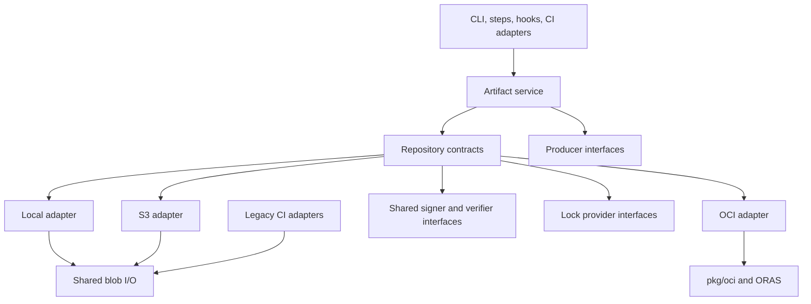

# Atmos Artifacts implementation contracts

**Status:** Proposed implementation specification, not an implemented API.
Read with the [implementation plan](./implementation.md) and [product requirements](../artifacts.md).
The names below are implementation defaults for V1. Change an externally visible contract only by
updating its specification, examples, schema, tests, and consuming adapters together.

## Package and dependency boundaries



The artifact service imports no CLI, runner, hook, plugin, or CI packages. Backends and producers
register through composition roots; plugin-specific policy stays above generic OCI transport.
`pkg/artifact/report` may depend on CI reporting; `pkg/artifact` itself must not. Share cached
discovery infrastructure below both plugin and artifact discovery, with separate schema adapters.

## Domain records and integrity

Use these types in `pkg/artifact`, with explicit JSON tags and versioned serialization:

| Type | Required data |
| --- | --- |
| `Ref` | Name and exactly one version or digest; repository alias is a separate request field |
| `Record` | Schema version 1, name, version, kind, created_at, metadata, sorted inventory, documents, content_digest, optional typed kind data |
| `Metadata` | Description, string labels, optional CI/source provenance; no required stack/component/SHA |
| `Entry` | Relative path, type (file/directory/symlink), size, ordinary mode bits, file digest or link target |
| `Document` | Role (readme/changelog), original source path, media type, size, digest |
| `Representation` | Packaging, payload/blob descriptors, backend locator, record digest, optional original OCI root descriptor |
| `PreparedArtifact` | Record, intent digest, staged blob readers, preparation timestamp, cleanup ownership |
| `OperationResult` | Operation ID, action, outcome, requested/resolved refs, aliases/locations, digest fields, size, duration, diagnostics |
| `Capabilities` | Read/write, enumeration, delete semantics, conditional update, packaging/modes, evidence formats, lock scopes |
| `SignatureSubject` | Subject kind, immutable digest, media type, size; portable Record or native OCI graph root |
| `SignatureEvidence` | Subject, format, evidence descriptor, storage locator; untrusted until verified |
| `VerificationResult` | Subject, policy fingerprint, verified signer claims, evidence digests, status and diagnostics |
| `PinnedReference` | Repository locator, resolved digest, record/content digests, evidence descriptors, optional selected platform |
| `LockRequest` / `LockHandle` | Resource scope, owner/operation ID, required guarantee, expiry where leased, ownership token, renew/release methods |

Keep record bytes independent of repository alias, credentials, resolved storage paths, upload
duration, and archive/OCI envelope digests. Those belong to Representation or OperationResult.
`Record` never includes its own hash. OCI config stores the same canonical Record bytes used by
local/S3 records; the manifest references the backend representation separately.

Canonical serialization uses a typed JSON schema, sorted inventory/document arrays and map keys,
UTF-8 strings, integer sizes/modes, UTC RFC3339 timestamps, no whitespace, and no trailing newline.
Freeze byte-level test vectors; do not rely on arbitrary `map[string]any` or float serialization.

- `content_digest`: SHA-256 of the canonical inventory and document descriptors, including paths,
  modes and link targets. Exclude storage locators and generated operation data.
- `intent_digest`: SHA-256 of name/version/kind, content_digest, effective user metadata and kind
  data. Exclude created_at and generated execution provenance; they cannot defeat retry/no-op.
- `record_digest`: SHA-256 of the full canonical Record bytes, including the original created_at.
- `representation_digest`: Checksum of an archive or other transferred payload representation.
- `resolved_digest`: OCI manifest/index digest for OCI references; record_digest for local/S3 refs.

A copy preserves Record bytes and content identity. Repacking may change representation_digest;
an OCI envelope newly assembled from another backend may have a different resolved_digest.
Existing OCI graphs preserve every original descriptor and blob digest instead.

Record and catalog JSON reads are bounded to 8 MiB, each document to 4 MiB, OCI manifest/index
reads to the existing bounded transport policy. Reject oversize metadata before publishing;
stream payloads to disk/network rather than loading them into memory. Use a default transfer and
discovery concurrency of four, injected through service options for tests; retain existing plugin limits.

## Service and repository APIs

Define separate request structs for Publish, Pull, Copy, Inspect, List, Search, Delete, and
ShowDocument. Each takes context first and returns typed results plus error. Do not use maps for
request fields or one method with backend-specific optional arguments.
Add Sign, Verify, and Pin requests; publication/copy/delete use the same Lock contract internally.

The service owns name/version selection, producer preparation, effective metadata, digest pinning,
conflict policy, retries, and result aggregation. Repositories own storage mechanics and capabilities.

Repository interfaces must provide:

- `Capabilities()` and `Resolve(ctx, Ref)` returning a pinned descriptor/record handle.
- `Inspect(ctx, pinned)` and `OpenDocument(ctx, pinned, role)` without payload download.
- `Read(ctx, pinned)` returning closeable verified content streams or an OCI graph source.
- `Publish(ctx, prepared, options)` with expected prior reference and force policy already checked.
- `List(ctx, query)` returning a page and cursor; pagination is consumed by the service.
- `Delete(ctx, pinned, options)` with expected current reference and explicit deletion scope.
- `Pin(ctx, Ref)` returning an immutable PinnedReference suitable for consumer lockfiles.
- `Sign(ctx, subject, signer, options)` returning stored SignatureEvidence descriptors.
- `Verify(ctx, subject, policy)` returning authenticated VerificationResult, never metadata claims.
- `Lock(ctx, LockRequest)` returning an ownership-checked LockHandle or unsupported-capability error.
- Optional `CopyFrom` for a compatible native transfer; absence uses the shared staging fallback.

Use OCI-standard descriptors at the OCI seam. Keep `remote.Repository`, go-containerregistry image
objects, AWS clients, and SDK errors out of the generic service API. Wrap errors in common sentinels
while retaining their causes for diagnostics. Generate mocks from these interfaces.

## Public command and step mapping

Signatures, verification, pinning, and coordination are repository contracts, not OCI-only service
branches. The following operations use them identically for every backend.

The following options supplement normal Atmos auth/profile/CI/output flags. A missing required
repository is an error; only collection list/search intentionally default to all configured repositories.

| Operation | CLI input | Artifact step fields |
| --- | --- | --- |
| Publish | `publish <source> --repository R --name N --version V --kind K` | `action: publish`, `source`, `repository`, `artifact_name`, `version`, `artifact_kind` |
| Publish controls | `--force`, `--dry-run`, `--labels`, `--readme`, `--changelog` | `force`, `dry_run`, `metadata.labels`, `readme`, `changelog` |
| Pull | `pull <ref> --repository R --output DIR [--force]` | `action: pull`, `ref`, `repository`, `destination`, `force` |
| Copy | `copy <ref> --from A --to B [--force]` | `action: copy`, `ref`, `from`, `to`, `force` |
| Inspect | `inspect <ref> --repository R` | `action: inspect`, `ref`, `repository` |
| Sign | `sign <digest-ref> --repository R` | `action: sign`, digest-only `ref`, `repository` |
| Verify | `verify <ref> --repository R` | `action: verify`, `ref`, `repository` |
| List | `list [name] [--repository R] [--labels L] [--refresh]` | `action: list`, optional `artifact_name`, `repository`, `labels`, `refresh` |
| Search | `search [text] [--repository R] [--labels L] [--refresh]` | `action: search`, `query`, `repository`, `labels`, `refresh` |
| Delete | `delete <ref> --repository R` | `action: delete`, `ref`, `repository` |
| Documents | `show readme|changelog <ref> --repository R` | `action: show`, `document`, `ref`, `repository` |

Publishing defaults to kind `files`; specialized convenience commands supply their kind. Name
precedence is explicit flag, producer metadata, source basename. Version precedence is explicit
flag then producer metadata; otherwise fail. No generated version, implicit latest, or package manifest
file is required for generic files. CLI publish labels use the existing exact key/value parser.

Explicit document paths resolve relative to the publish source directory or file's parent. Generic
source files can have any basename; name validation applies to artifact addressing, not payload names.
Validate portable relative name segments and OCI tag syntax for versions; reject backend-specific
invalid references before any writes rather than silently normalizing case or characters.

Step `name` remains the runner's name; `output` remains its display mode; `Artifacts` remains the
runner's expected-output declaration. Add only missing fields to WorkflowStep/Task and implement
the conversions explicitly. `source` must be a string for this step, despite other steps accepting maps.

Store the typed operation result under StepResult.Metadata[`artifact`]. Named Outputs are `ref`,
`location`, `resolved_digest`, `record_digest`, `content_digest`, `representation_digest`, `size`,
and `outcome`; optional values are omitted, never filled with misleading empty-success strings.
List/search use an `artifacts` results array. Unknown action/field combinations fail validation.
Structured CLI JSON/YAML uses the same named result fields; display format never changes semantics.

## Signatures, verification, and locks

Each repository implements Sign, Verify, Pin, and Lock, optionally by composing shared providers.
Capabilities describe supported evidence formats, immutable subjects, lock scope, and conditional
publication guarantees. An unavailable capability returns a typed error; it is never a successful
no-op. The orchestration layer asks for guarantees, not `if backend == OCI` behavior.

| Repository | Signature evidence | Pinning | Default write coordination |
| --- | --- | --- | --- |
| OCI registry | Subject-bound OCI referrers and supported fallback attachments | Original manifest/index digest, or portable Record digest bound through config | Host-local guard plus documented external serialization across hosts; configured lock repository for stronger scope |
| OCI layout | Referrer descriptors/blobs in layout plus subject index | Immutable layout descriptors | Filesystem guard for the layout/ref |
| S3 | Digest-keyed signature objects and subject records | Canonical Record digest, original OCI root when carrying a graph | Conditional owner claims and conditional reference updates |
| Local directory/archive | Detached signature files; portable evidence included when exporting archives | Canonical Record digest, original OCI root for graph payloads | Filesystem locks and atomic reference updates |

### Signature subjects and trust

For Atmos file packages, sign the canonical portable Record. It binds name/version, metadata,
inventory, content_digest, and document digests, so evidence survives representation changes.
For foreign OCI images and existing plugins, sign/verify the original manifest or index digest;
never substitute an archive checksum or rewrite an existing signature subject on copy.
An OCI attachment carrying a Record signature must bind that Record to the addressed manifest's
config descriptor. Verification distinguishes a signed Record from a signed native image envelope.

Store evidence by subject kind/digest and evidence digest. Local/S3 locations are beneath
`.atmos-artifacts/v1/signatures/<subject-kind>/<subject-digest>/<evidence-digest>.json`.
Signing adds evidence without changing the signed Record or native graph root. A local archive
signed after publication receives detached evidence; subsequent export/copy can embed that evidence
without changing the portable Record. Do not claim the original archive bytes were signed.

Extract reusable cryptography from `pkg/oci/signature` into `pkg/signature`, retaining compatibility
wrappers and existing plugin behavior. Repository adapters fetch/store evidence and invoke the
shared verifier; they may add native formats through registered providers with the same result contract.
Reuse the existing managed Cosign authoring path behind a generic Signer interface for V1 signing;
registry authentication remains separate from signing identity. Do not implement custom cryptography.

V1 supports Sigstore bundles with trusted certificate identities, and an explicitly configured
public-key bundle verification path. Keep that key verifier separate: a public-key-only signature
must never satisfy an OIDC issuer/identity requirement or weaken existing plugin SCT/log checks.
Legacy Cosign tag payloads and other formats require dedicated tested providers; do not claim support
merely because a signature-shaped object is present. Unsupported required evidence fails closed.
Follow [Sigstore verification](https://docs.sigstore.dev/cosign/verifying/verify/) and
[bundle semantics](https://docs.sigstore.dev/about/bundle/) through their supported Go libraries.

Proposed policy configuration:

```yaml
artifacts:
  verification:
    require_signature: true
    trusted_identities:
      - identity: https://github.com/acme/images/.github/workflows/release.yml@refs/heads/main
        issuer: https://token.actions.githubusercontent.com
    trusted_keys: []
  repositories:
    shared:
      kind: oci/registry
      options:
        registry: ghcr.io
        prefix: acme/images
      locking:
        required_scope: repository
        repository: coordination
    coordination:
      kind: aws/s3
      identity: lock-writer
      options:
        bucket: acme-artifact-coordination
```

`verification` is allowed globally and per repository. Unset require_signature defaults to false
for new general artifacts; existing plugin enforcement remains unchanged. Global requirements
cannot be weakened by repository overrides or CLI flags. Within one trust set, any configured signer
can satisfy it; if global and repository trust restrictions both exist, satisfy both sets rather
than unioning them into a weaker policy. Trusted keys are operator-managed public-key file paths.
Protected governing policies remain authoritative over ordinary imported configuration.
This enforcement covers artifact repository operations and their adapters; it does not imply
new admission controls on unrelated container-runtime pulls that bypass these operations.

`verify` always requires a trusted valid signature; `sign` accepts digest refs only and adds evidence.
Automatic consumption/copy verifies when policy requires it or supplies trust constraints. Without
trust configuration, report unchecked rather than verified. Required verification runs before
destination publication or local materialization; a normal checksum is not signature verification.
Copy evaluates both source and destination requirements and retains the evidence needed by each.
`--force` never bypasses verification. Catalog entries, labels, prior result files, and cached
"verified" booleans never establish trust.

At least one valid permitted signature must satisfy each required trust set. Invalid unrelated
attachments cannot override valid matching evidence, but malformed/unsupported evidence is bounded
and reported. If no permitted signature verifies, return a nonzero policy error before consumption.
Verify signature subject binding, cryptographic validity, signer/key trust, and applicable log,
certificate, and signing-time proofs. Preserve original index signatures when selecting platforms;
platform selection must not claim a newly generated index retains the original signature.

Offline verification uses preserved evidence and independently provisioned trust material. Reuse
unexpired TUF-authenticated roots or explicitly configured operator trust, never roots supplied by
the artifact itself. Missing/expired trust or missing required proofs fail without network access.
Expose verification subject, evidence digests, policy fingerprint, verified claims, and failure reason
in inspect/verify output and CI summaries. Explicit `verify` is the metadata/evidence-only check;
payload-consuming operations additionally verify every consumed content descriptor.

### Mutation locks versus dependency locks

`Pin` creates the immutable reference data that existing consumer lockfiles persist. It does not
acquire a write mutex, and a pinned reference is not a substitute for signature verification.
Keep existing plugin/toolchain lock schemas compatible; add adapters rather than a new mandatory
project-wide artifact lockfile. Reevaluate current trust policy when consuming a persisted pin.

`Lock` coordinates mutations. A LockHandle identifies owner, resource, guarantee/scope, and current
ownership token; release checks the token. Lock scopes are `host` and `repository`. Host scope is
the default for backward-compatible single-host use; cross-host publication still requires external
serialization unless repository scope is available/requested. Report the actual scope in results.
Acquire locks in canonical repository/resource order for multi-resource work to avoid deadlocks.

Local adapters use OS-backed file locks. S3 uses create-if-absent owner claims with conditional
release/update; V1 claims do not expire automatically, so a paused writer cannot become an unfenced
stale owner. A crash leaves an explicit recovery diagnostic; an operator may remove the owner claim
only after confirming that writer has stopped. Do not automatically steal another operation's lock.
Future expiring leases must add fencing before advertising equivalent guarantees.

An OCI adapter provides host locking but cannot implement distributed exclusion from mutable tags.
`locking.repository` delegates Lock to another configured repository that advertises repository
scope; its identity and storage root stay independent. Reject cycles and insufficient scope before
mutating. A catalog writer may use this coordinator or an externally serialized CI workflow.
No S3 Object Lock retention setting, OCI tag, or local-cache lock is advertised as a distributed lease.
External writers that ignore Atmos coordination remain outside these guarantees.

## Preparation and document conventions

Relative local repository roots use their declaring config directory. For remote imported config,
require a locally declared or absolute destination override rather than using ephemeral download paths.

Capture a single UTC preparation time and logical operation ID before the first attempt. Explicit
user metadata participates in intent identity; automatically attached run IDs/durations do not.
On a no-op return the existing Record unchanged and report the current execution separately.

Walk source paths using lstat. Preserve directories, file bytes, ordinary permissions and contained
relative symlinks; never follow a link outside the source. Reject absolute/escaping link targets,
devices, sockets, and unsupported entry types. Represent hard links as independent regular files.
Fail materialization when a target cannot implement a requested link instead of silently changing it.
Clear privileged mode bits; do not restore owner/group IDs or ACLs in V1.

Use epoch archive timestamps, deterministic gzip headers, stable ordering, and normalized owners
for newly assembled generic archives. Preserve executable bits. Keep verified upstream tool assets
as opaque files; any outer archive does not change the original package bytes or its checksum.

The source `.atmos/artifact/` directory is reserved for README/CHANGELOG distribution documents.
Reject conflicting unknown reserved files during preparation. Write generated `manifest.json`
there only inside the packaged representation; do not change the user's source tree. Its Record
excludes generated member entries to prevent self-reference. Root README remains normal payload.
Verify embedded document bytes against descriptors and expose documents separately for efficient reads.

For local archive permissions, retain whether the value was explicit. Parse quoted octal permission
bits, default to 0600, and fail explicitly when an explicit request cannot be enforced on the host.
Tests must distinguish archive-file mode from member mode and from filesystem ACL guarantees.

## Local/S3 record layout and publication lifecycle

Below the configured root reserve `.atmos-artifacts/v1/` for managed records. Reject payload names
and key patterns that enter this namespace. Use SHA-256 of canonical name/version for private
reference keys so names containing slashes cannot collide with control paths.

```text
<root>/.atmos-artifacts/v1/refs/<reference-key>.json
<root>/.atmos-artifacts/v1/records/<record-digest-hex>.json
<root>/.atmos-artifacts/v1/representations/<reference-key>.json
<root>/.atmos-artifacts/v1/operations/<operation-id>.json
<resolved-payload-path>
<resolved-payload-path>.metadata.json           # archive sidecar
<resolved-payload-path>.docs/README.md          # archive document sidecar
<resolved-payload-path>.docs/CHANGELOG.md
```

For directory/per-file payloads, metadata/documents live at `<payload>/.atmos/artifact/` instead
of suffix paths. Managed readers omit this distribution directory when materializing user content.
Reference records bind name/version to record digest and Representation; immutable records never
contain a mutable storage locator. Enumerate reference records, not arbitrary user files.
Search ignores staging/journal entries. Direct digest lookup checks the Record's embedded name.

The operation journal records captured time, intent, expected prior reference, resolved location,
and prepared representation checksums. It is an implementation recovery record, not a public catalog.
Use local reference/location locks or S3 conditional ownership records. Reserve a location before
overwriting it; another reference cannot claim it even when its key_pattern collides.

Publication sequence:

1. Validate capability, policy, paths, metadata sizes, and identity; prepare a stable source snapshot.
2. Read current reference under the writer guard; compare intent and apply conflict/immutability rules.
3. Record the pending operation before changing payload paths; pending references are unavailable
    to managed readers and absent from completed search results.
4. Upload/stage payloads and separate documents, verify their descriptors, and write immutable Record.
5. Write Representation/adjacent sidecars, then atomically publish the completed reference last.
6. Reconcile an ambiguous response by reading the completed reference and verifying expected digests;
    mark success only after reconciliation. Clean only temporary resources owned by this operation.

Use [S3 conditional writes](https://docs.aws.amazon.com/AmazonS3/latest/userguide/conditional-writes.html)
for reference ownership and publication, treating precondition failures as conflicts. ETags are
concurrency tokens, not payload SHA-256 checksums. External serialization is still required for
writers to a mutable OCI reference and for catalog updates; no universal distributed lock is promised.

Readers check pending/completed state before accessing content, verify every consumed descriptor,
and recheck the generation after reads from mutable payload locations. A failed/interrupted force
replacement may leave the reference unavailable until its same-intent retry repairs it. Do not
claim rollback or serve changed bytes under an old digest. Do not automatically steal a pending
operation owned by another active writer; surface its operation ID for recovery diagnostics.

A retry in the same invocation reuses operation ID and preparation. A subsequent invocation may
resume a matching pending intent only under exclusive writer ownership and after checking staged
checksums; a different intent fails with a recovery diagnostic. Keep this conservative behavior in V1.
Old digest reads succeed only while their payload representation remains available and verifies;
otherwise return unavailable/not-found, never the current version's bytes.

## OCI-specific behavior

New Atmos packages use the PRD artifact/config/layer media types. Record bytes are the config blob;
README/CHANGELOG are separate Markdown blobs with explicit roles/titles. Transferred foreign OCI
graphs bypass new-package assembly. Copy required referrers through the existing policy-aware
transport; do not silently omit signature material on an unsupported registry.

Use [ORAS graph APIs](https://pkg.go.dev/oras.land/oras-go/v2@v2.6.2) through `pkg/oci` adapters.
Preserve original raw manifest/index bytes on graph transfer. Do not use the simple file store's
automatic filename-based extraction for arbitrary untrusted graphs.

Resolve names before reading. Name-scoped list can enumerate OCI tags without a catalog;
collection list/search uses supported registry repository enumeration or the optional catalog.
No public fallback repository list is added. A provider without enumeration/catalog returns a
capability error explaining that direct named operations still work.

For tag deletion, inspect other tags referencing the same digest and require a tag-safe operation;
if only manifest deletion is available and it would remove sibling references, reject. Digest
deletion is explicitly manifest-scoped and reports affected references. Never delete shared blobs
directly. Protect plugin immutability on both destination format and incoming format.

## Catalog commands and cache

Use a separate versioned `AtmosArtifactCatalog` manifest, not the plugin catalog schema. Each entry
contains logical name, kind, source, description, and versions with resolved/record/content digests,
labels, and document descriptors. Version labels are opaque; do not reuse plugin SemVer sorting.
Sort names/versions lexically and bind a catalog entry to its actual repository path, not credentials.
Publish catalogs as generic Records of kind `catalog`, with artifact type
`application/vnd.atmos.artifact.catalog.v1` and a direct JSON payload layer of type
`application/vnd.atmos.artifact.catalog.v1+json`; retain the shared Record config media type.

```shell
atmos artifacts catalog build --repository shared --input inventory.yaml --output catalog.json
atmos artifacts catalog publish catalog.json --repository shared
atmos artifacts catalog add components/terraform/vpc:1.2.0 --repository shared
atmos artifacts catalog remove components/terraform/vpc:1.2.0 --repository shared
atmos artifacts catalog sync --repository shared --input inventory.yaml
```

`inventory.yaml` is an `AtmosArtifactInventory` manifest whose spec contains `refs`, a list of
explicit names/versions or digests relative to the selected configured repository. Build resolves
and verifies metadata only and writes a snapshot; it never publishes. Publish writes to the
repository's configured catalog URI. Add/remove read and republish the latest catalog; sync merges
verified inventory releases while retaining entries absent from the inventory. Remove only unlists.
Missing catalog configuration fails these mutating catalog commands before writes. Catalog writes
require externally serialized read/build/write, and digest/revision rechecks reject already-stale input.

Initially support OCI catalog URIs as in the PRD and plugins; local/S3/layout discovery works
directly without a catalog. Store artifact caches under XDG `atmos/artifacts/discovery`, keeping
plugin cache paths and serialization unchanged. Cache scopes include effective config/auth realm
and host bindings without credential values; refreshed snapshots replace old snapshots atomically.

## Producer selection and CI compatibility

Toolchain convenience interface (new, explicit; no automatic repository fallback):

```shell
atmos toolchain publish hashicorp/terraform@1.13.4 --repository shared --platform linux/amd64
atmos toolchain install hashicorp/terraform@1.13.4 --artifact-repository shared
```

Publish accepts repeated platform selectors, defaulting to the host, and requires an explicit
version plus pinned checksum data in the configured lockfile. Name packages as
`toolchain/<owner>/<repo>/<os>/<arch>:<version>`. Bundle the selected lock entry, resolved install
definition, original asset, and verification evidence. Resolve aliases using existing config.
Artifact-selected installation is authoritative: fetch definition and package from that source,
reapply verification, then use the existing installer. Missing metadata, platform, or evidence fails
without contacting upstream. Default installations retain their current behavior.

Native CI reuses existing store selection through a new explicit adapter type:

```yaml
planfiles:
  default: shared
  stores:
    shared:
      type: artifact/repository
      options:
        repository: shared
```

Keep the existing `--store`, default, priority, and environment detection behavior. The adapter
references `artifacts.repositories.shared`; it does not duplicate its backend options. Map legacy
keys to `ci/planfiles/<sha256-of-key>:<commit-sha>` and retain the original key plus full CI metadata
in typed kind data. Implement existing query predicates from that data, not approximate label matches.
Preserve the existing planfile overwrite contract only inside this explicit adapter; it cannot
override plugin releases. Old store configurations and serialized archives are unchanged.

Do not weaken `pkg/ci/artifact.Metadata.Validate`. The generic Record is a new type; convert at
the boundary. Add optional modes to CI FileEntry/FileResult with legacy 0644 encoding when unset.
Keep backend constructors/adapters compatible with existing tests and public package callers.
