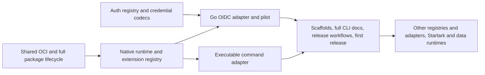

# Plugin platform delivery plan

**Status:** Proposed; part of the [plugin platform](../overview.md). The first implementation is validated together and reviewed in a five-PR stack; remaining registry work precedes its adapter. [Platform workstream](README.md).

This plan turns the [gap analysis](gap-analysis.md) into phased work packages (WPs) with dependencies and testable done-criteria. It is a PRD-level plan, not a task list: each WP is one reviewable deliverable that may span several stacked PRs. Phase 0 items (`P0.1`–`P0.12`) are named in the gap analysis; later phases use `WP1.x`–`WP4.x`. Done-criteria cite the [full-platform acceptance criteria](../overview.md#acceptance-criteria) as `A1`–`A21`; the [traceability table](#traceability) lists them. Decisions are referenced as D-numbers in [decisions](decisions.md). The [first-release checkpoint](../first-release.md#native-pilot-checkpoint) records what is implemented; work packages retain the full target and do not imply every interface or follow-on adapter exists.

## First-release delivery sequence

The [first-release scope](../first-release.md) is authoritative. All CLI commands, Go OIDC, their documentation, and extension mechanisms must ship together; the work packages below also retain the broader follow-on designs.

| Milestone | Required work | Exit criterion |
|---|---|---|
| Foundations | P0.1, P0.2, P0.3 manifest/command subset, P0.12 | Built-in auth uses the provider/identity registries; credential codecs and collisions are tested; API contracts have their intended home. |
| Reusable distribution | WP1.1–WP1.9 | Shared OCI extraction and existing-consumer regression tests pass; package/catalog/lock/install commands work with private auth, offline layouts, and no publisher execution at install. |
| Native platform | WP2.1, WP2.2, auth/command API services from WP2.3, WP2.6, Go execution from WP2.7 | Native plugin, SDK, HTTP client adapter, browser callbacks, session storage, negotiation, and descriptor registration pass contracts. |
| Auth and command adapters | WP3.1, executable portion of WP3.2 | Full Go OIDC flow and executable `plugin run`; test-only third descriptor proves extension mechanics. |
| Usable first release | Auth/command portions of WP4.1–WP4.4, WP4.5, WP4.6 | Every plugin command is tested and documented; existing scaffolding produces working examples; private publication, consumer restore/login, update/rollback, and live pilot sign-off pass. |

Remaining P0.3 registry changes and P0.4–P0.11 precede their follow-on adapters. WP2.4/2.5, the remaining API services in WP2.3, Starlark runner support/parity, WP3.3–WP3.9, and their authoring/docs work are follow-ons. Generic shared API services needed by executable commands still ship. No broad Phase 0, runtime-parity, or Phase 3 completion barrier can block the native auth release.

## Current validation and review sequence

The native Go OIDC example, plugin CLI, auth/API refactors, shared OCI, signature support, general policy admission, UI, and documentation were validated together, then split into a stacked series of five reviewable PRs.

Additional first-release exit criteria from implementation review:

- [Plugin policy](../policy.md) uses CEL/Starlark and protected governing definitions; explicit, automatic, cached, development, layout, conformance, and remote lifecycle paths cannot bypass it.
- Signature/trusted publisher enforcement, `plugin sign`, and `publish --sign` work independently of general admission and cannot be weakened by it.
- `pkg/list` formats and installed status dots are consistent with existing auth/toolchain views; bounded downloads use shared batch UI.
- The emulator lifecycle cast is generated and validated through Atmos custom commands, embedded in the changelog, and includes discovery/listing as well as create/build/publish and downloaded OIDC conformance.
- Relevant schemas, documentation build, and scoped behavioral tests pass, targeting at least 90% aggregate coverage of authored changes as defined in [testing](../testing.md#policy-ui-schema-and-coverage-acceptance).
- Lifecycle work stays in purpose-built packages; add no new business logic to `internal/exec`. Protocol generation is `atmos dev generate proto` with pinned tools and dual-output parity checks.

## Phase 0: Registry foundations

Phase 0 contains behavior-preserving refactors implemented before each dependent adapter, with the explicit P0.8 CUE exception below. For the initial OIDC pilot these changes remain in the same PR as the plugin implementation; the validated result can then be split for review ([D13](decisions.md)). The first-release subset is mandatory; the remaining items are scheduled with their follow-on surfaces. Rules that apply to every item:

- No plugin code or new dependency. No new user-visible feature except P0.8, which makes the existing CUE validator reachable through `schema_type: cue` without changing defaults.
- Built-in registration order and `init()` call sites keep working. Where a `Register` signature has no error return, built-ins keep it and a unit test asserts built-in uniqueness; error-returning forms are added for adapters.
- Golden snapshots under `tests/` do not change. If one must, the PR explains the cause and regenerates with `-regenerate-snapshots`.
- New sentinel errors go in [`errors/errors.go`](../../../../errors/errors.go) with names from [errors](errors.md).
- Each PR runs the `editions` skill and records the result in its description. Items where a default or stored-value meaning could change are named inline (P0.2, P0.7, P0.10); every other item changes no default.
- Mocks are generated with `mockgen` where an interface changes.

### P0.1 Auth registry

**Scope.** Finish registry adoption in [`registry.go`](../../../../pkg/auth/registry/registry.go): register every built-in kind with the `Registry`, export package-level `RegisterProvider`/`RegisterIdentity` for non-built-in callers, return an error on duplicate registration, and delete both `switch config.Kind` blocks and the `defaultRegistry != nil` guards. Built-in constructors take the full `*schema.Provider`/`*schema.Identity`, while legacy constructors take only `spec`/`principal`, so the PR adds a config-receiving registration form for built-ins and keeps the map form for GCP and plugin kinds (final shape in [interfaces](interfaces.md)).

Kinds to migrate out of the switch:

| Switch | Kinds |
|---|---|
| `NewProvider` (10) | `aws/iam-identity-center`, `aws/saml`, `azure/cli`, `azure/device-code`, `azure/interactive`, `azure/oidc`, `github/oidc`, `atmos/pro`, `mock`, `mock/aws` |
| `NewIdentity` (12) | `aws/permission-set`, `aws/assume-role`, `aws/assume-root`, `ambient`, `aws/ambient`, `aws/user`, `aws/credential-process`, `atmos/pro`, `azure/subscription`, `azure/pim-role`, `mock`, `mock/aws` |

Already registered and untouched: providers `gcp/adc`, `gcp/workload-identity-federation`; identities `gcp/service-account`, `gcp/project`, and the four emulator kinds (`aws/emulator`, `gcp/emulator`, `azure/emulator`, `kubernetes/emulator`). Constants in [`constants.go`](../../../../pkg/auth/types/constants.go) with no constructor today (for example `ProviderKindGCPOIDC`, `ProviderKindAWSUser`) are reported by the inventory test, not silently wired.

**Files touched.** [`pkg/auth/registry/registry.go`](../../../../pkg/auth/registry/registry.go); new per-cloud registration files beside [`gcp_providers.go`](../../../../pkg/auth/registry/gcp_providers.go) and [`emulator_identities.go`](../../../../pkg/auth/registry/emulator_identities.go) (`aws_*.go`, `azure_*.go`, `github_providers.go`, `atmospro.go`, `mock.go`); [`constructors_test.go`](../../../../pkg/auth/registry/constructors_test.go); the constructors' packages under `pkg/auth/providers/` and `pkg/auth/identities/` only if a constructor signature must change.

**Behavior preserved.** Every existing kind resolves to the same constructor with the same config. Unknown kinds still return `ErrInvalidProviderKind`/`ErrInvalidIdentityKind` with the same message. `ConfigSetter` still runs after construction. Registration order is irrelevant to resolution.

**Done when.**
- No `switch config.Kind` remains in `registry.go`.
- A kind-inventory test enumerates both tables above plus the already-registered kinds and asserts each resolves; adding a kind constant without a registration fails the test.
- Registering an existing kind returns the duplicate sentinel and leaves the first constructor in place.
- `atmos auth list` and `atmos auth whoami` snapshots are unchanged.

**Tests.** Table-driven over the 22 migrated kinds plus unknown/empty kind; duplicate-registration negative path; nil config; an isolated `NewRegistry()` per test so global state is never mutated.

**Risk.** M. Constructor signature mismatch touches many packages, but each registration is a thin closure.

**PR shape.** Standalone PR, `no-release`. May split by cloud if it exceeds 150 files.

### P0.2 Credential-type registry

**Scope.** Replace the two closed switches in [`keyring_store.go`](../../../../pkg/auth/credentials/keyring_store.go) (`marshalCredential`, `unmarshalCredential`) with a registry of versioned credential types: envelope `{type, expires_at, data, sensitive_keys}`, built-ins `aws/v1`, `gcp/v1`, `oidc/v1`, `atmos-pro/v1`, `mock`, and `azure/v1` registered for decode only if an Azure credential reaches the keyring today. Adapters wrap the existing `types.AWSCredentials`, `GCPCredentials`, `OIDCCredentials`, `ProCredentials`, and mock credentials. Plugin-namespaced types are opaque to Atmos ([D10](decisions.md)).

**Files touched.** [`keyring_store.go`](../../../../pkg/auth/credentials/keyring_store.go), [`keyring_backends.go`](../../../../pkg/auth/credentials/keyring_backends.go) (sentinels), [`store.go`](../../../../pkg/auth/credentials/store.go), new `pkg/auth/credentials/registry.go`; credential types under [`pkg/auth/types`](../../../../pkg/auth/types).

**Behavior preserved.** Existing keyring entries tagged `aws`, `gcp`, `oidc`, `atmos-pro`, `mock` decode unchanged; legacy tags are registered as aliases of the `/v1` types. The tag written stays the legacy tag until a downgrade-safe rollout is decided, because an older Atmos cannot read `aws/v1`. Flipping the written tag changes the meaning of stored values, so that step must run the `editions` skill and is out of scope here.

**Done when.**
- Both switches are gone; encode and decode resolve through the registry.
- A fixture keyring written by the pre-change code (all five legacy tags) decodes byte-identically.
- An unknown type returns the existing `ErrUnknownCredentialType`; an unregistered Go type returns `ErrUnsupportedCredentialType`.
- `sensitive_keys` is carried through round trip and consumed by the masking path.

**Tests.** Table-driven round trips per type; legacy-tag fixtures; unknown-type and corrupt-JSON negatives; duplicate type registration error.

**Risk.** M. Keyring format is a stored interface; compatibility fixtures guard it.

**PR shape.** Standalone PR, `no-release`.

### P0.3 Duplicate policy

**Scope.** Make duplicate registration an error for externally supplied registrants in the registries that silently replace today: component, command, step (including aliases), CI provider, backend operations, manifest kinds, auth integrations, artifact-delivery targets, and `provisioner.RegisterProvisioner` (dedupe by type and event). Stores, secrets, hooks, and component CI plugins already panic or error. Add an explicit replace form only where a caller needs it ([`custom.EnsureRegistered`](../../../../pkg/component/custom/provider.go) re-registers custom component types at runtime).

**Files touched.** [`pkg/component/registry.go`](../../../../pkg/component/registry.go), [`cmd/internal/registry.go`](../../../../cmd/internal/registry.go), [`pkg/runner/step/registry.go`](../../../../pkg/runner/step/registry.go), [`pkg/ci/registry_provider.go`](../../../../pkg/ci/registry_provider.go), [`pkg/provisioner/backend/backend.go`](../../../../pkg/provisioner/backend/backend.go), [`pkg/provisioner/registry.go`](../../../../pkg/provisioner/registry.go), [`pkg/manifest/registry.go`](../../../../pkg/manifest/registry.go), [`pkg/auth/integrations/registry.go`](../../../../pkg/auth/integrations/registry.go), [`pkg/provisioner/target/target.go`](../../../../pkg/provisioner/target/target.go), [`pkg/component/custom/provider.go`](../../../../pkg/component/custom/provider.go).

**Behavior preserved.** Built-in `init()` registrations compile and behave unchanged. YAML custom commands still extend or override built-ins through `processCustomCommands` in [`cmd_utils.go`](../../../../cmd/cmd_utils.go); only the future plugin adapter gets no-replace semantics ([D7](decisions.md), [D8](decisions.md)). `custom.EnsureRegistered` keeps idempotent re-registration.

**Done when.**
- Each listed registry has an error-returning registration form (or an error return on `Register`) that rejects a second registrant and leaves the first intact.
- A uniqueness test per registry asserts all built-in registrations are distinct, so any latent built-in duplicate surfaces in this PR.
- Step aliases collide with handler names and other aliases as errors for the error-returning form.
- No test or production caller depends on replace-on-duplicate except through the named explicit form.

**Tests.** Table-driven duplicate cases per registry (same name, alias vs name, case differences); explicit-replace positive path; built-in uniqueness sweep; concurrent registration with `-race`.

**Risk.** M. Silent replacement may currently mask a duplicate in tests or built-ins; the uniqueness sweep finds it.

**PR shape.** One PR per two or three registries, `no-release`. Lands first; P0.6, P0.7, P0.10, and P0.11 build on it.

### P0.4 Context plumbing

**Scope.** Add `context.Context` as the first parameter of `store.Store` methods ([`store.go`](../../../../pkg/store/store.go)) and secrets `Provider` methods ([`provider.go`](../../../../pkg/secrets/providers/provider.go)), and a `Context` field on `hooks.ExecContext` ([`kind.go`](../../../../pkg/hooks/kind.go)). Optional interfaces (`RawStore`, `DeletableStore`, `RawGetter`) follow. `ExecContext.Cmd` stays on Atmos side.

**Files touched.** `pkg/store/store.go`, `pkg/store/identity.go`, `pkg/store/mock_store.go` (regenerate), `pkg/store/deferred/`, every implementation under `pkg/store/providers/` (AWS SSM and Secrets Manager, Azure Key Vault, Google Secret Manager, HashiCorp Vault, Artifactory, GitHub Actions, Redis, 1Password, keychain); `pkg/secrets/providers/provider.go`, `pkg/secrets/providers/store.go`, `pkg/secrets/providers/sops/`; callers such as [`pkg/function/store.go`](../../../../pkg/function/store.go); `pkg/hooks/kind.go` and engine constructors in `pkg/hooks/`.

**Behavior preserved.** Callers pass the command context or `context.Background()` where none exists. No new timeouts or retries. A nil `ExecContext.Context` on directly constructed contexts resolves to `Background`.

**Done when.**
- All three interfaces take or carry a context; `mockgen` mocks are regenerated.
- Each provider forwards the context to its SDK call where the SDK accepts one; any that cannot are listed in the PR with the reason.
- A cancellation test on one store and one secrets provider proves the context reaches the client.
- Existing store, secret, and hook snapshots are unchanged.

**Tests.** Table-driven cancel/deadline-exceeded per interface using mocks; nil-context hook fallback; negative path that an uncancelled context changes nothing.

**Risk.** L by file count (mechanical, wide). Split by subsystem.

**PR shape.** Three PRs (stores, secrets, hooks), `no-release`. Stores and secrets may stack; hooks is independent.

### P0.5 Public aliases for CI component types

**Scope.** Export aliases for `Plugin`, `HookBinding`, `HookContext`, and `HookHandler` from `pkg/ci`, mirroring how [`ci.Provider`](../../../../pkg/ci/provider.go) re-exports the internal provider type, so code outside `pkg/ci/...` can name them.

**Files touched.** [`pkg/ci/plugin_registry.go`](../../../../pkg/ci/plugin_registry.go), [`pkg/ci/provider.go`](../../../../pkg/ci/provider.go) (pattern), [`pkg/ci/internal/plugin/types.go`](../../../../pkg/ci/internal/plugin/types.go) (unchanged shape).

**Behavior preserved.** Types are aliases, not copies; built-in terraform, helmfile, helm, kubernetes, and cloudformation plugins compile unchanged. `ci.RegisterPlugin` still errors on duplicates.

**Done when.**
- A test package outside `pkg/ci` implements and registers a `Plugin` using only public names.
- `go vet` shows no second distinct type for any aliased name.

**Tests.** Compile-time assertions (`var _ ci.Plugin = ...`), duplicate-registration negative path.

**Risk.** S.

**PR shape.** Standalone PR, `no-release`.

### P0.6 Component registry completeness

**Scope.** Register terraform, helmfile, and packer with the component registry and drive every closed list from it. Each provider implements `GetType`, `GetGroup`, `GetBasePath`, `ListComponents`, and `ValidateComponent` for real, and `Execute`/`GenerateArtifacts` delegate to the existing `internal/exec` entry points (no stubs). Routing `atmos terraform` through the registry is not part of this item.

Closed lists to open:

| Closed list | Location | Change |
|---|---|---|
| `GetComponentConfig` switch | [`schema.go`](../../../../pkg/schema/schema.go) | Typed built-in cases stay; any other registered type resolves through `Components.Plugins` and the registry's `GetBasePath`. |
| `autoDetectComponentTypes` | [`describe_component.go`](../../../../internal/exec/describe_component.go) | Built from `component.ListTypes()`; legacy trio first to keep detection order. |
| `typeEntries`, `componentsSectionHasComponents` | [`describe_stacks_component_processor.go`](../../../../internal/exec/describe_stacks_component_processor.go) | Registry-driven entries. |
| `getComponentBasePath` | [`describe_stacks.go`](../../../../internal/exec/describe_stacks.go) | Registry lookup with the existing fallback. |
| Three type lists | [`extract/components.go`](../../../../pkg/list/extract/components.go) | Iterate registered types. |
| Hardcoded `terraform, helmfile, packer` | [`component_reverse_path_utils.go`](../../../../pkg/utils/component_reverse_path_utils.go), [`cmd/list/sources.go`](../../../../cmd/list/sources.go) | Iterate registered types. |
| Component-section whitelist | [`pkg/config/const.go`](../../../../pkg/config/const.go), [`stack_processor_process_stacks_helpers_extraction.go`](../../../../internal/exec/stack_processor_process_stacks_helpers_extraction.go), [`stack_processor_merge.go`](../../../../internal/exec/stack_processor_merge.go), [`stack_processor_process_stacks.go`](../../../../internal/exec/stack_processor_process_stacks.go) | A registered external type takes the custom-type path, including `metadata.inherits`. |

**Files touched.** The files above; new provider packages `pkg/component/terraform`, `pkg/component/helmfile`, `pkg/component/packer`; blank imports in [`cmd/root.go`](../../../../cmd/root.go); [`pkg/component/registry.go`](../../../../pkg/component/registry.go).

**Behavior preserved.** `describe`, `list`, and `describe affected` output for existing projects is identical, including type ordering. Unknown types behave as today. Legacy execution paths are untouched.

**Done when.**
- `component.ListTypes()` includes terraform, helmfile, and packer.
- A registered test type (via `mock`-style provider) appears in describe, list, sources, affected, reverse-path lookup, and section handling without any edit to those files.
- No literal `"terraform", "helmfile", "packer"` type list remains outside the three provider packages and defaults.
- Describe/list/affected snapshots are unchanged.

**Tests.** Table-driven over each list with legacy-only, mixed, and external-only type sets; ordering assertions; negative path that an unregistered type is rejected as today.

**Risk.** L. Widest read surface; many lists. Land one list per commit and verify snapshots at each step.

**PR shape.** Stack of 3 to 4 PRs (providers, describe, list/utils, stack processor), `no-release` unless a snapshot changes (then `patch`). Depends on P0.3.

### P0.7 CI detection deterministic with selector

**Scope.** Replace map-iteration `Detect()` in [`registry_provider.go`](../../../../pkg/ci/registry_provider.go) with an ordered candidate list (specific providers before `generic`, ties ordered by name), and add an explicit `ci.provider` selector consulted first by `ResolveProvider`. Ambiguous automatic detection (two non-generic matches) is reported rather than chosen at random.

**Files touched.** `pkg/ci/registry_provider.go`, [`pkg/schema/schema.go`](../../../../pkg/schema/schema.go) (`CIConfig.Provider`), the `ci` schema in [`pkg/datafetcher/schema`](../../../../pkg/datafetcher/schema) and the generated atmos.yaml schema, [`provider.go`](../../../../pkg/ci/provider.go).

**Behavior preserved.** With a single matching provider (every real environment today) resolution is unchanged; `generic` remains the fallback and `GenericProviderName` stays. The new `ci.provider` key is new, so it is not journal-gated. Editions note: today's multi-match result is undefined, so no previously shipped default changes; the PR records that finding.

**Done when.**
- `Detect()` returns the same provider across 1,000 runs with two matching fakes.
- `ci.provider: <name>` wins over detection; an unknown name fails with `ErrCIProviderNotFound` plus a hint listing registered names.
- Ambiguity produces a distinct error naming the candidates.
- Schemas validate `ci.provider`.

**Tests.** Table-driven detection matrices with fakes (none, one, two, generic plus specific); selector precedence; repeated-run determinism; unknown-selector negative path.

**Risk.** S.

**PR shape.** Standalone PR, `patch` (fixes nondeterminism). Depends on P0.3.

### P0.8 Validation engine and check registry

**Scope.** Extract the `jsonschema`/`opa` dispatch in [`validate_component.go`](../../../../internal/exec/validate_component.go) and [`validate_utils.go`](../../../../internal/exec/validate_utils.go) into an engine registry (`pkg/validation/engine`) with `jsonschema`, `opa`, and `cue` registered, plus a check registry (`pkg/validation/check`) whose descriptors carry id, category, input type, and options schema. **Cue becomes reachable**: `ValidateWithCue` exists but no `schema_type` path invokes it today. The CI-only [`validate.Register`](../../../../pkg/ci/validate/validate.go) (actionlint) re-registers as a check so both paths share one registry.

**Files touched.** `internal/exec/validate_component.go`, `internal/exec/validate_utils.go`, [`pkg/ci/validate/validate.go`](../../../../pkg/ci/validate/validate.go), [`pkg/validation/diagnostic.go`](../../../../pkg/validation/diagnostic.go) and [`sarif.go`](../../../../pkg/validation/sarif.go) (reused), [`pkg/validator/schema_validator.go`](../../../../pkg/validator/schema_validator.go), new `pkg/validation/engine` and `pkg/validation/check`, validation schema in [`pkg/datafetcher/schema`](../../../../pkg/datafetcher/schema).

**Behavior preserved.** `jsonschema` and `opa` validation results, error text, and timeout behavior are unchanged. Built-in schema and structural validation cannot be replaced by an external check ([validation PRD](../extensions/validation.md#acceptance-criteria)). actionlint output is unchanged. Editions note: making Cue reachable turns a previously unsupported `schema_type` into a working one; no default changes.

**Done when.**
- The `switch schemaType` is gone; dispatch goes through the engine registry.
- `schema_type: cue` validates a component against a CUE document in a fixture and fails with a Cue diagnostic on violation.
- An unknown engine returns the existing unsupported-type error.
- actionlint runs through the check registry with identical diagnostics.

**Tests.** Table-driven per engine (pass, fail, malformed schema, timeout); Cue positive and negative fixtures; registry duplicate negative path; actionlint golden diagnostics.

**Risk.** M. Dispatch is in a long file; keep functions under the `funlen`/`cyclop` limits when extracting.

**PR shape.** Two PRs (engines, then checks and CI re-registration), `patch` for the Cue fix, `no-release` for the checks PR.

### P0.9 Secret-provider kind registry

**Scope.** Add a generic external track to [`providers/registry.go`](../../../../pkg/secrets/providers/registry.go) that resolves by provider **kind**, leaving the `store` and `sops` tracks unchanged. The `provider:` selector in secret declarations is a Phase 3 schema change; this item only provides the kind-keyed registry ([N6](gap-analysis.md#registries-to-create)).

**Files touched.** `pkg/secrets/providers/registry.go`, `provider.go`, [`pkg/secrets/registry.go`](../../../../pkg/secrets/registry.go), [`pkg/secrets/factory.go`](../../../../pkg/secrets/factory.go).

**Behavior preserved.** Declarations that choose `store` or `sops` resolve identically; `atmos secret` commands and `!secret` resolution are unchanged. Duplicate kind returns an error (not a panic) on the new track.

**Done when.**
- A fake provider registered under the generic track resolves by kind through `providers.New`.
- Existing `store` and `sops` registration still panics or errors exactly as before on duplicate track.
- Unknown kind produces the existing not-found error with registered kinds listed.

**Tests.** Table-driven registration and lookup; duplicate kind; track isolation (a kind name equal to a track name does not collide).

**Risk.** S. Depends on P0.4.

**PR shape.** Standalone PR, `no-release`.

### P0.10 Backend provisioner interface

**Scope.** Replace the four parallel maps (`RegisterBackendCreate`, `Delete`, `Exists`, `Name`) with one provisioner interface ([N7](gap-analysis.md#registries-to-create)) registered by backend type: `Ensure`, `Exists` returning absent / present-compatible / present-incompatible / denied / unknown, `Delete`, `Name`, `Describe`. Add `provision.backend.kind` resolution that falls back to `backend_type`. Wrap the existing `s3` and `azurerm` implementations; no `gcs` provisioner is added.

**Files touched.** [`pkg/provisioner/backend/backend.go`](../../../../pkg/provisioner/backend/backend.go), `s3.go`, `s3_delete.go`, `azurerm.go`, `azurerm_delete.go`, [`pkg/provisioner/backend_hook.go`](../../../../pkg/provisioner/backend_hook.go), [`pkg/component/aws/cloudformation/backend.go`](../../../../pkg/component/aws/cloudformation/backend.go), stack schema for `provision.backend.kind`.

**Behavior preserved.** `atmos terraform backend create|delete` and pre-init provisioning behave as today for `s3` and `azurerm`. Editions note: a missing exists-checker currently falls back instead of reporting unknown; built-ins keep the fallback, and any change to the fallback for built-ins is a behavior change that must run the `editions` skill. External registrants report `unknown` explicitly.

**Done when.**
- The four maps and their `Register*`/`Get*` pairs are removed or reduced to thin wrappers over the interface.
- `Exists` returns all five states in tests; existing callers map absent and present-compatible to today's branches.
- `provision.backend.kind` resolves, falling back to `backend_type`.
- Existing provisioner tests pass unchanged.

**Tests.** Table-driven state matrix with mocked cloud clients; kind-vs-backend_type precedence; duplicate negative path; unknown-state handling.

**Risk.** M. Existence semantics touch destructive flows (delete).

**PR shape.** Standalone PR, `no-release` (`patch` if the existence-state mapping changes a user-visible message). Depends on P0.3.

### P0.11 Step collision policy and namespaced validation

**Scope.** Build on P0.3 for steps: the error-returning registration rejects names and aliases that collide with built-ins. Give namespaced external types (`acme/change-request`) a static-validation path equivalent to `KnownFields()` without a handler: a descriptor registry the workflow, custom-command, and hook validators consult before reporting an unknown type or option.

**Files touched.** [`pkg/runner/step/registry.go`](../../../../pkg/runner/step/registry.go), [`pkg/hooks/step_engine.go`](../../../../pkg/hooks/step_engine.go), [`pkg/api/steps.go`](../../../../pkg/api/steps.go) (`StepLibrary.Names`), the workflow and custom-command step validators that call `KnownFields`.

**Behavior preserved.** About 44 built-in handlers register unchanged; unknown built-in types and fields produce the same errors. `steps.run("name")` for built-ins is unchanged.

**Done when.**
- A descriptor-only registered namespaced type passes validation in a workflow, a custom command, and a step-backed hook, with unknown options rejected from the descriptor.
- A name or alias collision with a built-in is rejected for the external form.
- `StepLibrary.Names()` includes descriptor-registered types.

**Tests.** Table-driven validation across the three surfaces; unknown option negative path; alias collision.

**Risk.** M.

**PR shape.** Standalone PR, `no-release`. Depends on P0.3.

### P0.12 Rename `pkg/automation` to `pkg/api`

**Scope.** Rename the shared programmatic interface to the Atmos API ([Decision 18](decisions.md)). Move `pkg/automation` to `pkg/api`, retaining `StepLibrary`, `StepCall`, `StepResult`, `ExecutionPolicy`, `FileSystem`, and `LocalFileSystem`. Update package declarations, imports, and references. The package stays in the main module.

**Files touched.** `pkg/automation` (moved to [`pkg/api`](../../../../pkg/api)), its importers ([`pkg/script`](../../../../pkg/script), [`pkg/script/starlark`](../../../../pkg/script/starlark), [`pkg/runner/step`](../../../../pkg/runner/step), [`pkg/workflow`](../../../../pkg/workflow), [`pkg/git/hooks`](../../../../pkg/git/hooks)), and the [Atmos API PRD](../../atmos-sdk.md).

**Behavior preserved.** Step execution, process policies, filesystem inspection, and language bindings retain their behavior. Module and release configuration are unchanged by this rename; the Plugin SDK module is delivered in WP2.6.

**Done when.** `go build ./...` and `atmos test` pass; no Go file imports `pkg/automation`; the API PRD identifies `pkg/api` as the implemented contract layer.

**Tests.** Existing tests move with the package and importer tests verify behavior. **Risk.** L (package/import rename). **PR shape.** Part of PR 1; `no-release`.

## Phase 1: Package lifecycle

Phase 1 delivers everything that works without launching a plugin: manifests, configuration, locking, OCI transport, catalogs, installation, verification, the `atmos plugin` CRUD surface, and the installed-plugin registry. Packages used for testing are inert native auth/command fixtures; static validation does not launch them. Phase 1 starts after P0.3 (manifest duplicate policy); the rest of Phase 0 can finish in parallel. Each WP lists `A#` acceptance items from the overview; `Tests` rely on `pkg/oci/ocitest` and a local OCI registry.

### WP1.1 Manifest kinds and schema

**Depends on:** P0.3. **Size:** M.
**Deliverables:** `pkg/plugin/manifest` types for `AtmosPluginConfig`, `AtmosPluginLock`, `AtmosPluginCatalog`, `AtmosPluginTestConfig`, registered through [`manifest.Register`](../../../../pkg/manifest/registry.go); generated JSON Schemas; compatibility block `{atmos, protocol, contracts}`; per-extension `capabilities` sub-schemas ([configuration](configuration.md)).
**Done when:** a manifest with every extension type loads and validates; unknown capability keys and missing runtime fields fail with located errors; incompatible `atmos` ranges fail before any other check; duplicate kind registration errors; schemas export for IDE use.
**Tests:** table-driven valid/invalid manifests per kind; golden schema output; negative path for mixed platform payload declarations.

### WP1.2 Plugin configuration, user scope, and policy

**Depends on:** WP1.1. **Size:** M.
**Deliverables:** `pkg/plugin/config` for the `plugins:` section (registries, packages, policy), the XDG user-scope file, and the gitignored dev-override state; precedence merge (CLI, env `ATMOS_PLUGINS_*`, project, user, defaults); schema touchpoints in [`pkg/datafetcher/schema`](../../../../pkg/datafetcher/schema) and the generated atmos.yaml schema in [`pkg/config/schema`](../../../../pkg/config/schema); flag and env binding through `pkg/flags` only.
**Done when:** project selections win over user selections; project config cannot weaken machine or CI trust policy (`A3`); a missing or incompatible project plugin never falls back to a user install; a project without `plugins:` performs no file reads beyond existing config (`A21`).
**Tests:** table-driven precedence; policy-weakening negative path; no-`plugins:` fast path with a counting filesystem.

### WP1.3 Lockfile

**Depends on:** WP1.1. **Size:** M.
**Deliverables:** `pkg/plugin/lock` for `.atmos.plugins.lock.yaml`: read, write, canonical ordering, frozen comparison, per-platform manifest digests, and references into [`toolchain.lock.yaml`](../../../../pkg/toolchain/lockfile/lockfile.go); consistency check between the two lockfiles.
**Done when:** frozen comparison fails on any drift without writing (`A14`); one committed lock restores two platforms' artifacts (`A3`); tool references must match existing toolchain entries; writes are deterministic.
**Tests:** table-driven drift cases; golden lockfile bytes; mixed-state negative path (plugin lock updated, toolchain lock not).

### WP1.4 Shared OCI foundation and plugin release format

**Depends on:** P0.3. **Size:** L.
**Deliverables:** reusable operations in `pkg/oci` for descriptors/manifests/blobs, indexes, platform selection, tag listing, writes/deletes, offline OCI layouts, and required verification material. Keep existing entry points and converge `pkg/version/resolver/oci` calls on the shared implementation. `pkg/plugin/oci` owns only plugin media types and release assembly. Apply the [OCI reuse inventory and artifact-design reconciliation](oci-reuse.md), including shared auth and separate source/destination credentials ([D3](decisions.md), [D20](decisions.md)).
**Done when:** existing consumers retain pull/auth/extraction/provenance behavior; a plugin moves source registry → local layout → destination registry → fresh offline restore with preserved digests; immutable publication, permissions, unsupported delete/referrers, and interrupted operations pass (`A17`, `A18`). No new plugin-only transport or credential store exists.
**Tests:** `ocitest` and temporary-layout round trips, multi-platform and digest failures, existing OCI/vendor/scaffold/source/version-resolver regressions, and opt-in registry-emulator smoke coverage.

### WP1.5 Optional catalogs and cached repository discovery

**Depends on:** WP1.1, WP1.4. **Size:** M.
**Deliverables:** `pkg/plugin/catalog`: explicit snapshot build/publish/add/remove, with externally serialized publication and diagnostic revision rechecks. `pkg/plugin/discovery`: common cached search over optional catalogs and explicit repository lists, name/source/capability/runtime filters, machine and human output, metadata-only indexing, incremental digest reuse, bounded source concurrency, freshness/refresh/offline behavior, and policy checks on cached results. Registry host/identity configuration is independent of discovery. See [Discovery](../discovery.md).
**Done when:** discovery works against a registry without repository enumeration, including private access, stale cache, and a multi-source failure reported explicitly (`A15`); an already-stale catalog update is rejected and external writer serialization is documented; unlisting never deletes artifacts (`A16`); direct install by OCI reference works without a catalog.
**Tests:** stale catalog revision rejection; direct and catalog source combinations; incremental digest reuse; source errors fail the search; freshness/refresh/offline paths; parallel process refresh locking; policy re-evaluation on cache hits; auth/realm cache isolation.

### WP1.6 Installer

**Depends on:** WP1.2, WP1.3, WP1.4, WP1.7, static descriptors/registry from WP1.9. **Size:** L.
**Deliverables:** `pkg/plugin/install`: install, `--frozen`, update, remove, rollback; XDG data layout `plugins/releases/<index-digest-hex>/<os>/<arch>/` ([D6](decisions.md)); atomic commit with interrupted-install recovery; local `path` packages ([D5](decisions.md) for the lock name); tool restore through the toolchain manager; platform selection from the running process; offline restore from supplied layouts.
**Done when:** install, update, and rollback leave the Atmos binary byte-identical (`A3`, `A13`); two machines restore identical bytes and different platforms restore their own artifacts from one lock (`A14`); a moved tag, corrupt index or layer, unsupported platform, or missing offline payload fails without changing the lock; an interrupted install leaves the prior install usable and retry completes; `remove` leaves remote artifacts intact and `update` changes only selection and lock (`A17`); frozen mode refuses while the active configuration sets `path`.
**Tests:** failure-injection table (kill between stage and commit, corrupt layer, moved tag); cross-platform restore fixture; ambient-PATH decoy proving locked tools win ([toolchain dependencies](../toolchain-dependencies.md)).

### WP1.7 Verification

**Depends on:** WP1.4. **Size:** M.
**Deliverables:** digest verification on install and on every cache use; optional signature verification of the release index and referenced digests behind policy (`require_signature`, `trusted_publishers`) using sigstore, the dependency introduced here ([D4](decisions.md)); verification status surfaced to `info` and `list`, distinguishing integrity from publisher identity.
**Done when:** a tampered cached artifact is rejected at use time; with `require_signature` an unsigned or untrusted release is rejected and project config cannot lower the setting (`A19`); with no policy, install needs no network beyond the registry.
**Tests:** table-driven policy matrix; tamper-after-install negative path; sigstore bundle fixtures.

### WP1.8 `cmd/plugin` lifecycle commands and docs

**Depends on:** WP1.5, WP1.6. The A16 authoring acceptance criterion additionally depends on WP4.1, including its WP2.6, WP2.7, and selected-capability adapter dependencies. **Size:** L.
**Deliverables:** `cmd/plugin` `CommandProvider` (blank import in [`cmd/root.go`](../../../../cmd/root.go); no logic in `cmd/`) with `registry add|list|remove|login|logout`, `search`, `info`, `install`, `list`, `remove`, `update`, `validate`, `pack`, `publish`, `delete`, `catalog build|publish|add|remove`; `plugin run`, `create`, and `test` arrive in WP3.2, WP4.1, and WP2.7. Confirmation for remote delete (interactive prompt, explicit flag in automation). Docusaurus pages under `website/docs/cli/commands/plugin/` with `<dl>` flags and screengrabs per the CLAUDE.md documentation rules.
**Done when:** every lifecycle command assigned here has working behavior, tests, and docs; `run`, `create`, and `test` complete the [first-release inventory](../first-release.md#complete-command-inventory) in their named WPs; using only Atmos commands, starting with `plugin create` from WP4.1, an author creates a package fixture, validates, packs, publishes two versions, inspects, deletes one, and edits catalog entries in a test registry (`A16`); `update` versus `publish`, and local `remove` versus remote `delete`, behave as the overview specifies (`A17`); registry login works before any auth plugin exists, and an auth dependency cycle is reported with its path.
**Tests:** command-level tests with `cmd.NewTestKit(t)`; JSON output golden; confirmation negative path; `npm run build` for the website.

### WP1.9 Installed-plugin registry and bootstrap

**Depends on:** WP1.1, WP1.2, WP1.3, first-release P0.3. **Size:** M.
**Deliverables:** `pkg/plugin/registry` ([N1](gap-analysis.md#registries-to-create)): alias to resolved package, scope precedence, cross-namespace collision detection (kinds, types, commands, tools, skills, stores, checks), static metadata only; an N8 `pkg/plugin/extension` descriptor registry (schemas, versions, adapter factories, scaffold/test hooks) and `pkg/plugin/bootstrap` invoked by CLI startup after config/imports and before auth, stores, and stack processing ([D11](decisions.md)); lazy-start seams (small local interfaces plus setters in existing packages, per the import rules in [interfaces](interfaces.md)).
**Done when:** a project without `plugins:` takes the fast path and launches no process and makes no network request (`A21`); a package declaring colliding names fails registration with both owners named; `plugin info` shows extensions without starting anything; a test-only third descriptor exercises static schema/negotiation and runtime dispatch without lifecycle-code edits; registration failure leaves no partial registrations (atomic package activation, [package composition](../package-composition.md#acceptance)).
**Tests:** subprocess and network counters in a no-plugins project; collision table across namespaces; atomic-failure negative path.

## Phase 2: Runtimes

Phase 2 makes packages executable. Foundation WPs use `no-release` until an adapter in Phase 3 wires an extension. WP2.7 is the user-visible exception: `atmos plugin test` exposes the contract runner directly and takes the appropriate feature label (see [PR plan](#pr-plan)).

### WP2.1 Protocol, buf config, and breaking-change gate

**Depends on:** WP1.1. **Size:** M.
**Deliverables:** `proto/atmos/plugin/v1/*.proto` (package `atmos.plugin.v1`) for `Info` and first-release auth services (other extension services follow their adapters), plus `proto/atmos/api/v1/*.proto` for `atmos.api.v1` services; `buf.yaml` and `buf.gen.yaml`; generated Go in `sdk/proto`; a CI job running `buf lint` and `buf breaking` against `main` ([D15](decisions.md)). Message shapes follow [protocol](protocol.md).
**Done when:** generated code is reproducible (CI fails on diff); `buf breaking` fails a deliberately incompatible fixture change; generated files carry the standard generated header so `generated: lax` exclusions in [`.golangci.yml`](../../../../.golangci.yml) apply.
**Tests:** reproducibility check, breaking-change fixture.

### WP2.2 Native runtime

**Depends on:** WP2.1, WP1.9. **Size:** L.
**Deliverables:** `pkg/plugin/runtime/native`: `hashicorp/go-plugin` client in gRPC mode with `HandshakeConfig` and magic cookie ([D1](decisions.md)), auto mTLS, health check, lazy start on first invocation, cancellation and deadline propagation, process cleanup on exit and cancel, stderr forwarding through masking, crash classification, version negotiation; the dependency enters `go.mod` here.
**Done when:** the fixture process starts only on first use; an incompatible protocol is rejected before any call; a crash maps to `ErrPluginCrashed` with plugin name and version and is never retried automatically; cancellation terminates the child and no orphan remains; secrets in stderr are masked (`A19`).
**Tests:** crash, hang, cancel, bad-handshake, and orphan table using the test binary as the subprocess (no platform-specific binaries); `-race`.

### WP2.3 API services broker

**Depends on:** P0.12, WP2.1, WP2.2. **Size:** L.
**Deliverables:** proposed service contracts in `pkg/api` and `pkg/plugin/bridge` exposing `api.HTTP`, `api.Secrets`, `api.Prompt`, `api.Browser`, `api.Process`, `api.FS`, `api.Credentials`, `api.Diagnostics`, `api.CIReporter`, `api.Log`, and `api.Toolchain` over the go-plugin broker, with per-extension scoping, masking, and non-interactive refusal. First-release services are those needed by auth and executable commands; remaining services follow their adapters. Include the [OIDC callback/session contracts](../oidc-pilot.md), `Credentials.Delete`, and the SDK HTTP transport.
**Done when:** each service has a mock-backed test exercising scope limits (a plugin cannot read outside its grant); `api.Prompt` and `api.Browser` fail with `ErrPluginInteractionRequired` when non-interactive; `api.Process` applies the locked scoped PATH, never ambient (`A4`); `api.Credentials` returns only envelopes the caller is configured to accept.
**Tests:** table-driven per service, scope-escape negatives, redaction.

### WP2.4 Starlark plugin sessions and bindings (follow-on)

**Depends on:** WP2.1, WP2.3. **Size:** L.
**Deliverables:** one evaluation session per package per process ([D12](decisions.md)), isolated thread per invocation, existing `AfterFunc` cancellation; `predeclared()` in [`engine.go`](../../../../pkg/script/starlark/engine.go) gains `plugin`, `auth`, `validation`, and `hooks` modules for plugin sessions only and extends `atmos` with the API services; bindings mirror the proto message shapes; package-local `load()` only, no fetching.
**Done when:** the same fixture scenario passes through the Starlark and native paths with identical results (`A9` precondition); global state does not leak between invocations; evaluation cannot import outside the package.
**Tests:** parity table running each API service through both runtimes; isolation negative path; cancellation.

### WP2.5 Data runtime (follow-on)

**Depends on:** WP1.9. **Size:** S.
**Deliverables:** `pkg/plugin/runtime/data`: serves rule packs and skill files from the verified install directory with no process.
**Done when:** a data-only package installs and its metadata and files resolve with zero subprocess launches (skills acceptance, [skills PRD](../extensions/skills.md)).
**Tests:** subprocess counter at zero; path-traversal negative path.

### WP2.6 Plugin SDK module, helpers, and fixture plugins

**Depends on:** P0.12, WP2.1, WP2.2. **Size:** L.
**Deliverables:** the nested `sdk/` module, dual-generated CLI/SDK bindings with parity tests, optional author development workspaces, import-boundary rule, lockstep release tags, and `gomodcheck` support ([D17](decisions.md)). Add `sdk/plugin` (`plugin.Main`, per-service base types), `sdk/api` (bindings to the Atmos API plus `http.RoundTripper` and callback-listener adapters), and `sdk/sdktest` (mock API services, frozen clock, fake broker). Coordinate the module skeleton and generated `sdk/proto` with WP2.1 in the same PR. API contracts live in `pkg/api`; plugin bindings use the wire representations without importing main-module packages ([D18](decisions.md)). Retain Go fixtures now and Starlark fixtures when that runtime ships for protocol-regression tests ([D15](decisions.md)).
**Done when:** a Go fixture built with the Plugin SDK only (no main-module imports) handshakes with Atmos and answers `Info`; an old-version fixture still passes; Atmos builds with and without `GOWORK=off` at a tagged commit; the SDK imports no `github.com/cloudposse/atmos/{pkg,cmd,internal,errors}` packages.
**Tests:** SDK unit tests, API/wire mapping parity, import-boundary lint, tagged-module build, and Atmos-side tests launching prebuilt fixture binaries.

### WP2.7 Contract runner and `atmos plugin test`

**Depends on:** WP1.1, WP2.2, WP2.3, WP2.6. Starlark support later adds WP2.4. **Size:** L.
**Deliverables:** `atmos plugin test` loading `AtmosPluginTestConfig`, a temporary Atmos process with isolated credentials and configuration, harness-supplied time, environment, prompts, HTTP, and persistence, reusing the existing automation test-step reporting; `--run`, `--format json`, and `--integration`; live scenarios reported as not selected by default ([testing](../testing.md)).
**Done when:** Go auth/command fixtures run through Atmos; unexpected HTTP/process calls fail; the [OIDC pilot conformance suite](../oidc-pilot.md#conformance-and-pilot-sign-off) passes without live credentials (`A12`); missing integration inputs fail clearly. Later Starlark execution reuses applicable scenarios (`A9`) without gating the first release.
**Tests:** runner self-tests with passing, failing, and unselected scenarios; JSON output golden.

## Phase 3: Extension adapters

Order and rationale: auth first because it is the customer outcome and exercises the hardest boundaries (credential envelopes, prompts, browser, chains). Commands next because `Commands.Run` reuses the native runtime and proves streamed output, terminal exit validation, and collision handling. Steps and hooks share the automation foundation. Stores and secrets share `api.Credentials`. Validation follows once the check registry has settled. Component engines are the largest closed-list change and gate the CI work. CI providers are tested in both directions against component reporting. MCP and skills carry the least risk to Atmos but need the combined-package test. Backend provisioners go last: the smallest surface and the most dependence on auth.

Every adapter WP delivers a package under `pkg/plugin/adapter/<ext>`, a Go fixture (and Starlark parity when that runtime ships), the plugin-backed implementation of the small seam in the existing package, and the extension's acceptance tests. Injection points come from the gap analysis [missing injection points](gap-analysis.md#missing-injection-points).

### WP3.1 Auth provider and identity (pilot)

**Depends on:** P0.1, P0.2, first-release P0.3, WP1.9, WP2.2, WP2.3, WP2.6, WP2.7. Starlark parity is a follow-on requiring WP2.4. **Size:** L.
**Adapter:** `pkg/plugin/adapter/auth` (`ProviderAdapter`, `IdentityAdapter`). **Injection points:** bootstrap registration of plugin constructors into the shared auth registry, registry-only `registry.NewProvider`/`NewIdentity` lookup, keyring encode and decode through the credential-type registry, kind validation from registered metadata, `atmos auth list` and `whoami` display, chain validation of accepted and produced credential types. `PreAuthenticate(AuthManager)` and `PostAuthenticateParams.Manager` do not cross the wire; Atmos `Credentials` and `Prompt` services replace them.
**Fixtures:** a runnable Go OIDC provider, OIDC-to-AWS broker identity, and built-in AWS identity chain, with local issuer/broker/cloud endpoints. The exchange-only `acme/broker` fixture remains a smaller test; it does not satisfy the pilot.
**Done when:** the [authentication acceptance](../extensions/authentication.md#acceptance) passes: chains, plugin-to-built-in handoff, invalid input, expiry, reuse, refresh, logout, realms, cancellation, non-interactive failure, and redaction for Go (`A20`), including the complete [OIDC pilot](../oidc-pilot.md); a plugin credential feeds a built-in identity against a mock cloud endpoint; auth cycles through the plugin being installed fail with their path.

### WP3.2 Commands

**Depends on:** first-release P0.3, WP1.9, WP2.1 (wire contracts), and WP2.2 (native runtime). Starlark commands are a follow-on requiring WP2.4. **Size:** M.
**Adapter:** `pkg/plugin/adapter/command` behind `cmd/plugin` ([D9](decisions.md)). **Injection points:** plugin command adapters between `RegisterAll` and `processCustomCommands`; collision records; `atmos plugin run <alias> -- …` and `--command <export-name>`; help from static metadata.
**Fixtures:** an executable command (Go) in the OIDC package; a Starlark command follows later.
**Done when:** commands appear in help without starting a plugin; argv boundaries, `--`, streamed stdout and stderr, cancellation, and terminal exit status are preserved through `Commands.Run`, with no shell interpolation (`A8`); the process starts in the package directory; stdin streaming and TTY attachment are unavailable; a colliding shortcut is unavailable and diagnosed while `plugin run` works; plugins never replace built-ins or YAML commands ([D8](decisions.md)); the [commands contract](../extensions/commands.md) tests pass.

### WP3.3 Steps and hooks

**Depends on:** P0.3, P0.4, P0.11, WP2.3, WP2.4. **Size:** M.
**Adapters:** `pkg/plugin/adapter/step`, `pkg/plugin/adapter/hook`. **Injection points:** `runnerstep.Get` and `hooks.GetKind` misses; static option schemas in workflow, custom-command, and hook validation; `StepLibrary.Names()`; the shared finding adapter between `hooks.Finding` and `validation.Diagnostic`.
**Fixtures:** a namespaced step and a hook kind in both runtimes.
**Done when:** the [steps](../extensions/steps.md) and [hooks](../extensions/hooks.md) acceptance lists pass: all four invocation surfaces for steps, result equivalence, TTY needs, parallel isolation, retry side effects, cancellation, event and condition filtering, fail/warn/ignore, recursion protection, and truthful reporting after a completed operation; installing a package subscribes nothing.

### WP3.4 Stores and secret providers

**Depends on:** P0.4, P0.9, WP2.3. **Size:** M.
**Adapters:** `pkg/plugin/adapter/store`, `pkg/plugin/adapter/secret`. **Injection points:** `NewStoreRegistry` kind miss; registered capability metadata replacing `secretByDefaultKinds` and `secretIncapableKinds`; generic `IdentityRef` replacing per-cloud `AuthContextResolver`; `providers.New` on the generic track; `provider:` selector and schema.
**Fixtures:** a mock store and a mock secret backend in both runtimes.
**Done when:** the [stores](../extensions/stores.md) and [secret providers](../extensions/secret-providers.md#authoring-and-acceptance) acceptance lists pass: typed and raw round trips, scope isolation, auth failure, cancellation, crash, redaction, and no automatic retry of uncertain writes; collisions are rejected before an internal registry can panic; a package with both extensions installs once.

### WP3.5 Validation

**Depends on:** P0.8, WP2.5, WP2.2. **Size:** L.
**Adapter:** `pkg/plugin/adapter/validation`. **Injection points:** component validation dispatch through check descriptors; root `atmos validate` running `validate.checks`; new `atmos validate artifact`; `settings.validation.<name>.validator`; rule packs through the data runtime.
**Fixtures:** a rule pack (positive and negative fixtures), a Go validator, a Starlark validator, and an external-linter adapter.
**Done when:** every bullet of the [validation acceptance criteria](../extensions/validation.md#acceptance-criteria) passes (`A10`), including no activation on install, required-check blocking on missing plugin, crash, timeout, and violation, and artifact checks that evaluate the saved plan.

### WP3.6 Component engines and `ci.component`

**Depends on:** P0.3, P0.5, P0.6, WP2.2, WP2.3 (`api.Credentials` and `api.Process`). **Size:** XL (split into 4 to 6 PRs).
**Adapters:** `pkg/plugin/adapter/component`, `pkg/plugin/adapter/cicomponent`. **Injection points:** `component.GetProvider` miss; all P0.6 lists read plugin metadata; stack processor custom-type path; dependency graphs and `describe affected`; `GetPluginForEvent` for plugin `ci.component`.
**Fixtures:** an engine in both runtimes.
**Done when:** the [component engine acceptance](../extensions/component-engines.md) passes (`A6`): discovery from stack config, imports and dependencies, authentication through `api.Credentials`, artifact generation, pinned tools, lifecycle events, cancellation, partial failure, required plan validation, collisions, and unchanged built-ins; reporting through a built-in provider works here, and the external-provider direction completes in WP3.7.

### WP3.7 CI providers

**Depends on:** P0.3, P0.5, P0.7, WP2.3 (`api.CIReporter`), WP3.6. **Size:** M.
**Adapter:** `pkg/plugin/adapter/ci`. **Injection points:** `ResolveProvider` with `ci.provider` then ordered candidates including plugins; `api.CIReporter` routing in place of handing out `OutputWriter`.
**Fixtures:** a provider in both runtimes.
**Done when:** the [CI provider acceptance](../extensions/ci-providers.md) passes (`A7`): mocked detection, context, base resolution, and reporting; a built-in engine reports through an external provider, an external engine through a built-in provider, and both external together; explicit selection, ambiguous detection, generic fallback, project and global isolation, metadata-only startup, fork trust, partial reporting failure, and preserved infrastructure outcome.

### WP3.8 MCP tools and skills

**Depends on:** WP1.9, WP2.2, WP2.5; combined-package test needs WP3.1 and WP3.2. **Size:** M.
**Adapters:** `pkg/plugin/adapter/mcptool`, `pkg/plugin/adapter/skill`. **Injection points:** `RegisterTools` in [`setup.go`](../../../../pkg/ai/tools/atmos/setup.go) from manifest metadata; optional `JSONSchema()` on [`Tool`](../../../../pkg/ai/tools/types.go) so the [MCP adapter](../../../../pkg/mcp/adapter.go) passes raw schemas; lazy start on `Execute`; permission checker unchanged; `ListByCategory` fix in [`registry.go`](../../../../pkg/ai/tools/registry.go); `LoadSkills` plugin stage, `plugin://` source, ownership in `installations.json` tied to package digest.
**Fixtures:** a tool in both runtimes; a data-only skill package.
**Done when:** the [MCP tools](../extensions/mcp-tools.md) and [skills](../extensions/skills.md) acceptance lists pass: static listing starts no process, policy denial, name conflicts, malformed schemas and results, masking, session version pinning, update and restart, owned client copies and edit conflicts; one package supplies commands, an identity, a tool, and a skill with one lock entry (`A2`).

### WP3.9 Backend provisioners

**Depends on:** P0.3, P0.10, WP2.3, WP3.1 (auth cycle tests). **Size:** M.
**Adapter:** `pkg/plugin/adapter/backend`. **Injection points:** backend operations keyed by `provision.backend.kind` then `backend_type`; the same path for `atmos terraform backend` and pre-init lifecycle.
**Fixtures:** a mock-backend provisioner in both runtimes.
**Done when:** the [backend provisioning acceptance](../extensions/backend-provisioning.md) passes: explicit and lifecycle execution, then component init against the result; absent, present-compatible, present-incompatible, denied, and unknown states; ownership, concurrent creation, partial failure, deletion policy, cancellation, and redaction; built-in `s3` and `azurerm` unchanged.

## Phase 4: Authoring and release

### WP4.1 `plugin create` scaffolds

**Depends on:** WP2.6, WP2.7, and the adapters for the capabilities scaffolded. **Size:** M.
**Deliverables:** `atmos plugin create` per capability (`--capability` repeatable) and runtime (`go`, `starlark`); generated manifest, schemas, shared implementation, positive and negative tests, `tests/contract.yaml`, and unfinished handlers that return not-implemented errors. Templates use the existing scaffold subsystem and its `AtmosScaffoldConfig` kind.
**Done when:** the completed Go OIDC and command templates build and pass local mock contract tests outside an Atmos checkout (`A11`, `A12`); unsupported runtimes/capabilities fail clearly. Generic unfinished handlers remain failing until implemented. Reuse existing `AtmosScaffoldConfig`, template/source loading, generator engine, prompts/defaults, conflict handling, and provenance; share command-neutral orchestration as needed. No second scaffold engine or OCI downloader is introduced. MCP/skill/Starlark templates follow their adapters.

### WP4.2 Generated release workflow

**Depends on:** WP4.1, WP1.4, WP1.7. **Size:** M.
**Deliverables:** a generated GitHub Actions workflow: build matrix, per-platform smoke test on matching runners, validate, author tests, contract tests against oldest and newest supported Atmos, `pack`, `publish`, sign. Uses the repository's local-action conventions and pinned action SHAs.
**Done when:** the workflow publishes a multi-platform fixture to an ephemeral registry only after every declared platform passes; cross-compilation alone cannot satisfy the smoke gate ([distribution](../distribution.md#acceptance-criteria)).

### WP4.3 Website documentation, blog, and roadmap

**Depends on:** WP1.8 and each adapter's CLI surface. **Size:** M.
**Deliverables:** `website/docs/cli/commands/plugin/*` (one page per subcommand with frontmatter, Intro, a static CastPlayer help recording, Usage, `<dl>` arguments), a `plugins` configuration page under `website/docs/cli/configuration/`, a "Developing plugins" guide, a blog post per the `changelog` skill, and the roadmap entry in `website/src/data/roadmap.js` per the `roadmap` skill (the `featured[]` list is not edited); screengrabs regenerated with the `casts` flow in CLAUDE.md.
**Done when:** `cd website && npm run build` passes with no broken links; docs distinguish compiled-in registration from installable plugins; the PR carries the labels and artifacts the `pull-request` skill requires.

### WP4.4 Examples

**Depends on:** the adapters each example uses. **Size:** M.
**Deliverables:** the first-release Go OIDC package with an executable command, and later Go/Starlark examples for the other executable extension types plus data-only examples, each built from the repository's `examples/` conventions and runnable without a source checkout.
**Done when:** each example installs from a local OCI layout and passes its contract suite in CI.

### WP4.5 Enterprise pilot

**Depends on:** WP3.1, executable WP3.2, and first-release portions of WP4.1–WP4.4. **Size:** M.
**Deliverables:** a pilot checklist and exit criteria: the enterprise authors its Go OIDC provider from the existing-scaffold-based starter in a separate repository, publishes to a private registry, a consumer discovers and installs it, and uses it through `atmos auth login`, all on a released Atmos binary.
**Exit criteria (`A5`, `A11`):** no Atmos fork, rebuild, or compiler on the consumer; update and rollback succeed on an unchanged binary (`A13`); the complete [OIDC pilot](../oidc-pilot.md) passes mock conformance and an explicitly configured live issuer/broker walkthrough; defects found are fixed in the owning WP before sign-off.

### WP4.6 Deprecation and compatibility matrix

**Depends on:** WP2.1, WP2.7. **Size:** S.
**Deliverables:** a per-release published matrix of supported protocol majors, contract versions, and SDK versions with the deprecation policy; retained old-version fixture plugins in Atmos CI.
**Done when:** each Atmos release lists its supported protocol and contract versions; CI runs the retained fixtures against the current Atmos build.

## PR plan

The generated Go OIDC example and its required foundations were validated together and split into five stacked PRs. The groups below describe dependencies within that implementation; they supersede the previous 17-PR all-adapter sequence.

| Group | Work | Release boundary |
|---|---|---|
| 1 | P0.1 auth registry and P0.2 credential-type registry, legacy-session and built-in regressions | Required foundation in this PR |
| 2 | P0.3 manifest/command collisions and P0.12 API rename | Required foundation in this PR |
| 3 | WP1.4 shared OCI extraction, existing-consumer convergence, plugin format | First release |
| 4 | WP1.1–WP1.3, WP1.9, descriptor registry/static validation/bootstrap | First release |
| 5 | WP1.5–WP1.8 lifecycle, catalog, verification, complete lifecycle command wiring | First release |
| 6 | WP2.1, WP2.2, WP2.6 native protocol/runtime/SDK | First release |
| 7 | First-release WP2.3 and WP2.7 API services and native contract runner | First release |
| 8 | WP3.1 Go OIDC and executable WP3.2; third-descriptor extensibility test | First release |
| 9 | WP4.1–WP4.4 auth/command scaffolds, publication workflow, examples, every command's docs | First release |
| 10 | WP4.5 full pilot acceptance and WP4.6 compatibility matrix | First-release sign-off |
| Later | Remaining registry refactors, API services, runtimes, adapters, parity, and their authoring/docs | Follow-ons |

Deliver tests and relevant documentation with each group; group 9 completes the user journeys. Apply repository PR/label rules and review file limits. Publish no first-release completion claim while any CLI command is stubbed, OIDC lifecycle stage is unproven, or its author/consumer docs are absent. Keep unfinished planned work in this PRD.

## Traceability

`A1`–`A21` number the full-platform checklist in the overview [acceptance criteria](../overview.md#acceptance-criteria). First release requires A3–A5, native portions of A8/A9, and A11–A21, plus all four outcomes in [First release](../first-release.md). A1/A2 full composition, A6/A7, A10, and remaining runtime portions follow their adapters.

| # | Acceptance criterion (abbreviated) | Satisfied by |
|---|---|---|
| A1 | Every extension PRD satisfies its acceptance criteria | WP3.1–WP3.9 |
| A2 | One package supplies commands, auth, MCP tools, skills with one install, version, and lock entry; unified update and rollback | WP1.3, WP1.6, WP1.9, WP3.1, WP3.2, WP3.8 |
| A3 | Compiled multi-platform install without Go, Git, or a compiler; Atmos binary unchanged | WP1.2, WP1.3, WP1.4, WP1.6 |
| A4 | Tools restore through the toolchain with consistent locks, scoped paths, offline and frozen behavior, conflict diagnostics | WP1.3, WP1.6, WP2.3 |
| A5 | Enterprise pilot authors, publishes privately, discovers, installs, uses its own auth provider | WP3.1, WP4.5 |
| A6 | New component engine works through stack resolution, execution, lifecycle events, auth, CI reporting | P0.6, WP3.6, WP3.7 |
| A7 | External CI provider reports through declared capabilities | P0.7, WP3.7 |
| A8 | Executable and Starlark commands appear in help and preserve arguments, output, cancellation, exit status | WP3.2 |
| A9 | Go and Starlark pass the same applicable contract tests | WP2.4, WP2.7, WP3.1–WP3.9 |
| A10 | Rule packs and validators satisfy validation acceptance | P0.8, WP2.5, WP3.5 |
| A11 | Author follows scaffold-to-publication; consumer follows install-to-login on a released binary | WP4.1, WP4.2, WP4.3, WP4.5 |
| A12 | Generated suite verifies the complete Go OIDC lifecycle against mock issuer/broker; live results distinguishable | WP2.7, WP4.1 |
| A13 | Update and rollback work on an unchanged compatible Atmos binary | WP1.6, WP4.5 |
| A14 | Fresh developer and CI environments restore identical locked artifacts; offline restore works | WP1.3, WP1.6 |
| A15 | Discovery works against OCI without repository enumeration (private, filtering, stale cache, partial failure) | WP1.5 |
| A16 | Author creates, validates, packages, publishes, inspects, deletes a release, publishes a second version, edits catalog entries using only Atmos | WP1.4, WP1.5, WP1.8, WP4.1 (including WP2.6, WP2.7, and the selected-capability adapters) |
| A17 | `update`, `publish`, local `remove`, and remote `delete` change only what each is specified to change | WP1.4, WP1.6, WP1.8 |
| A18 | Lifecycle tests: immutable conflicts, permissions, disabled deletion, shared digests, catalog conflicts, interrupted operations, reconciliation | WP1.4, WP1.5 |
| A19 | Tests: incompatible protocols, unsupported platforms, moved tags, corruption, signature rejection, collisions, interrupted installs, crashes, cancellation | WP1.6, WP1.7, WP1.9, WP2.2 |
| A20 | Auth tests: chaining, expiry, realms, non-interactive failure, logout, redaction | P0.1, P0.2, WP3.1 |
| A21 | Projects without external plugins preserve behavior with no plugin subprocess or registry request | WP1.2, WP1.9, and every Phase 0 item |
