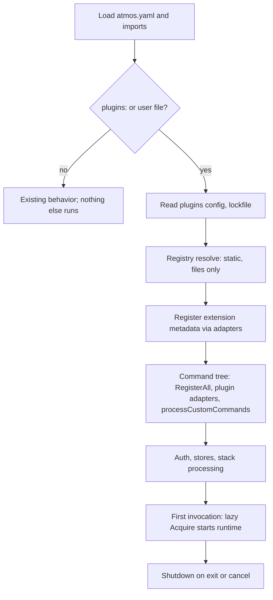

# Plugin platform interfaces

**Status:** Proposed; part of the [plugin platform](../overview.md). All Go symbols below are proposed APIs unless linked to existing code. [Platform workstream](README.md).

This document fixes the Go package layout and the Atmos-side interfaces: how an installed package becomes a `Registry` entry, how a `Runtime` starts it, which API services it may call, and which adapter maps each wire service onto an existing Atmos interface. The wire messages are in [protocol](protocol.md), the YAML schemas in [configuration](configuration.md), sentinel errors in [errors](errors.md), and the inventory of what must change first in the [gap analysis](gap-analysis.md).

## Package layout

Plugin logic lives in `pkg/plugin/...` and a thin `cmd/plugin/`; generic OCI work extends `pkg/oci`, and scaffold orchestration reuses `pkg/generator`. No plugin-specific transport or renderer is duplicated. The [first-release scope](../first-release.md) identifies implemented adapters; remaining interfaces below are follow-on designs.

```text
pkg/plugin/                  Shared value types only (Package, Extension, Scope, Selection). No init() registration.
  manifest/                  Go types for AtmosPluginConfig, AtmosPluginLock, AtmosPluginCatalog, AtmosPluginTestConfig; registers kinds with pkg/manifest.
  config/                    plugins: section, user-scope file, `path` packages; precedence merge; no network.
  lock/                      .atmos.plugins.lock.yaml read, write, and frozen comparison.
  oci/                       Plugin media types and release assembly over shared pkg/oci operations.
  catalog/                   Explicit catalog snapshot build, publish, add, remove.
  discovery/                 Cached search over catalog snapshots and explicit OCI repositories.
  install/                   Install, frozen restore, update, remove, rollback; digest and signature verification; tool restore.
  extension/                 Descriptor registry: capability schema, versions, adapter factory, scaffold and test hooks.
  registry/                  Installed-plugin registry: alias resolution, kind lookup, collision detection. Static; starts nothing.
  runtime/                   Runtime and Handle contracts plus the process-wide manager.
    native/                  hashicorp/go-plugin client in gRPC mode.
    starlark/                In-process sessions on pkg/script/starlark.
    data/                    No process: rule packs and skills.
  bridge/                    Serves Atmos API contracts over the broker; imports no extension adapters.
  bootstrap/                 Composes descriptor registration, installed registry, runtimes, and adapters.
  adapter/<ext>/             One adapter per extension type: auth, component, ci, cicomponent, command, hook, step,
                              mcptool, skill, store, secret, backend, validation.
cmd/plugin/                  CommandProvider and subcommands for atmos plugin. Argument parsing and output only.
proto/atmos/plugin/v1/       Plugin protocol source (package atmos.plugin.v1).
proto/atmos/api/v1/          Atmos API wire source (package atmos.api.v1). buf checks cover both packages.
pkg/api/                     Atmos API contracts; renamed from pkg/automation in P0.12, then expanded incrementally.
sdk/                         Nested module github.com/cloudposse/atmos/sdk, the Plugin SDK.
  api/                       Plugin-facing bindings to the Atmos API, backed by the wire protocol.
  proto/                     Generated Go (atmos.api.v1, atmos.plugin.v1).
  plugin/                    plugin.Main and per-service bases.
  sdktest/                   Test doubles and fixtures.
```

The Atmos API in `pkg/api` defines the programmatic interface that language adapters consume. Its initial types retain their names (`api.StepLibrary`, `api.ExecutionPolicy`, `api.FileSystem`); the service interfaces below are proposed additions. Implementations that need Atmos internals stay in the main module.

The Plugin SDK is a separate nested Go module at `sdk/`, tagged in lockstep as `sdk/vX.Y.Z`. It supplies extension authoring helpers and protocol bindings, including `sdk/api` for calling the Atmos API. It never imports main-module packages; a `depguard` rule enforces that. `pkg/plugin/bridge` maps the API to the wire types, and parity tests cover those mappings ([Decision 17](decisions.md), [Decision 18](decisions.md)).

The implemented native pilot generates CLI wire types into `pkg/plugin/proto` and SDK wire types into `sdk/proto` from the same source, using `atmos dev generate proto`. The main module does not import the SDK. Parity tests guard drift; the two copies communicate on the wire and must not be linked into one binary. The package tree above also includes planned adapters and runtimes.

Import-direction rules:

1. Adapters import the **existing** registry they feed (for example `pkg/store`, `pkg/hooks`) plus `pkg/plugin/proto`, `pkg/plugin/runtime`, and `pkg/plugin/bridge`. They never import each other.
2. Existing packages never import `pkg/plugin/...`. Auth uses public constructor registration for both built-in and external kinds. Where later adapters need a miss hook (`hooks.GetKind`, `runnerstep.Get`), existing packages declare a small local interface and a setter, and bootstrap injects the plugin-backed implementation.
3. `pkg/plugin/registry` imports `pkg/plugin`, `pkg/plugin/manifest`, and `pkg/plugin/lock`. It imports neither `runtime` nor any adapter, so it can run before any process exists.
4. `pkg/plugin/runtime/*` imports `pkg/plugin/proto` and `pkg/plugin/bridge`. It does not import adapters.
5. `cmd/plugin/` is the only place that imports `cmd/internal` for plugin purposes (Decision [D9](decisions.md)). It contains no feature logic; every command body is one call into `pkg/plugin/...`. `cmd/root.go` gets one inline call site, not logic.
6. `pkg/plugin/bootstrap` is the composition root importing the installed registry, descriptors, runtimes, and adapters. Nothing in those packages imports bootstrap. The API bridge does not import adapters or the installed registry; this keeps adapter → runtime/bridge dependencies acyclic.
7. CLI startup invokes bootstrap after configuration loading and before auth/stack processing. The config package exposes a local injection seam if necessary; it does not import the plugin composition root.

## Extension descriptor registration

`pkg/plugin/extension` registers descriptors by capability selector with duplicate rejection. A descriptor supplies static schema/metadata validation, supported versions, an adapter factory, and hooks for scaffold templates and contract suites. Production registration initially supplies `auth.provider`, `auth.identity`, and executable `command`. Startup injects the registry into discovery, compatibility, validation, and bootstrap; those consumers do not switch over an exhaustive list of extension kinds.

Static operations never construct an executing adapter. First invocation obtains a runtime handle and dispatches through the registered factory; adapters register their kinds with the existing Atmos registries. Unknown required capabilities fail as incompatible before install/activation; reserved future schemas alone do not enable them. A test-only third descriptor demonstrates an added capability without edits to OCI, installation, locking, or catalog code. See [extension mechanisms](../first-release.md#mechanisms-for-subsequent-extension-types).

The native pilot's conformance runner accepts the composed descriptor registry through `conformance.Options.Registry`, defaulting to `bootstrap.Descriptors()`. After verifying the executable's manifest agreement, it invokes each exported binding's optional `Descriptor.Test` hook as a local case named `extension/<capability>/<export>`. These cases support the same substring selection, timeout, cancellation, and credential-safe failure reporting as authored fixtures. A `plugin.tests.yaml` containing only `version: 1` is sufficient when registered hooks supply the selected tests; a selection with no executable cases still fails. Hooks are local conformance checks; `--integration` runs only explicitly configured integration steps.

## Core types

```go
// Scope (pkg/plugin) says where a selection was declared: "project" (atmos.yaml and the project lockfile)
// or "user" (the user-scope file under the XDG config directory).
type Scope string

// RuntimeKind names the runtime that loads a package: "native", "starlark", or "data".
type RuntimeKind string

// Package is one installed, locked, immutable plugin release.
type Package struct {
    Name           string                    // Fully qualified identity, for example "acme/okta".
    Version        string                    // Exact semantic version.
    Scope          Scope                     // Where the selection was declared.
    Source         Source                    // OCI reference, local path, or offline layout.
    IndexDigest    string                    // Digest of the OCI index (or single manifest) the lock pins.
    PlatformDigest string                    // Digest of the resolved platform artifact; empty for starlark and data.
    Dir            string                    // Install directory: XDG data atmos/plugins/<name>/<version>/<digest>/.
    Manifest       *manifest.PluginConfig    // Decoded AtmosPluginConfig; read from Dir without starting anything.
    Runtime        RuntimeKind               // Taken from the manifest.
    Verification   Verification              // Integrity and, when policy requires it, publisher identity.
    Local          bool                      // True when selected through plugins.packages.<alias>.path.
}

// ExtensionType names an extension surface. Values match the adapter package names: auth,
// component, ci, cicomponent, command, hook, step, mcptool, skill, store, secret, backend,
// validation.
type ExtensionType string

// Extension is the static descriptor of one thing a package exposes. It is read from the manifest.
type Extension struct {
    Type     ExtensionType     // Surface the extension attaches to.
    Name     string            // Export name: kind, type, command, tool, skill, step type, or check ID.
    Aliases  []string          // Additional names claimed in the same namespace (steps, commands).
    Contract string            // Contract version this extension implements, for example "store/v1".
    Schemas  map[string]string // Schema role to package-relative path, for example "options" -> "schemas/options.json".
    Service  string            // Plugin service that serves it, for example "atmos.plugin.v1.Store"; empty for data.
}

// Selection is the effective result for one alias after precedence is applied.
type Selection struct {
    Alias      string
    Package    *Package
    Extensions []Extension
    Provenance Provenance
}

// Provenance explains why this package won.
type Provenance struct {
    Layer      string // One of "cli", "env", "project", "user", "dev".
    File       string // Declaring file; empty for cli and env.
    Constraint string // Version constraint as declared.
    Locked     bool   // True when a lock entry pinned the version.
}
```

## Registry

`Registry` is built from configuration and lockfile alone. It reads installed manifests from disk; it never starts a process, evaluates Starlark, or touches the network.

```go
// Binding (pkg/plugin/registry) is an extension together with the selection that provides it.
type Binding struct {
    Extension plugin.Extension
    Selection *plugin.Selection
}

// Registry resolves aliases and extension names to installed packages.
type Registry interface {
    // Resolve returns the effective selection for an alias, or ErrPluginNotInstalled.
    Resolve(alias string) (*plugin.Selection, error)
    // ByKind returns the binding for one extension name, or ErrPluginNotFound.
    ByKind(t plugin.ExtensionType, kind string) (*Binding, error)
    // Extensions lists every binding of one type in deterministic (name) order.
    Extensions(t plugin.ExtensionType) []Binding
    // Collisions reports every namespace conflict found while building the registry.
    Collisions() []Collision
}

// Reserved lists names claimed by built-ins and YAML; bootstrap adapts small local interfaces from existing packages.
type Reserved interface{ Names(t plugin.ExtensionType) []string }

// Collision is one name claimed by more than one party.
type Collision struct {
    Type      plugin.ExtensionType
    Name      string
    Claimants []string // "builtin", "yaml", or "<alias>@<version>".
    Outcome   Outcome  // OutcomeError, OutcomeShortcutUnavailable, or OutcomeSelectorRequired.
}

// New builds a registry from resolved selections. Any OutcomeError collision yields
// ErrPluginCollision, joining every conflict with errors.Join.
func New(selections []*plugin.Selection, reserved Reserved, opts ...Option) (Registry, error)
```

### Precedence

1. **Configuration layers** (flag values only): CLI flags, then `ATMOS_PLUGINS_*` environment, then project `atmos.yaml`, then the user-scope file, then defaults.
2. **Selection per alias:** the project declaration wins over the user declaration. A missing or incompatible project package is an error; it never falls back to the user-installed version.
3. **Path package** (`plugins.packages.<alias>.path`, usually set in a profile) replaces the release for that alias. It is refused in frozen mode (`ErrPluginFrozenDrift`).
4. **User-scope packages** never alter project automation: aliases the project does not declare are not activated by project commands.
5. **Built-ins are reserved.** A plugin claiming a built-in name is a collision, never an override.

### Collision namespaces

Every row is checked across built-ins, YAML configuration, and all selected packages.

| Namespace | Key | Built-in or YAML claimant | Outcome |
|---|---|---|---|
| Auth provider and identity kinds | `kind` | `factory` kinds | Error |
| Component types | `type` | [`component.Register`](../../../../pkg/component/registry.go) including Terraform, plus legacy helmfile and packer | Error |
| Command names | top-level name and aliases | [`internal.Register`](../../../../cmd/internal/registry.go) and YAML `commands:` | Shortcut unavailable; `atmos plugin run <alias>` still works |
| Hook kinds | `kind` | [`hooks.RegisterKind`](../../../../pkg/hooks/kind.go) | Error |
| Step types and aliases | `type`, `aliases` (one namespace) | [`step.Register`](../../../../pkg/runner/step/registry.go) | Error |
| MCP tool names | `name` | [`tools.Registry`](../../../../pkg/ai/tools/registry.go) | Error |
| Skill names | `name` | [`skills.Registry`](../../../../pkg/ai/skills/registry.go) | Error (built-in loader order is first-wins) |
| Store kinds | `kind` | [`store.Register`](../../../../pkg/store/registry.go) | Error |
| Secret provider kinds | `kind` | [`providers.Register`](../../../../pkg/secrets/providers/registry.go) | Error |
| Backend provisioner kinds | `kind` | `s3`, `azurerm` | Error |
| Validation check IDs | `id` | `validation/check` registry | Error |
| CI provider names | `name` | [`ci.Register`](../../../../pkg/ci/registry_provider.go) | Selector required when detection is ambiguous; explicit `ci.provider` wins |

## Runtime

```go
// Service names a plugin-side gRPC service in package atmos.plugin.v1: Info, AuthProvider,
// AuthIdentity, Component, CIProvider, CIComponent, Hook, Step, Validator, Store,
// SecretProvider, BackendProvisioner, or MCPTool, for example "atmos.plugin.v1.Store".
type Service string

// Runtime starts packages of one RuntimeKind.
type Runtime interface {
    Kind() plugin.RuntimeKind
    // Start launches or opens the package and completes the Info handshake.
    // API services are supplied with WithAPI; WithEnv and WithToolchainPATH scope the process.
    Start(ctx context.Context, pkg *plugin.Package, opts ...StartOption) (Handle, error)
}

// Handle is a running package.
type Handle interface {
    // Info returns the manifest echo, contract versions, and capability flags.
    Info(ctx context.Context) (*protov1.InfoResponse, error)
    // Client returns a connection for one service; adapters wrap it in the generated client.
    Client(service Service) (grpc.ClientConnInterface, error)
    // Close stops the plugin. It is safe to call twice.
    Close(ctx context.Context) error
}

// Manager reuses handles within one Atmos process.
type Manager interface {
    // Acquire starts the package on first use and returns the shared handle afterwards.
    Acquire(ctx context.Context, pkg *plugin.Package) (Handle, error)
    // Shutdown closes every handle, newest first, honoring ctx deadlines.
    Shutdown(ctx context.Context) error
}
```

Lifecycle:

- **Lazy start.** Nothing starts at bootstrap. The first `Acquire` starts the package; later calls in the same process reuse the handle, keyed by package digest.
- **Cleanup.** `Shutdown` runs on normal exit and on cancellation. Native processes get a graceful `Close`, then a kill after a grace period. No orphan survives Atmos.
- **Cancellation.** The per-call `ctx` becomes the gRPC deadline and cancellation. Starlark threads use the existing `AfterFunc` cancellation.
- **Crash.** A dead native process surfaces as `ErrPluginCrashed` with package identity, version, and the last masked stderr lines. The failed call is not retried because it may have changed external state; the next `Acquire` starts a fresh process.

### Native runtime

`pkg/plugin/runtime/native` wraps `github.com/hashicorp/go-plugin`:

```go
// Illustrative; exact values are fixed by protocol.md.
&goplugin.ClientConfig{
    HandshakeConfig:  goplugin.HandshakeConfig{ProtocolVersion: 1, MagicCookieKey: "ATMOS_PLUGIN_MAGIC_COOKIE"},
    VersionedPlugins: versioned,                                  // Future protocol majors.
    Cmd:              exec.Command(entrypoint),                   // Digest re-verified before exec.
    AllowedProtocols: []goplugin.Protocol{goplugin.ProtocolGRPC}, // gRPC only.
    AutoMTLS:         true,
    Logger:           maskedLogger,                               // Plugin stderr passes through the masker.
}
```

- The environment is an allowlist plus the scoped toolchain PATH, never the full Atmos process environment.
- API services are served on the go-plugin `GRPCBroker`; the broker ID is delivered during the `Info` handshake.
- Windows transport (named pipe versus loopback TCP) is an open question in [decisions](decisions.md).

### Starlark runtime

`pkg/plugin/runtime/starlark` runs on [`pkg/script/starlark`](../../../../pkg/script/starlark/engine.go) through the [`script.Engine`](../../../../pkg/script/engine.go) seam.

- One evaluation session per package per process (D12); the module top level runs once and registers callbacks (`plugin.register_*`).
- Each invocation runs on an isolated Starlark thread with its own streams and environment; globals are frozen and shared read-only.
- `Client(service)` returns an in-process `grpc.ClientConnInterface` that decodes the request to a dict, calls the registered callback, and encodes the response. Adapters see identical generated clients for native and Starlark, so the same contract tests run against both.
- The extra predeclared modules (`plugin`, `auth`, `validation`, `hooks`, and the extended `atmos`) are visible to plugin sessions only; `atmos.*` binds the services below.

### Data runtime

`pkg/plugin/runtime/data` starts no process. `Start` validates the manifest's payload paths; `Client` returns `ErrPluginUnsupportedOperation`. Rule packs feed the validation engine registry; skills feed the skill loader, which records ownership in `installations.json` with the package digest (Atmos-written only).

## API services

API services are Go interfaces in `pkg/api`, served to plugins by `pkg/plugin/bridge`. Native plugins reach them through the go-plugin broker (`atmos.api.v1`) using the Plugin SDK's `sdk/api` bindings; Starlark reaches them through `atmos.*`. Both paths call the same implementation, constructed once per package invocation with that package's scope. In Atmos-side examples, `api` refers to `pkg/api`; in plugin-author examples, it refers to `sdk/api`. The wire bindings translate operations and results rather than importing the main-module types.

```go
// Services (pkg/plugin/bridge) is the set handed to a runtime for one package.
type Services struct {
    HTTP        HTTP
    Secrets     Secrets
    Prompt      Prompt
    Browser     Browser
    Process     Process
    FS          FS
    Credentials Credentials
    Diagnostics Diagnostics
    CIReporter  CIReporter
    Log         Log
    Toolchain   Toolchain
}

// HTTP performs requests through Atmos's proxy, CA, and masking configuration.
type HTTP interface{ Do(ctx context.Context, req *HTTPRequest) (*HTTPResponse, error) }

// Secrets returns values the package declared as inputs.
type Secrets interface{ Get(ctx context.Context, name string) (SecretValue, error) }

// Prompt asks the user for input; it fails with ErrPluginInteractionRequired when not interactive.
type Prompt interface{ Ask(ctx context.Context, req PromptRequest) (PromptResponse, error) }

// Browser opens authorization URLs and creates invocation-scoped loopback listeners.
type Browser interface {
    Open(ctx context.Context, url string) error
    Listen(ctx context.Context, req ListenRequest) (CallbackListener, error)
}

// CallbackListener is returned only after the socket is bound and its redirect URI is known.
type CallbackListener interface {
    RedirectURI() string
    Receive(ctx context.Context) (Callback, error)
    Close() error
}

// Process runs an executable resolved through the toolchain and streams masked output.
type Process interface {
    Run(ctx context.Context, req ProcessRequest, out OutputSink) (ProcessResult, error)
}

// FS reads and writes inside the granted roots.
type FS interface {
    Read(ctx context.Context, path string) ([]byte, error)
    Write(ctx context.Context, path string, data []byte, perm fs.FileMode) error
    List(ctx context.Context, dir string) ([]fs.DirEntry, error)
    Stat(ctx context.Context, path string) (fs.FileInfo, error)
}

// Credentials stores package-owned session state and resolves Atmos-authenticated identities.
type Credentials interface {
    // Load, Store, and Delete address entries in the calling package's namespace.
    Load(ctx context.Context, key string) (*credentials.Envelope, error)
    Store(ctx context.Context, key string, env *credentials.Envelope) error
    Delete(ctx context.Context, key string) error
    // Resolve authenticates a configured identity through Atmos auth manager.
    Resolve(ctx context.Context, ref IdentityRef) (*credentials.Envelope, error)
}

// Diagnostics receives findings in the shared validation model.
type Diagnostics interface {
    Emit(ctx context.Context, diags []validation.Diagnostic) error
}

// CIReporter forwards reporting requests to the selected CI provider.
type CIReporter interface {
    Report(ctx context.Context, req CIReport) error
}

// Log writes to the Atmos logger, never to the terminal directly.
type Log interface {
    Log(ctx context.Context, level LogLevel, msg string, fields map[string]string)
}

// Toolchain resolves declared tools to pinned executable paths.
type Toolchain interface {
    Resolve(ctx context.Context, tool string) (string, error)
}
```

`credentials.Envelope` is `{type, expires_at, data, sensitive_keys}` (for example `type: aws/v1`), defined with the credential-type registry in `pkg/auth/credentials` (see [gap analysis](gap-analysis.md), N3).

The Go SDK supplies an `http.RoundTripper` over `api.HTTP`, permitting OIDC/OAuth libraries to use their normal injected `http.Client`. Browser listen readiness, cancellation, redirect behavior, `oidc/v1`, private session storage, and refresh/logout coordination follow the [OIDC pilot contracts](../oidc-pilot.md). `Credentials.Delete` is required on the wire as well as in Go.

Scoping rules:

| Service | May | May not |
|---|---|---|
| `api.HTTP` | Make requests with a deadline; Atmos adds proxy, CA bundle, and a User-Agent naming package and version. | Bypass masking of response logging. Starlark has no other network path, so this is its enforcement point; native plugins can open sockets themselves (not an OS sandbox). |
| `api.Secrets` | Read only names declared as inputs in the manifest and bound by configuration. Returned values are registered with the masker. | Enumerate secrets or read other packages' inputs. |
| `api.Prompt` | Ask through Atmos TTY, with prompt types Atmos supports. | Prompt in non-interactive runs; the call fails with `ErrPluginInteractionRequired`. |
| `api.Browser` | Open one URL per call. | Read browser state. |
| `api.Process` | Run executables resolved from the package's `dependencies.tools` through the toolchain, with the scoped PATH and an allowlisted environment. | Run a shell, an arbitrary absolute path, or a binary outside the declared tools. |
| `api.FS` | Read the Atmos working directory and the package directory; write under the working directory and a per-package scratch directory. | Escape the roots (paths are cleaned, symlinks resolved and re-checked) or touch another package's directory. |
| `api.Credentials` | Load, store, and delete entries under its own `<package>/<realm>` namespace; resolve identities named in its own resolved configuration. | Read another package's namespace or resolve an identity it was not configured with. |
| `api.Diagnostics` | Emit `validation.Diagnostic` values for the current invocation. | Write to the terminal or CI directly. |
| `api.CIReporter` | Request summaries, checks, comments, and outputs via the selected provider. | Receive the provider's `OutputWriter` or tokens. |
| `api.Log` | Log at any level; fields pass through the masker. | Bypass log-level configuration. |
| `api.Toolchain` | Resolve tools the manifest declares. | Install tools; installation is an explicit `atmos plugin install` step. |

## Adapters

An adapter implements one existing Atmos interface by calling a wire service, so existing callers see no difference. Adapters are registered into the existing registry from static manifest metadata at bootstrap; the process starts on first call. Method lists are the names in the linked interface.

| Extension | Adapter (`pkg/plugin/adapter/...`) | Existing interface implemented | Wire service | API services | Must not cross | Phase 0 |
|---|---|---|---|---|---|---|
| Auth | `auth.ProviderAdapter`, `auth.IdentityAdapter` | [`types.Provider`](../../../../pkg/auth/types/interfaces.go): `Kind`, `Name`, `PreAuthenticate`, `Authenticate`, `Validate`, `Environment`, `Paths`, `PrepareEnvironment`, `Logout`, `GetFilesDisplayPath`, `SetRealm`. `types.Identity`: `Kind`, `GetProviderName`, `Authenticate`, `Validate`, `Environment`, `Paths`, `PrepareEnvironment`, `PostAuthenticate`, `Logout`, `CredentialsExist`, `LoadCredentials`, `SetRealm`. Optional `Provisioner`, `JustificationConsumer`. | `AuthProvider`, `AuthIdentity` | `api.Credentials`, `api.Prompt`, `api.Browser`, `api.HTTP`, `api.Log` | `types.AuthManager`, `*schema.Provider`, `*schema.Identity`, `*schema.AuthContext` | P0.1, P0.2 |
| Component | `component.Adapter` | [`ComponentProvider`](../../../../pkg/component/provider.go): `GetType`, `GetGroup`, `GetBasePath`, `ListComponents`, `ValidateComponent`, `Execute`, `GenerateArtifacts`, `GetAvailableCommands`. | Independent component configuration services; optional execution follows | `api.Process`, `api.Toolchain`, `api.FS`, `api.Credentials`, `api.Log` | `ExecutionContext` struct, `*schema.AtmosConfiguration`, `schema.ConfigAndStacksInfo` | P0.3, P0.6 |
| CI provider | `ci.Adapter` | [`provider.Provider`](../../../../pkg/ci/internal/provider/types.go): `Name`, `Detect`, `Context`, `GetStatus`, `CreateCheckRun`, `UpdateCheckRun`, `PostComment`, `OutputWriter`, `ResolveBase`. Optional `LabelReader`, `DebugModeDetector`, `LogGrouper`. | `CIProvider` | `api.HTTP`, `api.Secrets`, `api.Log` | `OutputWriter`, `io.Writer` | P0.3, P0.7 |
| Component CI | `cicomponent.Adapter` | [`plugin.Plugin`](../../../../pkg/ci/internal/plugin/types.go): `GetType`, `GetHookBindings` (`HookBinding{Event, Handler}`). | `CIComponent` | `api.CIReporter`, `api.FS`, `api.Log` | `HookHandler` func, `HookContext.Provider`, `TemplateLoader`, `CreatePlanfileStore` | P0.5 |
| Command | `command.Adapter` (lives behind `cmd/plugin`) | [`internal.CommandProvider`](../../../../cmd/internal/command.go): `GetCommand`, `GetName`, `GetGroup`, `GetFlagsBuilder`, `GetPositionalArgsBuilder`, `GetCompatibilityFlags`, `GetAliases`, `IsExperimental`. | `Commands.Run` for native plugins; in-process binding proposed for Starlark | Native command bootstrap currently grants `api.HTTP`; output uses RPC events, not inherited stdio | `*cobra.Command` | P0.3 |
| Hook | `hook.Adapter` | [`hooks.Engine`](../../../../pkg/hooks/kind.go): `Run`, plus `ResultHandler`, wrapped in a `hooks.Kind`. | `Hook` | `api.Process`, `api.Toolchain`, `api.Diagnostics`, `api.FS` | `ExecContext.Cmd`, `AtmosConfig`, `Info` | P0.4 |
| Step | `step.Adapter` | [`StepHandler`](../../../../pkg/runner/step/registry.go): `GetName`, `GetCategory`, `Execute`, `Validate`, `RequiresTTY`; optional `GetAliases`, `KnownFields`. | `Step` | `api.Prompt`, `api.Process`, `api.FS`, `api.Log` | `*schema.WorkflowStep`, `*Variables`, `io.Writer` | P0.3, P0.11 |
| MCP tool | `mcptool.Adapter` | [`tools.Tool`](../../../../pkg/ai/tools/types.go): `Name`, `Description`, `Parameters`, `Execute`, `RequiresPermission`, `IsRestricted`. | `MCPTool` | `api.HTTP`, `api.Process`, `api.FS`, `api.Credentials` | `permission.Checker` (stays Atmos side) | None |
| Skill | `skill.Adapter` | Loader stage in [`LoadSkills`](../../../../pkg/ai/skills/loader.go) producing `*skills.Skill`. | None (data) | None | `installations.json` writes (Atmos only) | None |
| Store | `store.Adapter` | [`store.Store`](../../../../pkg/store/store.go): `Set`, `Get`, `GetKey`; optional `RawStore`, `DeletableStore`, `IdentityAwareStore`. | `Store` | `api.Credentials`, `api.HTTP`, `api.Log` | `AuthContextResolver` | P0.4 |
| Secret provider | `secret.Adapter` | [`providers.Provider`](../../../../pkg/secrets/providers/provider.go): `Set`, `Get`, `Delete`, `Status`, `Kind`, `SupportsScope`; optional `RawGetter`. | `SecretProvider` | `api.Credentials`, `api.HTTP`, `api.Log` | `*schema.AtmosConfiguration` (constructor input) | P0.4, P0.9 |
| Backend | `backend.Adapter` | Proposed unified provisioner interface (gap analysis N7) replacing `BackendCreateFunc`, `BackendDeleteFunc`, `BackendExistsFunc`, `BackendNameFunc`. | `BackendProvisioner` | `api.Credentials`, `api.HTTP`, `api.Log` | `*schema.AtmosConfiguration`, `*schema.AuthContext`, `OutputWriters` | P0.3, P0.10 |
| Validation | `validation.Adapter` | [`validate.Validator`](../../../../pkg/ci/validate/validate.go): `Name`, `Validate`; generalized by the engine and check registries (N4). | `Validator` | `api.Diagnostics`, `api.FS`, `api.Process`, `api.Toolchain` | `validation.Report` internals; only `Diagnostic` crosses | P0.8 |

### Auth

`PreAuthenticate(manager AuthManager)` has no wire equivalent. The implemented adapter leaves it as a no-op: accepted and produced credential types come from static metadata, and the manager never crosses the boundary. The wire method is `AuthProvider.PrepareEnvironment`, whose request contains the provider and environment map, not next-link chain metadata. The current provider adapter preserves the supplied environment locally; the identity adapter delegates preparation to its Atmos-side credential materializer. `Authenticate` returns a credential envelope; the adapter converts it to an `ICredentials` through the credential-type registry. A type with no registered converter is stored opaquely under the package namespace and is acceptable only as a chain input for identities that declare it. `PostAuthenticateParams.Manager` is replaced by calls to `api.Credentials`; `ConfigSetter.SetConfig(*schema.Identity)` becomes a validated `spec` map delivered once at construction. Interactive flows use `api.Prompt` and `api.Browser`; non-interactive runs fail with `ErrPluginInteractionRequired`. Registry authentication for the plugin's own OCI source cannot depend on the plugin (`ErrPluginAuthCycle`).

### Component

Separate configuration providers from component types and execution engines. `ComponentDiscovery`, `ComponentValidation`, `ComponentPreparation`, and `ComponentState` are independent versioned services. Native Terragrunt configuration composes with the registered Terraform provider; it does not replace it. The SDK and runtime expose these services, but package activation and the host adapters remain pending.

Requests flatten host context into explicit invocation, coordinates, source/root, operation/options, effects, and typed configuration. `ComponentValue` preserves cty types, exact numbers, unknowns, nulls, and sensitivity. Generated files return literal bytes and ownership policies for host validation. State resolution is separate from preparation. Optional execution must stream through masked host I/O and provide an authoritative outcome.

Use the [component plugin PRD](../extensions/component-engines.md) for static flag metadata, collision rules, discovery/import integration, host service grants, and acceptance. The current protocol does not grant filesystem or process access merely by declaring an effect policy.

### CI provider and component CI

`Detect` and `Context` are answered from manifest-declared environment probes when present, so provider selection does not start a process. `OutputWriter` stays Atmos side; plugins request outputs and summaries through `api.CIReporter`. The proposed `cicomponent.Adapter` replaces the `HookHandler` function with `CIComponent.HandleEvent`, receiving the event, command, original operation outcome, output, and component/stack identity. Its response contains only `handled` and `diagnostics`. Reporting requests (status, title, summary Markdown, outputs, checks, and comments) go exclusively through `api.CIReporter`, not through a second response outcome. A successful response acknowledges handling or non-applicability through `handled`; diagnostics are rendered separately. Handler execution and reporting failures use the error contract and do not change the original infrastructure outcome. Provider, template loader, and planfile store remain Atmos concerns. These CI services and adapters are follow-on designs, not implemented native-pilot services.

### Command

Native commands use the implemented [`Commands.Run`](protocol.md#commands) server-streaming RPC. Command metadata comes from the manifest, so help renders without starting a process. Invocation starts the installed plugin through go-plugin and sends the export name, arguments, settings, and invocation context. Stdout and stderr arrive as events written to the caller-provided output writers; exactly one terminal exit event followed by EOF determines the Atmos exit status. Cancellation uses the RPC context and native runtime lifecycle. The current wire contract has no stdin stream or TTY attachment. Starlark command bindings remain a proposed in-process extension. A conflicting shortcut is not added, and `atmos plugin run <alias> -- ...` dispatches regardless.

### Hook

`Engine.Run` becomes `Hook.Run(RunRequest)`. `ExecContext.Cmd *cobra.Command` stays Atmos side: only the command name and arguments cross. The plugin receives event, hook name, resolved hook options, component and stack identity, outcome (status, exit code), and the invocation `context.Context` (added in P0.4). `ResultHandler` output maps to `hooks.Summary`; structured findings map through a shared adapter between `hooks.Finding` and `validation.Diagnostic`. The Atmos-side toolchain PATH (`ExecContext.ToolchainPATH`) is applied by `api.Process`, not handed over.

### Step

`StepHandler.Execute(ctx, *schema.WorkflowStep, *Variables)` becomes `Step.Execute(ExecuteRequest)` with the step's `with:` options as a map, rendered variables (a flat, read-only snapshot), and working directory. The result mirrors `StepResult` (`value`, `values`, `metadata`, `outputs`, `skipped`, `error`). `Validate` and `KnownFields` are answered from the manifest option schema, so workflow, custom-command, and hook validation work without a process. The adapter also exposes plugin types through `api.StepLibrary.Names()` (renamed in P0.12), so Starlark `steps.run("acme/x")` resolves them.

### MCP tool

`Parameters() []Parameter` is a flat model that cannot express nested JSON Schema. The adapter implements an optional `JSONSchema() map[string]any` interface (proposed addition next to `Tool`), and the [MCP adapter](../../../../pkg/mcp/adapter.go) prefers it over deriving a schema from `Parameters`. `Parameters()` still returns a best-effort flat view for built-in consumers. `RequiresPermission` and `IsRestricted` come from the manifest and can only be made stricter by configuration. The executor and `permission.Checker` run unchanged before the adapter's `Execute`.

### Store and secret provider

`store.Store` gains `context.Context` in P0.4, so the adapter forwards deadlines. `IdentityAwareStore` with a per-cloud `AuthContextResolver` is replaced by a generic identity reference (`IdentityRef{Name, Realm}`): Atmos authenticates the identity and the plugin calls `api.Credentials.Resolve`, receiving an envelope it is configured to accept. Capability metadata (`secretByDefault`, `secretIncapable`, raw, delete) comes from registration instead of two hardcoded lists. The secret adapter registers under the generic external track keyed by kind.

### Backend provisioner

The unified interface (N7) returns explicit existence states (absent, present-compatible, present-incompatible, denied, unknown) instead of a boolean. A missing implementation maps to `unknown`, never `absent`. Built-in `s3` and `azurerm` register through the same interface.

### Validation

Plugin validators register as check descriptors (ID, category, input type, options schema); component validation, `validate.checks`, and CI validators all dispatch through the check registry. Data rule packs register against an existing engine (`opa`, `jsonschema`, `cue`) with no process. Only `Diagnostic` crosses; Atmos builds `Report`, SARIF, and annotations.

## Installer and catalog

These interfaces back `atmos plugin` subcommands and automatic restoration during bootstrap. Both paths share artifact verification, cache installation, and lock transactions. Bootstrap restores missing declared packages, creates missing lock entries, and preserves existing selections; only explicit lifecycle actions select upgrades or edit declarations.

```go
// Installer (pkg/plugin/install) manages local installations and the lockfile.
type Installer interface {
    // Install resolves, downloads, verifies, restores tools, and writes the lock entry.
    Install(ctx context.Context, req InstallRequest, opts ...Option) (*Result, error)
    // Frozen restores exactly the lockfile; drift, including an active path package, is ErrPluginFrozenDrift.
    Frozen(ctx context.Context, opts ...Option) error
    // Update selects a newer compatible version for one alias and rewrites its lock entry.
    Update(ctx context.Context, alias string, opts ...Option) (*Change, error)
    // Remove deletes the local installation. Remote artifacts are untouched.
    Remove(ctx context.Context, alias string, opts ...Option) error
    // Rollback restores the previous declaration and lockfile, then reinstalls recorded artifacts.
    Rollback(ctx context.Context, opts ...Option) error
}

// Verifier checks integrity and, under policy, publisher identity.
type Verifier interface {
    // Digest compares content with the pinned digest, on installation and on every cache use.
    Digest(ctx context.Context, ref oci.Ref, want string) error
    // Signature verifies a signature bundle against policy; project config cannot weaken machine or CI policy.
    Signature(ctx context.Context, ref oci.Ref, policy Policy) (*plugin.Verification, error)
}
```

```go
// Discovery (pkg/plugin/discovery) indexes configured repositories and optional catalogs.
type Discovery interface {
    // Search returns cached or refreshed metadata; source errors fail the search.
    // It never starts plugins and rechecks source policy even on cache hits.
    Search(ctx context.Context, q Query) (*SearchResult, error)
}

// Catalog (pkg/plugin/catalog) reads and edits OCI catalog artifacts.
type Catalog interface {
    // Build generates a catalog artifact from a declared inventory.
    Build(ctx context.Context, inventory Inventory) (*Artifact, error)
    // Publish rechecks the current revision; callers must externally serialize writers.
    Publish(ctx context.Context, a *Artifact, target string) error
    // Add inserts or updates one entry; no artifact is deleted.
    Add(ctx context.Context, catalog string, e Entry) error
    // Remove unlists one entry; its artifact stays.
    Remove(ctx context.Context, catalog, name, version string) error
}

// Releaser (pkg/plugin/oci) manages release artifacts independent of any catalog.
type Releaser interface {
    Pack(ctx context.Context, dir string) (*Package, error)
    Publish(ctx context.Context, p *Package, repo string) (*Release, error)
    // Delete reports the exact digest and tags sharing it, and deletes only after confirmation.
    Delete(ctx context.Context, ref string, confirm Confirm) error
}
```

Invariants (from the [overview](../overview.md)):

1. **Publish before list.** A release artifact is pushed and verified before the catalog entry exists.
2. **Unlist before delete.** The catalog entry is removed before the artifact is deleted.
3. **No atomicity assumed.** Registry writes are not transactions. A partial result returns `ErrPluginPartialOperation` naming the completed and remaining steps; retrying the same command reconciles the remainder without overwriting unrelated catalog entries.
4. **Immutable releases.** Different content under an existing version fails with `ErrPluginImmutableRelease`; an identical repeat is safe; catalog maintenance remains a separate operation.
5. **Externally serialized catalog writes.** Maintainers serialize the complete read/update/publish workflow. The writer rechecks the revision before replacement and returns `ErrPluginCatalogConflict` for an observed conflict; this check cannot prevent simultaneous-writer races. Release publication never mutates a catalog.
6. **Frozen refuses path packages** and never resolves new versions.
7. **Remote and local are independent.** `Remove` leaves remote artifacts; `Delete` leaves local installations and lockfiles.
8. **No publisher code runs at install time.** Required tools restore through the toolchain only.

## Bootstrap order

1. Load `atmos.yaml` and imports as today. With no `plugins:` section and no user-scope file, stop: the rest is skipped.
2. Read `plugins:`, the lockfile, the user-scope file, (files only; a path package reads its local manifest).
3. Build the `Registry` from installed manifests under the install directory. Static: no network, no subprocess, no Starlark evaluation. Collision errors surface here.
4. Register extension metadata with the existing registries through the adapters: auth kinds, component types, hook kinds, step types, tools, skills, store and secret kinds, backend kinds, checks, CI providers, command descriptors.
5. Build the command tree: `RegisterAll`, then plugin command adapters (collisions recorded), then `processCustomCommands`.
6. Auth, stores, and stack processing run, resolving plugin kinds through the registries as if built in.
7. The first call into a plugin extension calls `Manager.Acquire`, which starts the runtime lazily.
8. On exit or cancellation, `Manager.Shutdown` closes every handle.



**Zero-cost guarantee.** A project without `plugins:` and without a user-scope plugin file performs no file reads beyond configuration, starts no subprocess, makes no network request, and constructs no `pkg/plugin` objects beyond a single nil-check at the call site. Registered metadata is cheap enough that projects with plugins pay no process cost until an extension is used.

## Decisions referenced

- [D1](decisions.md): go-plugin in gRPC mode is the native transport.
- [D2](decisions.md): Wasm (Extism) is the declared follow-on runtime; `Runtime` is the seam.
- [D9](decisions.md): `CommandProvider` stays in `cmd/internal`; `cmd/plugin` is the only bridge.
- [D11](decisions.md): bootstrap order and the zero-cost guarantee.
- [D12](decisions.md): one Starlark session per package per process.
