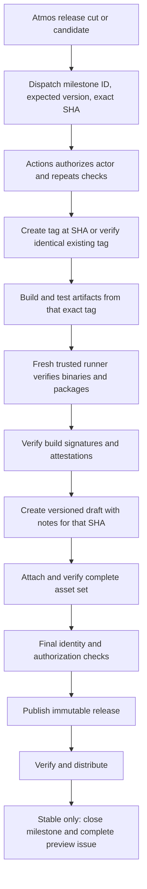

# PRD: Atmos Release Orchestration

The primary goal is to eliminate operator error and ensure every PR ships in its
intended release. Milestones establish that intent; merge and release checks enforce
it. The operator decides when to release the next eligible milestone, never which
version or arbitrary collection of PRs to publish. Artifact verification proves the
published files correspond to that intended release and its exact source SHA.


**Status:** Implementation in progress on PR #3474; production cutover has not occurred.

## Supported entry point

Atmos custom commands call tested Mage operations. GitHub Actions owns tag,
draft, asset, publication and milestone mutations. No release is created locally.

| Command | Behavior |
| --- | --- |
| `atmos release check` | Resolve the next milestone and source SHA; check included changes, unfinished work and labels; print the plan. |
| `atmos release cut` | Repeat local checks, dispatch the workflow with milestone identity, expected version and full SHA, then follow exactly that run. |
| `atmos release candidate` | Dispatch the same pipeline with a unique prerelease version; allow unfinished milestone work and leave the milestone open. |
| `atmos release milestones ensure` | Maintain the next three minor milestones. |
| `atmos release milestones create VERSION` | Explicitly create a milestone; patch and major milestones are always manual. |
| `atmos release milestones check` | Reconcile PR and merge-queue eligibility statuses. |

The local check is guidance. Actions re-reads GitHub state, authorizes the
initiating user and rerun actor, validates the exact source, and repeats all
checks. Clicking Run workflow must provide the same protection. A milestone
rename after local planning fails validation; it never silently changes the
requested release. Run correlation must use an explicit request identity, not
whichever workflow run is newest. Losing the terminal cannot cancel or repeat a
release already dispatched.

## Milestones and merge eligibility

The milestone version is the sole authority. No auto-semver selection or version
fallback remains. Labels declare compatibility requirements and categorize notes.

- Exactly one of `major`, `minor`, `patch`, or `no-release` is required.
- `no-release` PRs are exempt from milestone and release-order requirements.
- Other PRs require the **lowest open stable-semver milestone**, ordered
  numerically, not by title, due date, creation date or API order.
- The next milestone must also be viable from the unreleased commits already on
  the default branch. If PRs for `1.234.0` have merged, creating `1.233.1` must
  not make patch PRs mergeable. The merge gate, quality gate and release preflight
  reject that state and identify the conflicting merged PRs and milestones.
  They use the same commit-range validation; `no-release` remains exempt.
- Compare its version against the highest published stable release. Patch
  milestones accept patch PRs; minor milestones accept patch/minor; major
  milestones accept all three. A minor PR cannot enter `1.233.1` after `1.233.0`.
- Non-versioned planning milestones do not participate. Duplicate semantic
  versions, missing versions, closed assignments and unknown API state fail closed.
- New PRs choose the lowest eligible milestone by default. Preserve manual
  assignments; moving a PR does not circumvent CI.

Maintain the next three sequential minor milestones after the published stable
version: after `1.233.x`, keep `1.234.0`, `1.235.0`, `1.236.0` open. Publishing
`1.234.0` advances the window through `1.237.0`. Reuse equivalent existing titles,
recover retries, and reopen an unpublished required slot. Do not create patch or
major milestones automatically, or delete unrelated/farther-future milestones.

Mage owns planning and API operations; Actions reacts to PR/milestone/release
changes and runs scheduled recovery. Refresh **Release milestone** statuses on
PR heads and merge-queue heads, including predecessor PRs in a queued group.
Require this status in branch protection/rulesets at cutover. A failing workflow
alone does not revoke an earlier successful commit status. Metadata mutations
and merging are not atomic; repeat validation before releasing.

## Tag first, release last



Tagging fixes the release identity. Draft edits and advancing branches cannot
redefine it. Refuse any existing tag at a different SHA. Before publication,
validate every asset against that same identity; any mismatch leaves the release
unpublished. There is no post-publication rebuild/repair or moving a published tag.

Retries retain version, SHA and validated artifact identity. Reuse already
uploaded identical assets and upload missing ones; reject unexpected or different
assets. Do not rebuild into a partially populated draft with different bytes.
A successful publication followed by failed milestone closure retries bookkeeping,
not publication. Record the exact run, inputs and artifact identity durably.

## Nightly and feature releases

Both remain supported and use the same guarded pipeline, not a separate weaker
publisher. Nightlies select a pinned default-branch SHA on their scheduled trigger.
Features select the exact PR head under an explicitly authorized feature-release
request; fork content never receives publishing credentials. Candidates allow
unfinished milestone work and use the milestone's base version plus a unique
prerelease suffix. Nightly and feature suffixes are likewise unique and stable
across retries of one request. None closes the stable milestone or marks itself
as the latest stable release. A source feature branch need not already be merged.

## Upcoming-release preview issue

Automatically create one issue when a stable-release milestone is created. It
previews the future release with categorized summaries, associated PR links,
unfinished work and source information. Refresh after PR merges and milestone
membership/title changes, using the same Go note generation as the eventual
release. A milestone alone does not prove a change is in a particular commit.
Preview notes clearly distinguish planned work from merged work.

The issue is informational: no issue commands, milestone-close publication,
hidden approvals or mutable issue text as trusted release state. Optional hidden
HTML metadata identifies repository/milestone/issue IDs only; validate it against
the canonical association. Preserve manually written sections and discussion.

Pin the issue automatically, unpin when closed, and repin if reopened. GitHub
allows three pinned issues; do not evict unrelated pins. Report full capacity and
retry without duplicating issues. Closing an issue never publishes a release.
**Do not create issues for feature releases**; report those on the existing PR
and workflow run. Nightlies also do not need separate preview issues.

## Replace Release Drafter with Go

Remove the label-based version resolver and drafting action/configuration after
migrating all stable, nightly and feature callers. Preserve the existing Go
summarization, categories, bounded rendering, CodeRabbit/description fallbacks,
and their regression tests. Supply structured PR entries directly; do not infer
membership by parsing a mutable draft body. For published notes, verify the PRs
are represented in the exact source range. Preview membership comes from the
milestone and is explicitly not publication evidence.

## What each verification layer proves

Git commit SHA and artifact SHA-256 are different identities. All platform
binaries must identify the same source commit, but their file digests differ.

| Layer | Required evidence | What it does not establish |
| --- | --- | --- |
| Release request | Exact repository, milestone, tag, source SHA, actor and workflow run | That the chosen milestone version correctly reflects compatibility intent |
| Source selection | Clean checkout of the pinned commit; exact tag resolution; successful required source checks | That reviewed source contains no malicious behavior |
| Binary inspection | Embedded version/commit; Go `vcs.revision`; clean-tree flag; correct OS/architecture; complete platform matrix | Cryptographic authenticity of those claims by itself |
| Package inspection | Unpack each supported package and check its executable identity and correspondence to the verified platform binary | Package filename alone is insufficient |
| Checksums/manifest | SHA-256 for every distributable, exact names and complete set | Who produced the manifest; an attacker can replace both bytes and an unsigned checksum |
| Signed checksums | Verify the cosign bundle against the expected workflow identity and OIDC issuer | That the signed binaries have the requested version unless inspected separately |
| Build provenance | Verify artifact digest, signature, trusted signer/workflow, and actual source tag/commit in the authenticated predicate | Absence of vulnerabilities or malicious source code |
| SBOM attestation | Verify the signed dependency inventory is associated with the intended artifact or manifest | Correct release version or a vulnerability-free build |
| Uploaded assets | GitHub asset digests and exact asset set equal the verified manifest | Protection against a later authorized draft mutation |
| Immutable release attestation | Verify GitHub's published tag, commit, and asset record | A pre-publication content validation hook |
| Downstream verification | Independently reject mismatched or unauthenticated published inputs before distribution | Making an already-public invalid release private again |

GoReleaser signs checksums in the build job using the existing pinned cosign
and syft setup. That same job generates build provenance and SBOM attestations.
A separate trusted job inspects the binaries and verifies that existing evidence.
Verification must validate their cryptography and signer policy; merely finding
an attestation or hashing a signature file is insufficient. GitHub explicitly
requires signature, timestamp, and signer verification for meaningful assurance.
[GitHub attestation verification](https://docs.github.com/en/rest/orgs/attestations),
[GitHub CLI verification options](https://cli.github.com/manual/gh_attestation_verify).

The source commit being released can differ from the workflow/tooling commit,
particularly for a maintenance release. Record both. Verify the actual build
source in the authenticated provenance predicate; do not assume the signing
workflow's checkout SHA is the source of the binary. Restrict signer identities
to approved workflows and trusted workflow revisions. A matching repository
name alone is insufficient. No SLSA level certification is claimed by this PRD.

GitHub's immutable-release attestation is generated at publication. It complements
our earlier build provenance rather than replacing it. Publish only after all
assets are attached; there is no post-publication binary repair step.
[GitHub immutable release model](https://docs.github.com/en/code-security/concepts/supply-chain-security/immutable-releases).

## Authorization, environments and isolation

Only Erik (`osterman`, GitHub ID `52489`) or Andriy (`aknysh`, ID `7356997`) may
authorize manual publication. Either can act alone; no dual approval or deployment
approval requirement is introduced. Compare exact authenticated numeric IDs;
never regexes, substrings, display names or text claiming authorization. Validate
both the original actor and rerun actor. Automated nightly execution is a distinct
trusted trigger and must never authorize stable publication.

AWS CodeBreach demonstrated how an unanchored actor-ID regex admitted an
attacker's longer ID; untrusted build execution then exposed powerful credentials.
Strict equality and credential isolation address separate failures.
[Wiz research](https://www.wiz.io/blog/wiz-research-codebreach-vulnerability-aws-codebuild),
[AWS bulletin](https://aws.amazon.com/security/security-bulletins/2026-002-AWS/).
An actually compromised authorized account remains trusted under the accepted
single-person policy.

Separate fresh jobs for trusted preparation, source build/signing, verification,
and publication. The build receives OIDC and attestation permissions for signing
and provenance, but no release App key or release-publishing token.
Trusted privileged jobs do not execute the release binary or source hooks; they
inspect artifacts as data using pinned tooling. Bind transfers to repository,
workflow run/attempt, immutable artifact ID and digest. Keep Go caches, separated
by trust; privileged tools cannot come from untrusted build caches.

The repository already uses environments with branch/tag policies and no
required-reviewer rules. Keep publisher credentials environment-scoped. Environment
rules inspect the workflow ref, not a later checkout SHA; they neither validate
assets nor intercept Publish in the GitHub release editor. No approval requirement
is being added. [GitHub environments](https://docs.github.com/en/actions/reference/workflows-and-actions/deployments-and-environments).

GitHub Write/Maintain/Admin users can publish directly. Workflow checks cannot
prevent that path; exclusive publication requires a separate permissions decision.
Immutability freezes published tags/assets but does not validate them beforehand.
Do not claim these checks and publication are one atomic API transaction.

## Implementation and test requirements

- Thin Atmos and Actions wrappers around shared Mage/Go functions.
- Use **90% statement coverage** as a development goal for this change, with
  coverage reported through the existing Codecov integration. Preserve
  existing binary-integrity regressions and the real GoReleaser rehearsal.
- Offline API fixtures and injected clients/runners; no live release mutations
  in unit tests. Test production wrapper wiring and argument transport too.
- Negative cases: incorrect label/milestone, lexical sorting traps, duplicate
  versions, pagination, open work, source outside selected SHA, stale plans,
  spoofed actor IDs, unauthorized reruns, conflicting tags/drafts/assets,
  partial uploads, API failure, signature/signer/source mismatches, and retries.
- Test milestone-window advancement and manual-only patch/major creation.
  Test merge-group predecessor failures and stale successful status revocation.
- Test preview issue idempotency, metadata tampering, pin capacity and closure;
  verify no feature/nightly issue creation.
- Rehearse stable/candidate/nightly/feature paths against a stateful local GitHub
  mock using real GoReleaser artifacts. Create no GitHub repositories or releases.
- Before cutover, separately validate environment permissions and OIDC in an
  explicitly scoped Actions run without publishing a release. Local mocks cannot
  establish that GitHub configuration is correct.

Current branch already contains useful identity, manifest, upload, provenance and
distribution guards. Preserve those and their tests while replacing obsolete
orchestration. Do not enable production until the new entry points, isolation,
verification, required milestone status and the mocked rehearsal are complete. Live rollout
validation remains separate and must not be implied by passing local tests.

### Offline lifecycle rehearsal

Run with GoReleaser 2.18.3, Node.js and `bsdtar` installed:

```bash
ATMOS_TEST_GORELEASER=goreleaser go test -tags=mage -race -count=1 \
  -run TestGoReleaserTagAuthority -v ./magefiles/release
```

The local-action tests workflow runs this as part of the release suite. The test
uses temporary local Git directories, real executable fixtures, the production
platform/package configuration, and one stateful GitHub API mock shared by the
Go planner and CJS publisher. It never creates a repository or release on GitHub.
The mock transport is restricted to loopback and the publisher child receives
no GitHub credentials.

Nineteen lifecycle scenarios cover all four release modes, resuming partial
uploads with the same draft, incorrect binary identities even with recomputed
checksums, changed milestones and tags, unmerged work, incompatible labels,
renamed drafts, altered local/uploaded bytes, unexpected assets, and downstream
rejection after tampering. The success assertions check the exact source SHA,
complete asset count, stable/latest behavior, and milestone closure.

The executable is a small test fixture, not a full Atmos build. Signature and
SBOM files are unsigned fixture placeholders. Cryptographic verification and
workflow signing configuration have separate regression tests; this rehearsal
does not claim to validate live OIDC issuance or signing infrastructure.

## Operator confirmation and completion reporting

`atmos release cut` first runs the same read-only preflight as `check`, then uses
Atmos's native confirm step: **Do you want to cut X.Y.Z?**, default No. Dispatch
requires affirmative confirmation and the serialized plan. The Mage target repeats
live preflight and rejects changed milestone, version, source SHA, branch or baseline.
It cannot silently select a different next release after confirmation.

The command follows its uniquely correlated workflow run, verifies the resulting
published identity, and prints version, source SHA, release URL and workflow URL.
A failure or interruption identifies the existing request/run, without redispatch.

## Homebrew and rollout evidence

Homebrew's stable-only distribution job remains behind published-release verification.
Preserve explicit `brew shellenv`, forced `homebrew/core` tap, release environment,
and GH_BOT_TOKEN mapping. It bumps the formula for the exact event tag; Homebrew
builds independent bottles from source, not the uploaded upstream binaries.
Local workflow contract tests do not replace an external formula/build rehearsal.

The feature-releases environment currently has a `**/*` branch policy. Confirm it
allows the default branch used by the new trusted feature dispatcher, or explicitly
add `main` during cutover. No environment approval requirement is introduced.

The accompanying blog remains a draft until live signing, immutability, distribution,
and operator rehearsal evidence has been recorded. Do not claim production readiness
from statement coverage alone.
