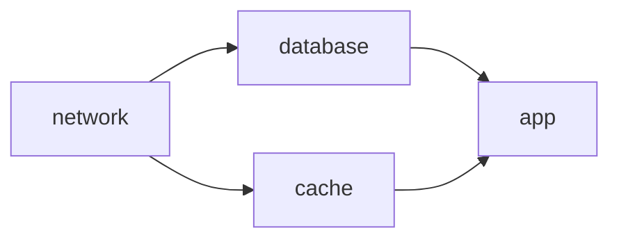

# Advanced Terragrunt fixture

This fixture combines shared HCL configuration with a diamond dependency graph:

`root.hcl` reads `env.hcl`, generates a Terraform file, and configures a separate local backend for each unit.
Units use deep includes, exposed locals, command-scoped output mocks, and dependency outputs.
The module uses only the built-in `terraform_data` resource.

The native acceptance runner lists the four units, plans with command-scoped mocks, applies in dependency order, checks unchanged plans, changes the network revision, and verifies fresh downstream outputs. It destroys in reverse order.

`failures/hook` is an unsupported-hook fixture outside the successful discovery scope.

Run `python3 plugins/terragrunt/scripts/acceptance.py --atmos <built-atmos>` from the repository root. The runner copies all files before execution.
