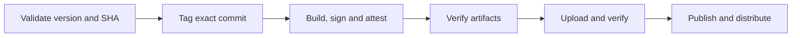

We published incorrect artifacts in the [1.233.0 and 1.233.1 releases](https://github.com/cloudposse/atmos/issues/3475).

Release engineering controls versions, builds, signatures, provenance, and distribution. Application tests alone do not prove that this process publishes the correct release.

We test the release process in CI alongside Atmos. Tests check release rules, artifact verification, and publication without real releases.

<!--truncate-->

## Make release intent enforceable

Each PR requires a versioned milestone unless it has the `no-release` label. The lowest open release milestone defines the next version. Merge checks and the quality gate enforce milestone order and label compatibility.

Automation maintains minor milestones and preview issues for stable releases. We create patch and major milestones manually. Release notes come from the included PRs.

## Make the operation repeatable

Local [custom commands](/scripting/custom-commands) and GitHub Actions use the same tested Go code:

```bash
atmos release list       # Inspect PRs and merge status in the next milestone
atmos release check      # Validate the next milestone and source commit
atmos release cut        # Confirm, dispatch, wait, and report the result
atmos release candidate  # Build a prerelease without closing the milestone
```

Use `atmos release list 1.233.2` to inspect a specific milestone. The list shows all assigned PRs in aligned columns, with a filled green dot for merged PRs and hollow dots for open (blue), draft (yellow), or closed without merging (red) PRs. Textual statuses remain readable without color. Milestone creation confirms whether the version was created or already exists.

Candidates are numbered automatically for each version: `v1.233.2-rc.1`, `-rc.2`, and so on. Each workflow reserves its tag before building, and retries retain that number even after an interrupted build.

The operator chooses when to release. The milestone determines the version. For a stable release, Atmos checks that all milestone PRs have merged and are present in the selected commit. It then asks **Do you want to cut X.Y.Z?** GitHub Actions repeats these checks before it creates the tag. Temporary GitHub-hosted runners build, sign, and publish the artifacts.

## Verify the artifacts people receive



Each binary must contain the version and exact commit SHA from the tag. Packages must contain that verified binary. GoReleaser uses the build workflow's OIDC identity to sign artifacts. Before publication, the workflow checks signatures, provenance attestations, and uploaded assets. Provenance attestations identify the source and workflow that produced the artifacts.

Separate GitHub Apps authorize production and feature releases. GitHub environment rules restrict which branches and tags can access their credentials. All release modes use the same artifact checks. Homebrew updates follow verified stable releases.

## Test the release system itself

We test release planning, tag creation, verification, and publication against a simulated GitHub API. The API tracks state. Tests use real executables and packages. Nineteen test scenarios cover incorrect versions and commits, incompatible milestones, changed tags, damaged assets, and interrupted uploads. Tests check that failures block publication and retries safely complete interrupted uploads.

Local tests cover **97% of Go statements in release and milestone code** and **100% of publisher JavaScript lines**. CI sends Go coverage to Codecov. Live permissions, issue creation, and OIDC signing need separate tests. Immutable releases prevent changes to published assets. Users with direct publication permission can still bypass the workflow checks.
