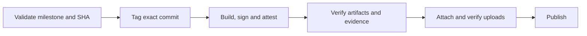

As release pipelines grow, successful builds can still produce the wrong release.

Atmos hit two failures: binaries from the wrong commit, and an unintended version. Our new process aims to eliminate those operator mistakes and ship PRs in their intended releases.

<!--truncate-->

## Milestones define the version

The lowest open versioned milestone determines the next release. Labels describe compatibility, never calculate versions.

Except for `no-release`, PRs must belong to the next milestone before merging. A patch fits a minor release; a minor change cannot enter a patch. The merge check and quality report share these rules.

Automation maintains three minor milestones and previews upcoming stable releases in GitHub issues. Patch and major milestones remain manual; nightly and feature releases get no issues.

## One command initiates the release

Maintainers use repository [custom commands](/scripting/custom-commands):

```bash
atmos release check
atmos release cut
atmos release candidate
```

The cut command checks that all milestone PRs are merged and included, asks **Do you want to cut X.Y.Z?**, then dispatches and follows GitHub Actions. CI repeats the checks against the confirmed version and SHA.



Release notes come from included PRs, preserving our categories and optional AI summaries. Release Drafter is no longer needed.

## Verify before publishing

Every binary must match the tag's version and exact commit. Packages must contain the verified executable. Missing, extra, stale, or changed assets stop publication.

GoReleaser retains its signing setup. The build job signs and attests; a separate job verifies that evidence. Checksums identify bytes, signatures authenticate the signer, and provenance records the workflow and source. All must agree with the release identity.

Every release type shares the guard. Go caching stays enabled, and Homebrew follows verified stable publication.

## Test failures without releasing anything

A stateful GitHub mock exercises the production release code with real, locally built executable fixtures and packages. It creates no GitHub repositories or releases.

Tests inject wrong versions, SHAs, milestones, moved tags, corrupted assets, and interrupted uploads. Invalid releases must remain unpublished; identical partial uploads must resume safely. Coverage is reported through Codecov.

Live permissions and OIDC signing still need rollout checks. Immutable releases prevent later changes once enabled; direct publishing permissions remain a bypass boundary.

*Draft: rollout validation is still in progress.*
