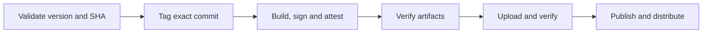

We messed up the [1.233.0 and 1.233.1 releases](https://github.com/cloudposse/atmos/issues/3475). Here’s what we’re doing about it.

Release engineering connects versioning, builds, signing, provenance, and distribution. Application tests alone don’t prove that this process ships the intended release.

We now test the Atmos release process in CI the same way we test Atmos itself. Those tests exercise release policy, artifact verification, and publication without creating real releases.

<!--truncate-->

## Make release intent enforceable

Atmos records release intent in versioned milestones: the lowest open milestone defines the next release. PR labels describe compatibility, and merge checks reject changes that do not fit their milestone. The quality gate applies the same rules.

Automation maintains minor milestones and stable-release preview issues. Patch and major milestones remain manual; included PRs supply release notes.

## Make the operation repeatable

Atmos puts release logic in tested Go operations, shared by local [custom commands](/scripting/custom-commands) and GitHub Actions:

```bash
atmos release check      # Validate the next milestone and source commit
atmos release cut        # Confirm, dispatch, wait, and report the result
atmos release candidate  # Build a prerelease without closing the milestone
```

The operator chooses when; the milestone determines the version. Preflight requires every milestone PR to be merged and included, then asks **Do you want to cut X.Y.Z?** These commands dispatch workflows that repeat validation. Building, signing, and publication run on GitHub-managed ephemeral runners, tying artifacts to verified source and workflow identity to protect supply-chain integrity.

## Verify the artifacts people receive



Every binary must match the tag's version and exact commit; packages must contain that executable. GoReleaser signs using the build workflow's OIDC identity. Verification checks signatures, provenance attestations, and uploaded assets before publication.

Separate GitHub Apps authorize production and feature release operations. Environment branch/tag policies gate access to their credentials. All release modes share artifact verification; Homebrew follows verified stable publication.

## Test the release system itself

To maintain confidence in our release system, we set the bar high for test coverage. A stateful GitHub mock exercises production planning, tagging, verification, and publication code with real executable fixtures and packages. Nineteen lifecycle scenarios inject wrong identities, incompatible milestones, moved tags, corrupted assets, and interrupted uploads. Assertions require publication to stay blocked or retries to resume safely.

Local coverage is **96.2% of Go statements** and **100% of publisher JavaScript lines**; Go coverage also feeds Codecov in CI. Live permissions, issue creation, and OIDC signing require separate validation. Immutable releases protect published assets; direct publishing access remains a bypass boundary.
