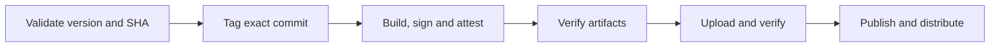

Release engineering coordinates what ships, how it is built, and how it reaches users. Versioning, signing, provenance, and distribution form a system with their own failure modes. Application test coverage tells us little about whether that system releases the right thing.

Atmos makes that process testable through explicit policy and repeatable operations, without publishing real releases.

<!--truncate-->

## Make release intent enforceable

Atmos records release intent in versioned milestones: the lowest open milestone defines the next release. PR labels describe compatibility, and merge checks reject changes that do not fit their milestone. The quality gate applies the same rules.

Automation maintains minor milestones and stable-release preview issues. Patch and major milestones remain manual; included PRs supply release notes.

## Make the operation repeatable

Atmos puts release logic in tested Go operations, shared by local [custom commands](/scripting/custom-commands) and GitHub Actions:

```bash
atmos release check      # Validate the next milestone and source commit
atmos release cut        # Confirm, dispatch, wait, and report the result
atmos release candidate  # Build a prerelease without closing the milestone
```

The operator decides when to release. The milestone determines the version. Local preflight requires all milestone PRs to be merged and included, then asks **Do you want to cut X.Y.Z?** Actions repeats validation and owns every release mutation.

## Verify the artifacts people receive



Every binary must match the tag's version and exact commit; packages must contain the verified executable. GoReleaser signs during the build. A separate job verifies signatures and provenance attestations. Uploaded assets are checked again before publication.

Stable, candidate, nightly, and feature releases share the guard. Go caching stays enabled, and Homebrew follows verified stable publication.

## Test the release system itself

We measure coverage of the release tooling itself. A stateful GitHub mock exercises production planning, tagging, verification, and publication code with real executable fixtures and packages. Nineteen lifecycle scenarios inject wrong identities, incompatible milestones, moved tags, corrupted assets, and interrupted uploads. Assertions require publication to stay blocked or retries to resume safely.

Local coverage is **96.1% of Go statements** and **100% of publisher JavaScript lines**; Go coverage also feeds Codecov in CI. Live permissions, issue creation, and OIDC signing require separate validation. Immutable releases protect published assets once enabled; direct publishing access remains a bypass boundary.

*Draft: rollout validation is still in progress.*
