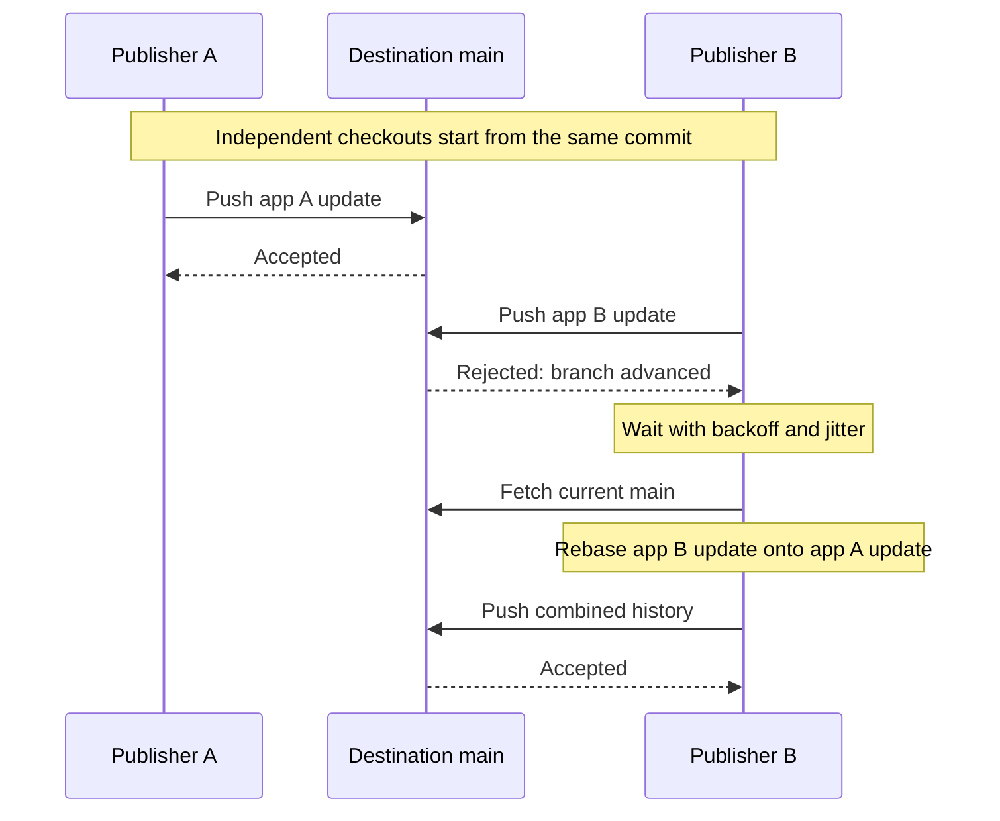

import Intro from '@site/src/components/Intro'

<Intro>
Multiple applications can publish manifests to the same GitOps repository without a shared workflow lock. Reliable publication requires handling branch contention, preserving update intent, and respecting the hosting platform's capacity. This chapter explains how to configure Atmos for independent publishers and how to measure the limits of your workload.
</Intro>

This guidance assumes publishers run in multiple source repositories and have **no shared serialization, concurrency group, or central publisher**. Each publisher owns its checkout and independently updates the destination repository. Argo CD and Flux consume the resulting desired state.

## Understand What Is Competing

A local commit records a change in one checkout. Publishing it updates a shared remote branch. Two jobs can commit different files successfully and still compete when they push to the same branch.

| Condition | What happened | Appropriate response |
| --- | --- | --- |
| Non-fast-forward rejection or concurrent ref update | Another publisher advanced the remote branch | Wait, fetch and rebase, then retry the push |
| Rebase conflict | The local change cannot be replayed automatically | Stop and resolve the overlapping change |
| Remote throttling | The server rejected work because of a capacity or rate limit | Honor the cooldown before another request |
| Authentication or branch-policy failure | The identity or operation is not permitted | Correct credentials or policy; repeating the request does not repair it |
| Lost connection | The client cannot establish whether the remote accepted the push | Inspect the remote state before replaying the whole workflow |

Atmos handles rejected-ref recovery and recognized throttling inside [`atmos git push`](/cli/commands/git/push). It does not add force-push flags or automatically resolve rebase conflicts. Generic connection errors are not assumed to be rate limits.



GitHub Actions concurrency groups operate within a repository. Reusing the same group name in multiple source repositories does not provide a destination-wide lock. Account for all publishers targeting the destination, including other CI systems and humans. See [GitHub's concurrency scope](https://docs.github.com/en/actions/how-tos/write-workflows/choose-when-workflows-run/control-workflow-concurrency).

## Size for Bursts and Retry Amplification

Measure publication arrivals over short windows, not just daily commit counts. For example, 30 commits per hour averages 0.5 per minute, while six publications within 94 seconds average about 3.8 per minute during that burst. Several can still start from the same branch tip and collide. A retry budget that finishes in under a minute may expire while other writers continue advancing the branch.

Track these quantities separately:

- **Intended updates:** distinct application versions or desired-state changes.
- **Concurrent publishers:** jobs targeting the same destination branch at once.
- **Push attempts:** successful pushes plus rejected or throttled attempts.
- **Read operations:** initial clones/fetches and recovery fetches.
- **API operations:** pull requests, checks, comments, token requests, and polling around publication.
- **Workflow reruns:** which can repeat generation, commits, reads, and API operations as well as pushes.

Retries increase the work required per successful publication. In an illustrative synchronized burst where one writer wins each round and all remaining writers collide again, `N` writers need `N × (N + 1) / 2` push attempts and `N × (N - 1) / 2` recovery fetches. For 12 writers, that is 78 pushes and 66 fetches. An initial throttle for every writer adds another 12 failed pushes. This describes one contention pattern, not a universal upper bound; continuing arrivals can prolong contention further.

Jitter reduces synchronized retries, but it does not enforce an aggregate rate across independent processes. A successful local burst test is not evidence that a hosting provider will accept the same request rate.

## Preserve the Intended Update

Give each publisher its own checkout, index, and working directory. Avoid concurrent writes to a shared cached checkout, including Atmos's deterministic managed-repository workdir on a shared host. Restore caches into isolated job workspaces; do not let one job rebase while another is committing there.

Prefer a separate manifest or directory for each application's update. Small, deterministic changes are easier to rebase than regenerating an entire catalog for every application. However, a clean rebase only establishes that Git could combine the text. It does not establish that the deployment is semantically current.

When two jobs update the same application's image tag, define which desired version wins. An older job must not overwrite a newer release simply because its retry finishes later. Check application version or source-revision intent against the current desired state in your publishing workflow. Atmos's push retry does not implement this application-level ordering rule.

Make reruns converge on the same desired state. Use an immutable artifact digest or source revision to identify the intended deployment. Avoid changing generated manifests solely to add a fresh timestamp or workflow run ID on every rerun. Keep attempt metadata in CI records where possible. After an ambiguous network failure, compare remote content with the intended update before creating another commit.

A rebase changes commit IDs. Verify signing credentials are available during recovery when your destination requires signed commits, and validate the rebased commits against that policy. Branch protection, required checks, and signing failures need explicit handling in the surrounding workflow.

## Configure a Bounded Retry Policy

Use the shared [`retry` format](/steps/retry), under [`git.repositories.<name>.push`](/cli/configuration/git). This example provides room for contention and minute-long cooldowns; it is a starting point to validate against your workload, not a throughput guarantee:

```yaml
git:
  repositories:
    gitops:
      uri: https://github.com/acme/gitops-deploy.git
      branch: main
      push:
        retry:
          max_attempts: 16
          backoff_strategy: exponential
          initial_delay: 1s
          max_delay: 30s
          multiplier: 2
          random_jitter: 0.5
          max_elapsed_time: 10m
```

```shell
atmos git push gitops
```

Use the same policy with an SSH repository URI. Authentication is configured separately; see [Git Configuration](/cli/configuration/git).

| Setting | Operational meaning |
| --- | --- |
| `max_attempts` | Includes the initial retry-loop iteration. Recovery fetch failures also consume iterations, so it is not a promise of this many actual pushes. |
| `initial_delay`, `backoff_strategy`, `multiplier` | Control the configured retry delay. The first push is immediate; `initial_delay` does not stagger initial publication. |
| `max_delay` | Caps the configured delay before jitter. It does not shorten a server cooldown. |
| `random_jitter` | Spreads retry timing. Ordinary contention uses positive or negative jitter; rate-limit cooldowns use positive jitter only. |
| `max_elapsed_time` | Bounds the push operation, including Git subprocesses and waits. Leave additional CI job time for setup, generation, validation, and failure handling. |

With `max_delay: 30s` and `random_jitter: 0.5`, ordinary capped delays can range from 15 to 45 seconds. For a one-minute rate-limit cooldown, that jitter can extend the cooldown to 90 seconds, but cannot shorten it below one minute.

An explicit policy does not inherit omitted fields from the default policy. Set both attempt and elapsed-time limits deliberately. An empty `retry: {}` makes one attempt. Optional `conditions` narrow rejected-ref recovery; they do not disable recognized throttle recovery or enable retries for authentication failures.

Without an explicit policy, the default is four total attempts, 250 ms initial exponential backoff, a 5-second cap before jitter, and a 30-second overall budget. Legacy `push.retries` counts retries after the initial attempt and remains supported when `push.retry` is absent. The default budget **cannot accommodate a one-minute fallback cooldown**: Atmos returns a rate-limit error instead of retrying before the cooldown expires.

Do not multiply retries at every layer without a total deadline. Sixteen internal attempts followed by repeated immediate workflow reruns can produce much more traffic than the application fan-out suggests. Preserve the failed desired-state update and its reason, then resume it deliberately within an overall deployment-time budget.

## Tune From Measured Failures

Use the example policy as a starting point. Test it at your expected peak load. A local test does not establish a supported concurrency limit.

Set the publication deadline first. Keep `max_elapsed_time` within the time available in the CI job. Then change the setting that caused recovery to stop:

| Observation | Action |
| --- | --- |
| Attempts run out before the deadline, without throttling | Increase `max_attempts` in small steps. |
| Publishers repeatedly reject each other’s pushes | Increase `initial_delay` or `max_delay`. Keep jitter enabled. |
| The server cooldown exceeds the remaining time | Increase `max_elapsed_time` only if the deployment deadline permits. Do not shorten the cooldown. |
| Throttling continues, or the deadline still expires | Batch updates or reduce each workflow’s publishing concurrency before adding more retries. |
| Authentication fails or a rebase conflicts | Correct the cause. More retries will not fix it. |

Change one setting at a time. Repeat the same load test. Compare success rate, publication time, and requests per successful update. Confirm that all updates survive without duplicate commits.

## HTTPS and SSH Throttling

| Behavior | HTTPS | SSH |
| --- | --- | --- |
| Recognized signal | HTTP `429`; HTTP `403` with rate-limit metadata; explicit rate-limit diagnostics | Recognized rate-limit text on the Git error stream |
| Server cooldown | `Retry-After` as seconds or an HTTP date; reset time when remaining quota is zero | No HTTP response headers; the fallback cooldown applies |
| Unknown failure | Ordinary authentication and unrelated errors stop | Generic disconnects and authentication errors stop |
| Shared control | Per-invocation retry policy | The same per-invocation retry policy |

When no usable server hint exists, Atmos waits at least one minute. Repeated throttling increases the minimum exponentially. The effective wait also respects a longer configured retry delay. If the wait cannot fit in the remaining elapsed-time budget, the operation fails without sending another request.

A throttled push retries without rebasing. If a rejected push requires a recovery fetch and that fetch is throttled, Atmos retries the fetch before attempting another push. A successful rebase is still required before rejected-ref recovery can continue.

HTTP cooldown headers are used only when the server supplies them. SSH recognition depends on the diagnostic text; it cannot identify every host's throttling behavior. Changing transports does not create more destination-branch capacity or remove repository-level limits.

This recovery applies to `atmos git push` and its internal fetch/rebase sequence. It does not provide a global quota counter, proactive pacing after successful requests, retries for an independent initial clone/pull, or a general limiter for surrounding REST/GraphQL clients. HTTP trace headers and payloads are filtered before diagnostics; only rate-limit metadata is retained.

## Hosting Platform Limits

The following references were checked on **November 13, 2026**. Provider policies, plans, and self-hosted settings can change. Consult the linked limits for your deployment and identify the scope of each limit: repository, user, installation, IP address, or pipeline.

### GitHub

GitHub recommends at most **6 pushes per minute per repository** and **15 Git reads per second per repository**. These are operational recommendations, not guaranteed hard thresholds or a promise that lower rates cannot be throttled. They are not published as separate allowances for SSH and HTTPS. A push-size limit of **2 GB** is enforced; repository size also affects fetch cost and latency. See [GitHub repository limits](https://docs.github.com/en/repositories/creating-and-managing-repositories/repository-limits#activity).

Git transport requests are not interchangeable with REST requests. For surrounding API work, common GitHub REST budgets include **5,000 requests/hour** for authenticated users and a **5,000/hour minimum** for app installations, with different scaling and Enterprise allowances. Actions `GITHUB_TOKEN` commonly has **1,000 requests/hour/repository**, with an Enterprise Cloud exception. Secondary API limits include **100 concurrent requests** across REST/GraphQL and general content-creation limits of **80 requests/minute** and **500/hour**, with endpoint-specific exceptions. These are not Git-push allowances. See [GitHub API rate limits](https://docs.github.com/en/rest/using-the-rest-api/rate-limits-for-the-rest-api).

Avoid polling PR status or checks from every application publisher. Reuse observations where possible, budget API calls separately, and have the API client honor its own response headers. Changing to SSH for Git does not remove API calls made by the rest of the deployment workflow.

### GitLab

GitLab documents separate Git HTTP, SSH, and LFS controls. The documented SSH default is **600 operations/minute per user, project, and Git command**; clone and fetch share the upload-pack category. Additional controls depend on version and configuration. Consult [GitLab Git operation limits](https://docs.gitlab.com/rate_limits/git/) and the [current GitLab.com limits](https://docs.gitlab.com/user/gitlab_com/rate_limits/), including plan-specific limits; do not treat an individual default as the whole allowance.

GitLab.com also limits concurrent unauthenticated SSH connections. Excess connections can be dropped with an `ssh_exchange_identification` error. Such a disconnect may lack a recognizable rate-limit message, so Atmos does not automatically treat it as a cooldown instruction. See [GitLab SSH connection limits](https://docs.gitlab.com/user/gitlab_com/rate_limits/#ssh-maximum-number-of-connections).

### Azure DevOps

Azure DevOps uses resource-consumption limits rather than a simple pushes-per-minute allowance. The documented global threshold is **200 Azure DevOps throughput units (TSTUs) within a sliding five-minute window**; pipelines have their own consumption tracking. Requests can be delayed or blocked with HTTP `429`. TSTUs are not equivalent to request counts. See [Azure DevOps rate and usage limits](https://learn.microsoft.com/en-us/azure/devops/integrate/concepts/rate-limits?view=azure-devops).

Azure DevOps can also send `Retry-After` on successful HTTP `200` responses to request pacing of subsequent calls. Atmos's failed-push recovery does not implement proactive pacing after success; API clients and surrounding workflows must account for this separately. Repository and push sizes have additional constraints, including a **5 GB push-size limit**. See [Azure Repos Git limits](https://learn.microsoft.com/en-us/azure/devops/repos/git/limits?view=azure-devops).

### CI and Destination Policy

Hosting limits are only part of the path. Runner concurrency, workflow deadlines, token expiry, SSH agent availability, branch protection, required checks, and downstream GitOps reconciliation can each constrain completion. Set the CI job deadline longer than the publication budget, retain enough history for rebase, and exercise these conditions in a representative repository.

A successful push means Git accepted the update. It does not mean the GitOps controller has reconciled it or that the application is healthy. Observe publication and deployment outcomes separately.

## Reduce Pressure Without a Global Lock

1. **Batch within a source workflow.** When one release updates several apps in the same destination, combine their manifest edits into one commit and push where the deployment semantics allow it.
2. **Skip unchanged desired state.** Regenerating identical manifests should not produce a new deployment commit solely because the workflow ran again.
3. **Keep edits small and independent.** Avoid unrelated formatting and generated-file churn that expands rebase conflicts.
4. **Bound local fan-out.** A source workflow can limit its own publishers or stagger their start times. Atmos does not automatically jitter the initial attempt, and local controls cannot enforce a global rate across source repositories.
5. **Reuse reads safely.** Cache objects or restore isolated checkouts, while fetching enough current history for recovery. A shared writable checkout is not a safe read cache.
6. **Retain exhausted updates.** Record the desired version and failure reason. Reconcile current remote state before a delayed rerun, especially after an ambiguous connection failure.

If demand regularly exceeds the destination's sustainable capacity, a larger retry budget moves the failure later. Reduce the number of publications per deployment, shorten each operation, or partition independent desired state across destination repositories where that fits the application architecture. Separate branches can reduce ref contention but do not necessarily create separate repository-level quotas.

## Validation and Capacity Planning

The repository includes real Git transport tests for the push recovery behavior. They use local fixture repositories and injected throttling; they do not load-test GitHub, GitLab, or Azure DevOps.

| Validation | Observed result | What it establishes |
| --- | --- | --- |
| HTTP, 12 independent writers on one branch, one initial `429` per writer | All 12 completed in each of three runs; all app files and exactly 13 commits survived, including the seed | Real smart-HTTP cooldown and contention recovery with a 16-attempt, 30-second test budget |
| SSH, 12 independent writers on one branch, one initial throttle per writer | All 12 completed in each of three runs; 90 pushes and 66 recovery fetches per run; all app files and exactly 13 commits survived | Native Git/OpenSSH recovery; cooldowns were advanced with a test clock, so elapsed time is not a throughput measurement |
| SSH wall-clock cooldown | Successful retry reached the server after approximately 60.06 seconds | The public push operation respected the real one-minute fallback |
| Failure boundaries | Budget exhaustion, attempt limits, cancellation, auth denial, generic disconnects, and throttled recovery fetches passed | Recognized throttling stays bounded without converting unrelated failures into retry storms |

The HTTP fixture uses a one-second `Retry-After` and short contention delays to keep the test bounded. The SSH concurrency fixture uses a 16-attempt, 10-minute virtual budget. These fixture settings are not production rate recommendations. Hosted-service latency, repository size, identity quotas, policy checks, network interruptions, and overlapping edits can change results. Actual GitHub SSH throttle messages have not been validated by these tests.

Run the transport regression tests from the repository root:

```shell
# Fast regression checks, including SSH concurrency with a test clock.
go test -race -short ./pkg/git/providers/cli

# Real SSH cooldown validation; this takes at least one minute.
go test -race ./pkg/git/providers/cli -run '^TestSSHRateLimitWallClockCooldown$' -count=1 -v
```

Before choosing production budgets, test a representative repository with the same file layout, history depth, authentication, signing, and branch policies. Include bursts of 6, 12, and 24 independent writers, continuing arrivals during recovery, reruns, same-file conflicts, and long cooldowns. Use local fault injection first; perform hosted tests only against an authorized test destination within its operating limits.

Measure success rate without workflow reruns, publication latency percentiles, attempts and recovery fetches per success, cooldown time, and unreconciled update age. Keep transport throttling, ref contention, conflicts, and API throttling as separate failure categories. Track final content and commit counts as well as exit codes so that a fast test cannot hide dropped or duplicated updates.

## Related

- [Git Configuration](/cli/configuration/git)
- [`atmos git push`](/cli/commands/git/push)
- [Shared Retry Policy](/steps/retry)
- [`kind: git` lifecycle hooks](/stacks/hooks#kind-git)
