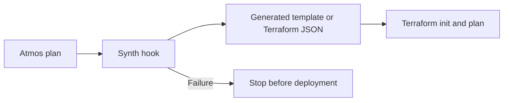

import Intro from '@site/src/components/Intro'
import Tabs from '@theme/Tabs'
import TabItem from '@theme/TabItem'
import CastPlayer from '@site/src/components/CastPlayer'
import TryExample, { TryExamples } from '@site/src/components/TryExample'

<Intro>
Use a synthesis hook to turn application code into infrastructure configuration before Atmos runs
CloudFormation or Terraform. AWS CDK produces a CloudFormation template; CDK Terrain produces Terraform JSON.
Keep the application as source, pass deployment inputs through Atmos stacks, and review the
resulting plan before applying it.
</Intro>

This tutorial covers two tools for defining infrastructure in application code:

- [AWS CDK (`cdk`)](https://docs.aws.amazon.com/cdk/v2/guide/home.html) generates CloudFormation
  templates with `cdk synth`. Its project configuration lives in `cdk.json`.
- [CDK Terrain (`cdktn`)](https://github.com/open-constructs/cdk-terrain), the community fork of
  CDK for Terraform (CDKTF), generates `.tf.json` files with `cdktn synth`. These use
  [Terraform's JSON configuration syntax](https://developer.hashicorp.com/terraform/language/syntax/json)
  and are deployed directly by Terraform or OpenTofu. Its project configuration file is still
  named `cdktf.json` in the version used here.

Both examples use TypeScript applications and Atmos hooks to run synthesis before deployment.

Choose a deployment track below. **With CloudFormation** deploys AWS CDK templates directly
through Atmos. **With Terraform** covers two paths: AWS CDK templates deployed through a
Terraform CloudFormation resource, and CDK Terrain configuration deployed directly by Terraform
or OpenTofu. Terrain does not use CloudFormation. Choose one owner for each deployed stack.
These examples use different CloudFormation stack names if you try both tracks independently.

<Tabs>
<TabItem value="cloudformation" label="With CloudFormation" default>

## Native CloudFormation Track

Atmos can deploy CloudFormation templates whether you write them by hand, generate them with
AWS CDK, or produce them with another tool. A lifecycle hook can generate the template before
Atmos reads it, previews the changes, and submits the deployment to CloudFormation.

:::tip Runnable example
The complete native track is available as the
[`cdk-cloudformation` example](/examples/cdk-cloudformation). It runs against a local
[AWS emulator](/cli/commands/emulator/usage), so no AWS account is needed to try it.
:::

<CastPlayer src="/casts/examples/cdk-cloudformation/lifecycle.cast" title="atmos aws cloudformation lifecycle with AWS CDK" chrome controls scrubber />

**For this demo**, we'll use a TypeScript AWS CDK app that creates an SSM parameter. You'll need
Atmos, Node.js 22 or a compatible later runtime, npm, and AWS credentials with permission to
manage CloudFormation stacks and SSM parameters. Deployment state stays in CloudFormation.

### Native Layout and Configuration

```text
.
├── atmos.yaml
├── stacks/deploy/dev.yaml
└── components/cloudformation/greeting/
    ├── package.json
    ├── cdk.json
    └── main.ts
```

```yaml title="atmos.yaml"
base_path: .
components:
  aws/cloudformation:
    base_path: components/cloudformation
stacks:
  base_path: stacks
  included_paths:
    - deploy/**/*
```

### Create the AWS CDK Application

Create these files in `components/cloudformation/greeting/`. The versions below are an example tested combination. Generate `package-lock.json` once with `npm --prefix components/cloudformation/greeting install --package-lock-only`, then commit it; the hook's install step runs `npm ci` against it.

```json title="components/cloudformation/greeting/package.json"
{
  "private": true,
  "scripts": {
    "synth": "cdk synth Demo --exclusively --quiet --output cdk.out"
  },
  "devDependencies": {
    "aws-cdk": "2.1146.0",
    "aws-cdk-lib": "2.274.0",
    "constructs": "10.7.2",
    "tsx": "4.20.6"
  }
}
```

```json title="components/cloudformation/greeting/cdk.json"
{
  "app": "npx --no-install tsx main.ts"
}
```

```typescript title="components/cloudformation/greeting/main.ts"
import {
  App, BootstraplessSynthesizer, CfnOutput, CfnParameter, CfnResource, Stack,
} from 'aws-cdk-lib';

const app = new App();
const stack = new Stack(app, 'Demo', {
  synthesizer: new BootstraplessSynthesizer(),
});
const message = new CfnParameter(stack, 'Message', { type: 'String' });
const marker = new CfnResource(stack, 'Marker', {
  type: 'AWS::SSM::Parameter',
  properties: { Type: 'String', Value: message.valueAsString },
});
new CfnOutput(stack, 'ParameterName', { value: marker.ref });
app.synth();
```

The application has no file/Docker assets or AWS lookups.
[`BootstraplessSynthesizer`](https://docs.aws.amazon.com/cdk/api/v2/docs/aws-cdk-lib.BootstraplessSynthesizer.html)
avoids introducing a bootstrap dependency for this small example. `Message` is a CloudFormation
parameter, so changing its value does not require changing the TypeScript application.

The synth command writes a JSON file; avoid capturing stdout, which can also contain CLI
messages. [`cdk synth`](https://docs.aws.amazon.com/cdk/v2/guide/ref-cli-cmd-synth.html) selects
the CDK construct ID `Demo`, while `stack_name` in the stack configuration selects the deployed CloudFormation name.
For more complex apps, inspect `cdk.out/manifest.json` to find the actual template artifact name.

### Attach the Synthesis Hook and Deploy

Add this stack manifest. The name `greeting` is arbitrary: choose a component name that fits your
project and use it in the Atmos commands below. By default it also selects the component directory;
set [`metadata.component`](/stacks/components/component-metadata) to use a differently named directory.
It is separate from the CDK construct ID `Demo` and the deployed CloudFormation `stack_name`.

```yaml title="stacks/deploy/dev.yaml"
name: dev
components:
  aws/cloudformation:
    greeting:
      path: cdk.out/Demo.template.json
      stack_name: atmos-cdk-native-dev
      parameters:
        Message: Hello from AWS CDK and Atmos
      region: us-east-1
      hooks:
        synth:
          events:
            - before.aws/cloudformation.diff
            - before.aws/cloudformation.apply
            - before.aws/cloudformation.changeset-create
          kind: steps
          on_failure: fail
          with:
            - name: install
              type: shell
              command: npm ci --no-audit --no-fund
              inputs:
                sources: [package-lock.json]
              artifacts:
                paths: [node_modules/.bin/cdk]
            - name: synth
              type: shell
              command: npm run synth
```

This configuration points `path` at
`cdk.out/Demo.template.json` and runs synthesis before `diff`, `apply`, and `changeset create`.
Atmos authenticates and provisions the component source first, runs the hook in the component
directory, then reads the generated template. A failed hook stops the operation before reading
or submitting an old template. This works when `cdk.out` does not yet exist.

This lifecycle requires an Atmos version containing the CloudFormation hook-ordering fix
introduced with this tutorial. On older versions, synthesize explicitly before invoking Atmos;
a before hook alone cannot refresh the template already loaded by that executor.

Validate the stack and deploy from the repository root; the hook installs dependencies on first use:

```shell
atmos validate stacks
atmos aws cloudformation diff greeting -s dev
atmos aws cloudformation apply greeting -s dev
atmos aws cloudformation output greeting -s dev
```

:::tip Shorten CloudFormation commands with an alias
Use [`atmos config set`](/cli/commands/config/config-set) to add a
[command alias](/cli/configuration/aliases):

```shell
atmos config set aliases.cft "aws cloudformation"
atmos cft diff greeting -s dev
atmos cft apply greeting -s dev
```

You can then use `atmos cft` for the CloudFormation commands throughout this track.
:::

For a separate review and execution step, create a named change set, inspect the changes, and
execute the returned change-set name:

```shell
atmos aws cloudformation changeset create greeting -s dev
atmos aws cloudformation changeset execute greeting -s dev --changeset-name <returned-name>
```

The `changeset execute` command uses the template stored in the reviewed change set. It does
not synthesize again. The `render` and `validate` commands do not fire synthesis hooks; run
`npm --prefix components/cloudformation/greeting run synth` (after an initial `npm ci`) before
those commands.

The diff previews CloudFormation resource changes. Change `parameters.Message` or edit the CDK
app and run diff again. To remove this example, run:

```shell
atmos aws cloudformation delete greeting -s dev
```

### Reproducible Native Deployments

The hook runs in the component directory. `on_failure: fail` stops deployment if synthesis
fails. Try an edit to the app, then a syntax error: the next diff should use the changed template,
and the invalid app must fail rather than reuse the prior artifact.

Commit `package-lock.json`, use `npm ci` in CI, and pin Atmos and Node.js. For separate review
and execution, use the stored change set described above; executing it does not synthesize again.
Keep `node_modules/` and `cdk.out/` out of version control. Deleting generated files does not
delete deployed resources.

</TabItem>
<TabItem value="terraform" label="With Terraform">

## Terraform Track

Atmos can manage Terraform or OpenTofu configurations, including configurations generated by
other tools. A lifecycle hook can generate files before planning: Terraform can deploy a
CloudFormation template through `aws_cloudformation_stack`, or execute Terraform JSON produced
by a tool such as CDK Terrain.

:::tip Runnable example
The CDK Terrain path is available as the [`cdk-terraform` example](/examples/cdk-terraform).
It runs against a local [AWS emulator](/cli/commands/emulator/usage), so no AWS account is
needed to try it.
:::

<CastPlayer src="/casts/examples/cdk-terraform/lifecycle.cast" title="atmos terraform lifecycle with CDK Terrain" chrome controls scrubber />

**For these demos**, you'll need Atmos, Node.js 22.19.0 or later (CDK Terrain's minimum), npm, and
Terraform 1.5.7+ or OpenTofu 1.6+. The AWS CDK demo creates an SSM parameter through CloudFormation
and needs AWS credentials with permission to manage both. The Terrain demo uses `terraform_data`
and runs entirely locally. Both examples use Terraform state; in the AWS CDK example,
CloudFormation also tracks the resources inside its stack.

### Terraform Layout and Configuration

Create the component directory for the application you want to try:

```text
.
├── atmos.yaml
├── stacks/deploy/dev.yaml
└── components/terraform/
    ├── greeting/                # AWS CDK app and Terraform CloudFormation wrapper
    └── terrain/                 # Terrain app and generated cdk.tf.json
```

```yaml title="atmos.yaml"
base_path: .
components:
  terraform:
    base_path: components/terraform
    auto_generate_backend_file: false
    apply_auto_approve: false
stacks:
  base_path: stacks
  included_paths:
    - deploy/**/*
```

To use OpenTofu, add `command: tofu` under `components.terraform`. Atmos commands are still
named `atmos terraform ...`. Backend generation is disabled: the AWS wrapper uses Terraform's
default local state, and Terrain emits its own local backend. Configure shared remote state
before using these examples as team deployments.

### AWS CDK: Synthesize a CloudFormation Template

Create these files in `components/terraform/greeting/`. The versions below are an example tested combination. Generate `package-lock.json` once with `npm --prefix components/terraform/greeting install --package-lock-only`, then commit it; the hook's install step runs `npm ci` against it.

```json title="components/terraform/greeting/package.json"
{
  "private": true,
  "scripts": {
    "synth": "cdk synth Demo --exclusively --quiet --output cdk.out"
  },
  "devDependencies": {
    "aws-cdk": "2.1146.0",
    "aws-cdk-lib": "2.274.0",
    "constructs": "10.7.2",
    "tsx": "4.20.6"
  }
}
```

```json title="components/terraform/greeting/cdk.json"
{
  "app": "npx --no-install tsx main.ts"
}
```

```typescript title="components/terraform/greeting/main.ts"
import {
  App, BootstraplessSynthesizer, CfnOutput, CfnParameter, CfnResource, Stack,
} from 'aws-cdk-lib';

const app = new App();
const stack = new Stack(app, 'Demo', {
  synthesizer: new BootstraplessSynthesizer(),
});
const message = new CfnParameter(stack, 'Message', { type: 'String' });
const marker = new CfnResource(stack, 'Marker', {
  type: 'AWS::SSM::Parameter',
  properties: { Type: 'String', Value: message.valueAsString },
});
new CfnOutput(stack, 'ParameterName', { value: marker.ref });
app.synth();
```

The application has no file/Docker assets or AWS lookups.
[`BootstraplessSynthesizer`](https://docs.aws.amazon.com/cdk/api/v2/docs/aws-cdk-lib.BootstraplessSynthesizer.html)
avoids introducing a bootstrap dependency for this small example. `Message` is a CloudFormation
parameter, so changing its value does not require changing the TypeScript application.

The synth command writes a JSON file; avoid capturing stdout, which can also contain CLI
messages. [`cdk synth`](https://docs.aws.amazon.com/cdk/v2/guide/ref-cli-cmd-synth.html) selects
the CDK construct ID `Demo`, while `stack_name` in the stack configuration selects the deployed CloudFormation name.
For more complex apps, inspect `cdk.out/manifest.json` to find the actual template artifact name.

Add this Terraform wrapper. It uses the AWS provider's resource directly:

```hcl title="components/terraform/greeting/main.tf"
terraform {
  required_version = ">= 1.5.7"
  required_providers {
    aws = {
      source  = "hashicorp/aws"
      version = "6.26.0"
    }
  }
}

variable "region" { type = string }
variable "stack_name" { type = string }
variable "message" { type = string }

provider "aws" {
  region = var.region
}

resource "aws_cloudformation_stack" "demo" {
  name          = var.stack_name
  template_body = file("${path.module}/cdk.out/Demo.template.json")
  parameters = {
    Message = var.message
  }
}

output "parameter_name" {
  value = aws_cloudformation_stack.demo.outputs["ParameterName"]
}
```

:::tip Optional Cloud Posse module
Cloud Posse also provides a
[`cloudformation-stack` Terraform module](https://docs.cloudposse.com/modules/library/aws/cloudformation-stack/)
if you prefer a reusable wrapper. It is optional; all examples here work without Cloud Posse modules.
:::

The component name `greeting` is arbitrary here too. Choose any name and use it consistently in
Atmos commands and the component directory, or set `metadata.component` to select a different
directory. The `stack_name` variable below independently names the CloudFormation stack.

```yaml title="stacks/deploy/dev.yaml"
name: dev
components:
  terraform:
    greeting:
      metadata:
        terraform_workspace: default
      vars:
        region: us-east-1
        stack_name: atmos-cdk-terraform-dev
        message: Hello from AWS CDK and Atmos
      hooks:
        synth:
          events:
            - before.terraform.init
            - before.terraform.plan
            - before.terraform.apply
          kind: steps
          on_failure: fail
          with:
            - name: install
              type: shell
              command: npm ci --no-audit --no-fund
              inputs:
                sources: [package-lock.json]
              artifacts:
                paths: [node_modules/.bin/cdk]
            - name: synth
              type: shell
              command: npm run synth
```

Validate the stack and deploy from the repository root; the hook installs dependencies on first use:

```shell
atmos validate stacks
atmos terraform plan greeting -s dev
atmos terraform apply greeting -s dev
atmos terraform output greeting -s dev
```

The plan should show one CloudFormation stack whose template creates an SSM parameter.
Terraform's plan shows the stack/template change, not a CloudFormation change set listing every
nested resource change. Review the synthesized template as well. Change `vars.message` or edit
the CDK app and plan again.

To apply an approved saved plan with its original generated artifacts available:

```shell
atmos terraform apply greeting -s dev --from-plan --skip-hooks=synth
```

To remove this example, keep the generated template available and run:

```shell
atmos terraform destroy greeting -s dev
```

If the template was removed, run `npm --prefix components/terraform/greeting run synth` first.
Review the destroy plan before confirming.

### CDK Terrain: Synthesize Terraform JSON

Terrain generates `cdk.tf.json`, a Terraform configuration in JSON syntax. Terraform or OpenTofu
reads it as configuration, just as it reads `.tf` files; no CloudFormation resource is involved.

Create `components/terraform/terrain/` with these files:

```json title="components/terraform/terrain/package.json"
{
  "private": true,
  "scripts": {
    "synth": "cdktn synth Demo --output cdktn.out && node copy-synth.cjs"
  },
  "devDependencies": {
    "cdktn": "0.24.0",
    "cdktn-cli": "0.24.0",
    "constructs": "10.7.2",
    "tsx": "4.20.6"
  }
}
```

```json title="components/terraform/terrain/cdktf.json"
{
  "language": "typescript",
  "app": "npx --no-install tsx main.ts",
  "output": "cdktn.out"
}
```

```typescript title="components/terraform/terrain/main.ts"
import {
  App, LocalBackend, TerraformOutput, TerraformResource, TerraformStack, TerraformVariable,
} from 'cdktn';

const app = new App();
const stack = new TerraformStack(app, 'Demo');
new LocalBackend(stack, { path: 'terraform.Demo.tfstate' });
const message = new TerraformVariable(stack, 'message', { type: 'string' });
const data = new TerraformResource(stack, 'echo', {
  terraformResourceType: 'terraform_data',
});
data.addOverride('input', message.stringValue);
new TerraformOutput(stack, 'result', { value: data.getStringAttribute('output') });
app.synth();
```

```javascript title="components/terraform/terrain/copy-synth.cjs"
const { copyFileSync } = require('node:fs');
const path = require('node:path');

copyFileSync(
  path.join(__dirname, 'cdktn.out/stacks/Demo/cdk.tf.json'),
  path.join(__dirname, 'cdk.tf.json'),
);
```

[`cdktn synth`](https://cdktn.io/docs/cli-reference/commands#synth) writes the stack's Terraform
JSON. The copy runs only after successful synthesis and places that file in the stable Atmos
component directory. Terraform initializes and stores state there, outside the disposable
`cdktn.out` directory. The explicit local backend path is relative to that execution directory.
Use a stack-specific filename: Terrain rejects a legacy `terraform.tfstate` file in the app
directory, even when only running synthesis.
Do not run `cdktn deploy` against this example as a second deployment path: that would execute
Terraform from a different directory and could select different local state.

Generate `package-lock.json` once with `npm --prefix components/terraform/terrain install --package-lock-only`,
then commit it; the hook's install step runs `npm ci` against it.

The example has no external providers, modules, or assets. For apps with generated provider
bindings, install/generate those bindings during setup before synthesis. If an app uses relative
asset or module paths, copying only `cdk.tf.json` is insufficient: stage the complete required
directory tree and preserve those paths. Do not delete `.terraform`, the lockfile, state, or
saved plans when refreshing generated configuration.

#### Configure and Deploy Terrain

For Terrain alone, use this stack manifest. If you already configured an AWS CDK example above,
merge `terrain` into the existing `components.terraform` mapping in `stacks/deploy/dev.yaml`;
keep the selected AWS component configuration.

```yaml title="stacks/deploy/dev.yaml"
name: dev
components:
  terraform:
    terrain:
      metadata:
        terraform_workspace: default
      vars:
        message: Hello from CDK Terrain and Atmos
      hooks:
        synth:
          events:
            - before.terraform.init
            - before.terraform.plan
            - before.terraform.apply
          kind: steps
          on_failure: fail
          with:
            - name: install
              type: shell
              command: npm ci --no-audit --no-fund
              inputs:
                sources: [package-lock.json]
              artifacts:
                paths: [node_modules/.bin/cdktn]
            - name: synth
              type: shell
              command: npm run synth
```

Run from the repository root; no cloud credentials are required:

```shell
atmos validate stacks
atmos terraform plan terrain -s dev
atmos terraform apply terrain -s dev
atmos terraform output terrain -s dev
```

Terrain should plan one `terraform_data.echo` resource and return your message as the `result`
output. Change `vars.message` and plan again to see the updated value.

To apply an approved saved plan with its original generated artifacts available:

```shell
atmos terraform apply terrain -s dev --from-plan --skip-hooks=synth
```

To remove this example, keep the generated configuration available and run:

```shell
atmos terraform destroy terrain -s dev
```

If generated files were removed, run `npm --prefix components/terraform/terrain run synth`
first. Review the destroy plan before confirming.

### Terraform Hook Behavior and Reproducible Runs

The steps hook runs in its component directory. Its first step declares `package-lock.json` as
its [input](/steps/inputs) and the installed CLI as its [artifact](/steps/artifacts), so `npm ci`
runs only when the lockfile changed or the CLI is missing; `npm run synth` then uses the project's
installed CLI and scripts. Setting `on_failure: fail` prevents deployment from using an older artifact when
synthesis fails.

Use all three events: `before.terraform.init` covers explicit initialization, while plan/apply
hooks cover their implicit initialization. An init-only hook does not cover those commands.
See [lifecycle hooks](/stacks/hooks). `atmos validate stacks` checks the stack configuration; it
does not synthesize applications. Terraform validation also needs synthesized files first.



Editing the application should produce a new artifact on the next plan. A syntax error
in `main.ts` must fail the hook rather than use the prior artifact.

For CI, commit npm and Terraform dependency lockfiles, run `npm ci`, and pin the Atmos and
Terraform/OpenTofu versions. Preserve the exact generated artifacts and source revision between
plan and apply.

Only skip the synth hook when applying that existing reviewed plan with its artifacts available.
Do not use `--skip-hooks` to bypass synthesis failures in a new plan.

Keep generated artifacts and state out of version control:

```gitignore
node_modules/
cdk.out/
cdktn.out/
components/terraform/terrain/cdk.tf.json
.terraform/
*.tfstate
*.tfstate.*
terraform.tfstate.d/
*.tfvars.json
*.planfile
```

Deleting synthesized files does not delete deployed infrastructure.

</TabItem>
</Tabs>

## Assets, Multiple Stacks, and Existing Deployments

### AWS CDK Assets and Bootstrap Resources

Synthesis alone does not publish Lambda bundles, Docker images, or nested-stack assets.
[CDK asset deployment](https://docs.aws.amazon.com/cdk/v2/guide/assets.html) also needs its S3/ECR
destinations, bootstrap resources, and appropriate permissions. This example's bootstrapless
synthesizer intentionally supports an app without those assets.

For an asset-bearing app, retain its appropriate synthesizer and bootstrap setup. Add an ordered
asset publication step using the generated asset manifest before submitting the CloudFormation
template. Verify the published object keys/image tags match the template. Neither deployment path
reads CDK's deployment-role or asset-publication instructions from `manifest.json`.
Configure the CloudFormation execution role and IAM capabilities when the template needs them.
For native CloudFormation, configure [artifact packaging](/stacks/components/aws-cloudformation)
for templates above the inline limit. For the Terraform wrapper, publish the template and use `template_url`;
see [`aws_cloudformation_stack`](https://registry.terraform.io/providers/hashicorp/aws/6.26.0/docs/resources/cloudformation_stack).

### Multiple Stacks and Environments

Give each independently deployed stack its own Atmos component and state identity. Use separate
working directories for concurrent runs so two synthesis hooks cannot overwrite the same
artifact. Avoid selecting `default` workspace in a shared directory for multiple environments.
Declare producer/consumer relationships through [component dependencies](/stacks/dependencies/components).
Atmos does not automatically import CDK or Terrain assembly dependency graphs.

### Adopting Existing Deployments

For Terrain/CDKTF, preserve construct paths, generated resource addresses, provider versions,
backend configuration, and the selected workspace. Keep the application's backend authoritative
with `auto_generate_backend_file: false`; do not add an Atmos-generated second backend.
Moving local execution directories requires explicitly preserving the old state path. Review a
no-change plan before moving execution to Atmos.

For an existing AWS CDK deployment, the native path targets its existing CloudFormation stack
name and region without introducing Terraform state. Preserve parameters, roles, capabilities,
and tags, then review a no-change diff before cutover.

Using the Terraform wrapper requires importing the existing
CloudFormation stack into `aws_cloudformation_stack.demo`. Preserve the deployed stack name,
parameters, roles, capabilities, and tags. Do not also keep `cdk deploy`
as an independent writer to the same stack.

:::note Verification boundary
Synthesis, hook execution, and the local Terrain lifecycle can be verified without AWS access.
The AWS deployment, bootstrap/assets, and remote-backend scenarios require validation in your
own account. This tutorial does not claim an AWS deployment was performed.
:::

## Try it out

<TryExamples>
  <TryExample example="cdk-cloudformation" label="AWS CDK with CloudFormation">

Install Node.js 22 or later and Docker or Podman, then deploy the AWS CDK app through the native
CloudFormation component against a local AWS emulator. The hook installs dependencies and
synthesizes the template.

```shell
atmos emulator up aws -s local
atmos aws cloudformation deploy greeting -s local
atmos aws cloudformation output greeting -s local
atmos aws cloudformation delete greeting -s local --auto-approve
atmos emulator down aws -s local
```

  </TryExample>
  <TryExample example="cdk-terraform" label="CDK Terrain with Terraform">

Install Node.js 22.19.0 or later, Terraform or OpenTofu, and Docker or Podman, then synthesize the
CDK Terrain app and apply its generated Terraform configuration against a local AWS emulator.

```shell
atmos emulator up aws -s local
atmos terraform apply greeting -s local
atmos terraform output greeting -s local
atmos terraform destroy greeting -s local
atmos emulator down aws -s local
```

  </TryExample>
</TryExamples>
