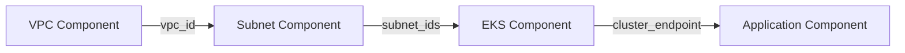
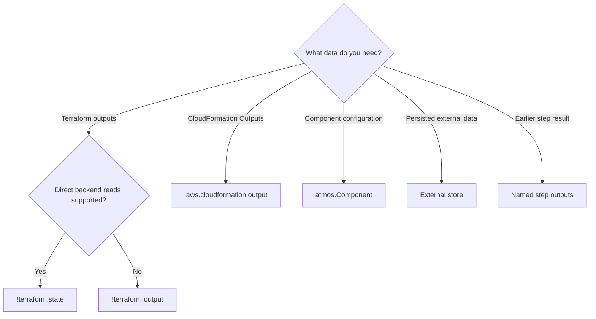

import Intro from '@site/src/components/Intro'
import ActionCard from '@site/src/components/ActionCard'
import PrimaryCTA from '@site/src/components/PrimaryCTA'
import KeyPoints from '@site/src/components/KeyPoints'
import File from '@site/src/components/File'

<Intro>
Breaking up your infrastructure into loosely-coupled components is a great way to manage complexity and
reuse code. However, these smaller components often need to share data with each other.
Atmos provides several ways to easily share outputs, configurations, and settings between components.
</Intro>

<KeyPoints>
- Read Terraform/OpenTofu outputs with state functions and CloudFormation Outputs with `!aws.cloudformation.output`
- Share persisted values across tools with external stores
- Read component configuration with template functions and pass results between workflow steps with named outputs
</KeyPoints>

## Why Components Need to Share State

Imagine building a typical web application infrastructure:

1. **VPC** creates the network and outputs `vpc_id`
2. **Subnets** need the `vpc_id` to create subnets
3. **EKS cluster** needs subnet IDs to launch in the right network
4. **Application** needs the EKS cluster endpoint to deploy

Each component depends on outputs from previous components. This is called a **loosely coupled architecture**---components are independent but can reference each other's outputs.



## Recommended: `!terraform.state`

For **Terraform/OpenTofu outputs with a supported backend**, prefer the [`!terraform.state`](/stacks/sharing-state/terraform-state) YAML function. It reads outputs directly from your Terraform backend without initializing Terraform, downloading providers, or generating configuration files. See its [backend support and limitations](/functions/yaml/terraform.state) before choosing it for your deployment.

<File title="stacks/dev.yaml">
```yaml
components:
  terraform:
    vpc:
      vars:
        cidr_block: "10.0.0.0/16"

    eks:
      vars:
        # Read VPC outputs directly from the state backend
        vpc_id: !terraform.state vpc vpc_id
        subnet_ids: !terraform.state vpc private_subnet_ids
```
</File>

**Why `!terraform.state` is recommended:**
- **Avoids Terraform initialization overhead** when reading outputs
- **No provider downloads** - reads state files directly from backends (S3, GCS, Azure, local)
- **Same syntax** as `!terraform.output` - easy migration
- **Automatic caching** - repeated calls are served from memory

<ActionCard title="Learn More About !terraform.state">
Read Terraform/OpenTofu outputs directly from supported state backends.
<PrimaryCTA to="/stacks/sharing-state/terraform-state">Get Started</PrimaryCTA>
</ActionCard>

## Alternative Methods

Choose based on the producer and the lifetime of the data. A component's configuration, its deployed outputs, and a command's result are different things:

| Method | Data source | When to use it |
|--------|-------------|----------------|
| [`!terraform.state`](/stacks/sharing-state/terraform-state) | Terraform/OpenTofu state | Read deployed outputs directly from a supported backend |
| [`!terraform.output`](/stacks/sharing-state/terraform-output) | Terraform/OpenTofu CLI | Use the engine's output handling, including when direct backend reads do not suit the setup |
| [`!aws.cloudformation.output`](/functions/yaml/aws.cloudformation.output) | Deployed CloudFormation stack | Read a native `aws/cloudformation` component's Outputs |
| [`atmos.Component`](/functions/template/atmos.Component) | Resolved component configuration; deployed outputs for supported types | Read sections such as `vars` or `settings` in templates, or Terraform/OpenTofu and CloudFormation `.outputs` |
| [Remote State Module](/stacks/sharing-state/remote-state-module) | Terraform state through HCL | Keep output lookups inside Terraform code |
| [`!store`](/stacks/sharing-state/stores) | External key-value store | Publish and consume persisted values across tools and deployments |
| [Named step outputs](/steps/outputs) | Results of earlier workflow steps | Pass values within a workflow run, without assuming persistence between runs |

For sensitive values, use [secret stores and `!secret`](/cli/configuration/secrets). An ordinary store or captured step result is not automatically a secret-handling mechanism.

### Quick Comparison

**`!terraform.state`** - Reads directly from state backends. Fastest option.
```yaml
vpc_id: !terraform.state vpc vpc_id
```

**`!terraform.output`** - Runs `terraform output` command. Slower but uses Terraform's output pipeline.
```yaml
vpc_id: !terraform.output vpc vpc_id
```

**Remote State Module** - Native Terraform approach using the `remote-state` module in HCL.
```hcl
module "vpc" {
  source    = "cloudposse/stack-config/yaml//modules/remote-state"
  component = "vpc"
  context   = module.this.context
}
```

**`!store`** - Read from external key-value stores.
```yaml
vpc_id: !store ssm/prod vpc vpc_id
```

### CloudFormation Outputs

A Terraform, Helmfile, or other component can consume a CloudFormation Output in its stack configuration:

```yaml
components:
  terraform:
    app:
      vars:
        vpc_id: !aws.cloudformation.output network shared-network VpcId
```

Here, `network` is the native `aws/cloudformation` component in the `shared-network` Atmos stack. Deploy the producer before reading its Outputs. See the [function reference](/functions/yaml/aws.cloudformation.output) for authentication, supported deployed-stack states, and output value types.

### Configuration and Template Functions

Use `atmos.Component` when a template needs another component's resolved configuration:

```yaml
vars:
  region: '{{ (atmos.Component "network" .stack).vars.region }}'
```

Reading `.vars` or `.settings` is different from reading `.outputs`. For Terraform/OpenTofu `.outputs`, the function uses the Terraform output execution path; prefer `!terraform.state` when direct backend access is suitable. For native CloudFormation components, `.outputs` reads the deployed stack's Outputs. The template function remains useful for configuration access and supported output types; it is not universally replaced by a Terraform-specific function.

### Other Component Types and Workflow Results

For integrations without a native deployed-output reader, publish non-sensitive values to an [external store](/stacks/sharing-state/stores) using supported hooks or your tool's commands. Consumers can read those values in later runs. Publishing is an explicit part of the producer's workflow.

When the value is needed only by later steps in the same run, use [named step outputs](/steps/outputs):

```yaml
workflows:
  report:
    steps:
      - name: discover
        type: shell
        command: printf 'https://api.example.com'
        outputs:
          endpoint: "{{ .value }}"
      - name: summary
        type: markdown
        content: 'Endpoint: {{ .steps.discover.outputs.endpoint }}'
```

These results belong to the workflow run. They are not a persistent registry of deployed component outputs.

## Cross-Stack References

Deployed-output functions can reference producers in other Atmos stacks. For example, Terraform state lookups accept an explicit stack:

<File title="stacks/prod.yaml">
```yaml
components:
  terraform:
    app:
      vars:
        # Read VPC from prod stack
        vpc_id: !terraform.state vpc prod vpc_id

        # Read database from shared-services stack
        db_endpoint: !terraform.state rds shared-services endpoint
```
</File>

This enables patterns like:
- **Shared services** with centralized databases or networking
- **Hub-and-spoke networks** with VPC peering
- **Cross-environment references** (e.g., staging uses prod DNS zone)

## Choosing the Right Method

Use this decision tree to choose a starting point:



**General guidance:**
- Declare [component dependencies](/stacks/dependencies/components) separately from value lookups; reading an output does not deploy its producer.
- Use the `remote-state` module when you prefer to keep Terraform output lookups in HCL.
- For Terraform planning before a producer exists, see [component mocks](/migration/terragrunt#mock_outputs--component-mocks). Do not assume Terraform mocks apply to other component types.
